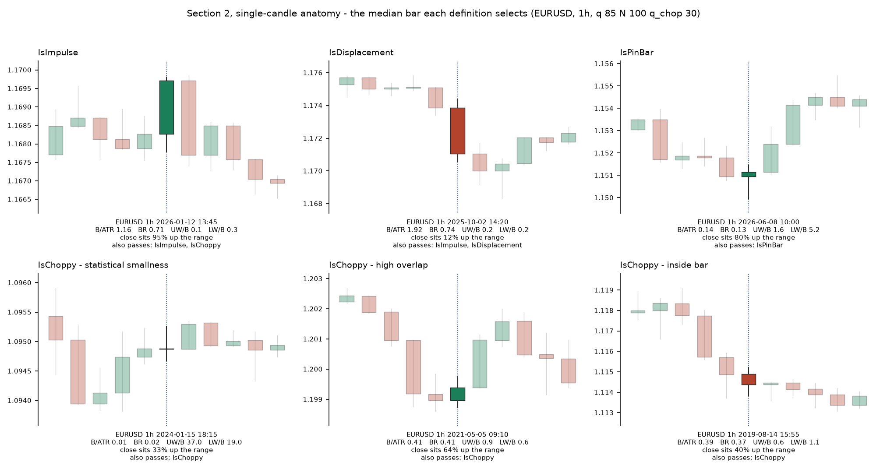
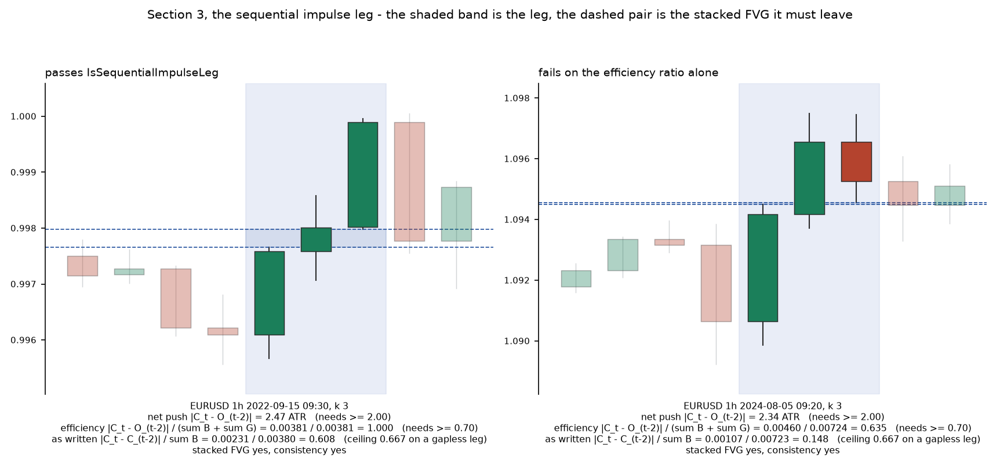
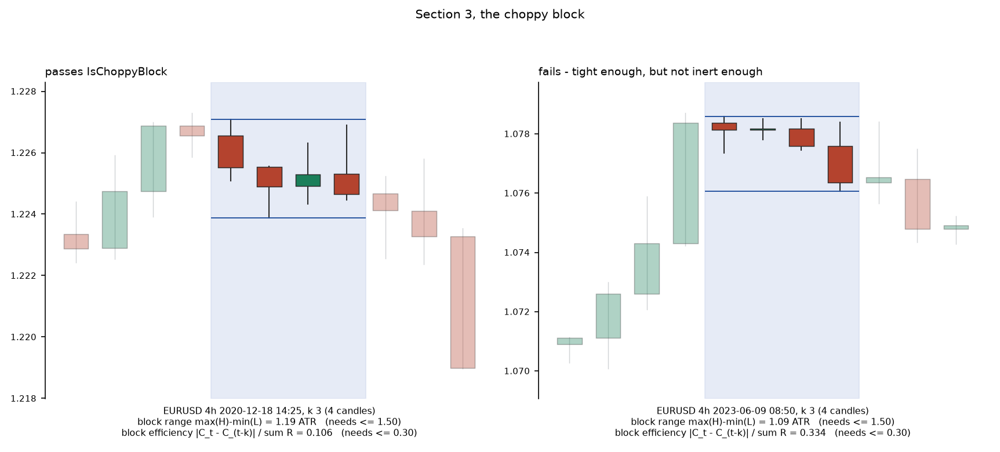
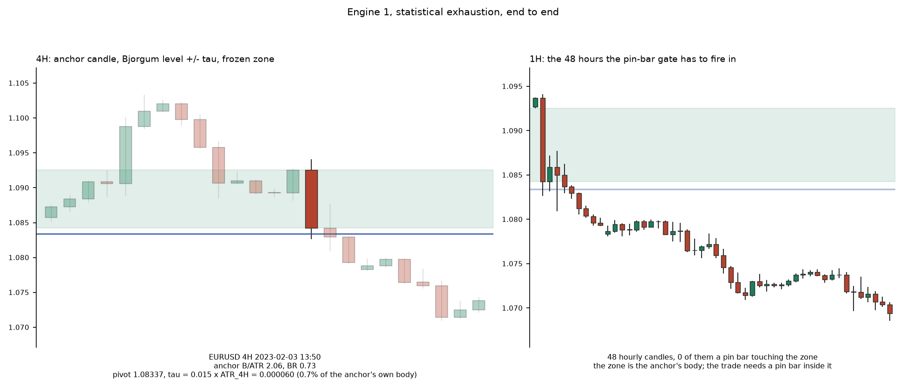
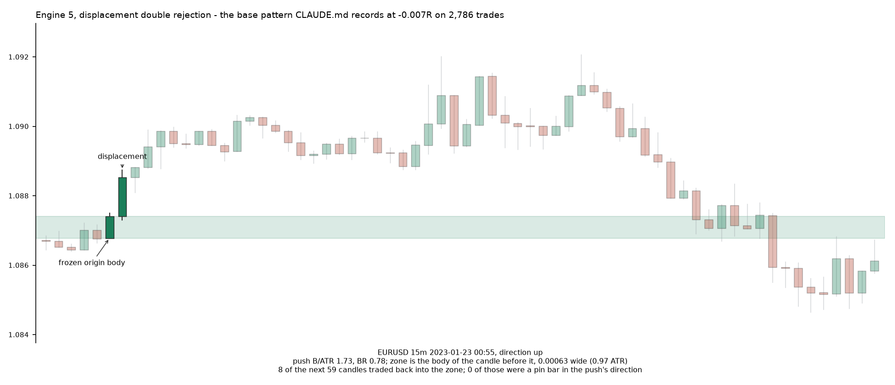

# Quantitative Multi-Structural Confluence: the formulation, and what is already measured against it

**Status**: **specified, not approved, and not implemented.** The formulation is recorded verbatim in
section 1 so there is one authoritative statement of it. Section 2 sets every definition against
`research/ideas/dual_engine_v6.py`, `dual_engine_v7.py` and `till_infinity/indicators/levels.py`,
which between them already implement most of them. Section 3 draws the definitions over eight years
of the broker's own bars, because arithmetic that is subtly wrong looks exactly like arithmetic that
is right. Section 4 is what the existing measurements already constrain, section 5 lists what is
contradictory or underspecified, section 6 is what is genuinely new, and section 7 is what would
have to be true before any of it reaches an account. **Nothing here is a recommendation to trade
it.**

## Why this document exists

This is the third formulation in one family. The first two are closed, on the same instruments and
the same engine, in [`dual-engine-confluence.md`](../../research/docs/dual-engine-confluence.md):

* **v1**, a volatility z-score exhaustion plus a choppy-cluster breakout: **-0.210R on n 906**,
  against its own flip at -0.219R, a gap of **+0.009**;
* **v2**, the same geometry with a softmax price z-score: **+0.162R on n 48** over 464 days, then
  **-0.127R on n 356** over 3,111 days - the rule's own expectancy went positive to negative on 7.4
  times the span;
* and the shared exit stack - break-even at 1R, half off at 2R, an ATR trail, a 48-hour time stop -
  costs about **0.2R a trade on a direction-free entry**, which is **twenty-five times** what the
  spread costs.

**This blueprint keeps that exit stack almost unchanged.** Section VI of the formulation is v1's
management with one addition, so any entry it produces starts 0.2R behind before its direction is
judged at all.

Four of the five engines are already written, in `dual_engine_v6.py`; the fifth is in
`dual_engine_v7.py`. Neither has been run and recorded. So the useful thing this document can do is
say precisely **which definitions are new**, **which are restatements of code that already exists**,
and **which are restatements of ideas this repository has already refuted** - so that if it is run,
what is measured is the part that is actually new.

---

## 1. The formulation

### I. Universal primitives

For a candle at $t$ with open $O_t$, high $H_t$, low $L_t$, close $C_t$:

$$B_t = |C_t - O_t| \qquad R_t = H_t - L_t \qquad BR_t = \frac{B_t}{R_t}$$

$$UW_t = H_t - \max(O_t, C_t) \qquad LW_t = \min(O_t, C_t) - L_t$$

$\text{ATR}_t$ is the 14-period average true range on the candle's own frame.

**Displacement outlier threshold.** With $q \in [75, 95]$ and $N \in [50, 200]$:

$$P_q = \text{Percentile}_q(B_{t-1}, \dots, B_{t-N})$$

**Chop outlier threshold.** With $q_{chop} \in [20, 40]$:

$$P_{q_{chop}} = \text{Percentile}_{q_{chop}}(R_{t-1}, \dots, R_{t-N})$$

**The attention gate, $\text{Attended\_Z}$.** The blueprint names it and does not define it, but the
definition is not missing - **it was given with the engine this one grew out of**, and it is
transcribed here so that nothing downstream is guessing. Over the last $N = 70$ closes of each
timeframe in $\{15m, 1H, 4H, 1D\}$, newest first:

$$r_i = \left|\frac{P_i}{P_{i+1}} - 1\right| \qquad w_i = \frac{e^{r_i}}{\sum_j e^{r_j}}$$

$$\mu_w = \sum_i w_i P_i \qquad \sigma_w = \sqrt{\sum_i w_i (P_i - \mu_w)^2} \qquad Z_{tf} = \frac{P_0 - \mu_w}{\sigma_w}$$

and then across the four frames, a second softmax over the absolute scores:

$$\alpha_{tf} = \frac{e^{|Z_{tf}|}}{\sum_k e^{|Z_k|}} \qquad \text{Attended\_Z} = \sum_{tf} \alpha_{tf} Z_{tf}$$

$Z_{crit}$ is $\text{Percentile}_{85}$ of the **absolute** values of the last 200 readings, and the
gate is two-sided: long below $-Z_{crit}$, short above $+Z_{crit}$.

Two things that formulation leaves open were decided when it was implemented, and are restated here
rather than re-decided: a reading is recorded **once per structure bar** (200 readings is then about
33 days at a 4H structure, where sampling per execution bar would make the threshold track the thing
it thresholds); and $e^{r_i}$ is applied to a **raw** return, which for an intraday FX bar is order
$10^{-4}$, so $e^{r_i} \approx 1 + r_i$ and the softmax is very nearly uniform - the feature is
close to a plain 70-bar price z-score, which is worth knowing before reading any result from it.
Both are recorded with the implementation in [`research/ideas/dual_engine_v2.py`](../../research/ideas/dual_engine_v2.py)
and [`research/docs/dual-engine-confluence.md`](../../research/docs/dual-engine-confluence.md).

### II. Single-candle anatomy

**Impulse** - no FVG required:

$$\text{bullish: } B_t \ge 0.8\,\text{ATR}_t \ \wedge\ BR_t \ge 0.60 \ \wedge\ C_t \ge H_t - 0.25 R_t$$

$$\text{bearish: } B_t \ge 0.8\,\text{ATR}_t \ \wedge\ BR_t \ge 0.60 \ \wedge\ C_t \le L_t + 0.25 R_t$$

**Displacement** - must leave an FVG:

$$\text{bullish: } B_t \ge 1.5\,\text{ATR}_t \ \wedge\ B_t \ge P_q \ \wedge\ BR_t \ge 0.70 \ \wedge\ L_t > H_{t-2}$$

$$\text{bearish: } B_t \ge 1.5\,\text{ATR}_t \ \wedge\ B_t \ge P_q \ \wedge\ BR_t \ge 0.70 \ \wedge\ H_t < L_{t-2}$$

**Pin bar**:

$$\text{bullish: } LW_t \ge 2.0 B_t \ \wedge\ BR_t \le 0.35 \ \wedge\ C_t \ge H_t - 0.25 R_t$$

$$\text{bearish: } UW_t \ge 2.0 B_t \ \wedge\ BR_t \le 0.35 \ \wedge\ C_t \le L_t + 0.25 R_t$$

**Choppy candle** - **any** of the three:

$$\text{statistical smallness: } R_t \le P_{q_{chop}} \ \wedge\ BR_t \le 0.35$$

$$\text{high overlap: } \frac{\min(H_t, H_{t-1}) - \max(L_t, L_{t-1})}{\min(R_t, R_{t-1})} \ge 0.60$$

$$\text{inside bar: } H_t \le H_{t-1} \ \wedge\ L_t \ge L_{t-1}$$

### III. Multi-candle anatomy

**Engulfing**:

$$\text{bullish: } O_t \le C_{t-1} \ \wedge\ C_t > O_{t-1} \ \wedge\ B_t > B_{t-1}$$

$$\text{bearish: } O_t \ge C_{t-1} \ \wedge\ C_t < O_{t-1} \ \wedge\ B_t > B_{t-1}$$

**Sequential impulse leg**, $k = 3$ - all four clauses:

$$\text{net push: } |C_t - O_{t-k+1}| \ge 2.0\,\text{ATR}_t$$

$$\text{efficiency ratio: } \frac{|C_t - C_{t-k+1}|}{\sum_{i=0}^{k-1} B_{t-i}} \ge 0.70$$

$$\text{directional consistency: at least } k-1 \text{ of } k \text{ closes with the move}$$

$$\text{stacked FVGs: bullish } L_t > H_{t-k+1}, \quad \text{bearish } H_t < L_{t-k+1}$$

**Choppy block**, $k \in [3, 5]$:

$$\text{total block range: } \max(H) - \min(L) \le 1.5\,\text{ATR}_t$$

$$\text{block efficiency: } \frac{|C_t - C_{t-k}|}{\sum R} \le 0.30$$

### IV. Structural and liquidity anatomy

**Bjorgum key level**, pivot lookback $k = 7$:

$$\text{pivot high: } H_{t-k} > H_{t-2k} \ \wedge\ H_{t-k} > H_t$$

$$\text{zone: } P_H \pm 0.5\,\text{ATR}_{4H} \qquad \text{alignment tolerance: } \tau = \pm 0.015\,\text{ATR}_{4H}$$

**CRT sweep**, against the daily extremes $H_D$ and $L_D$:

$$\text{bearish: } H_t > H_D \ \wedge\ C_t < H_D \qquad \text{bullish: } L_t < L_D \ \wedge\ C_t > L_D$$

**Origin zone**: the body of the candle immediately preceding the first candle of the
impulse/displacement sequence.

### V. The five engines

1. **Statistical exhaustion.** $\text{Attended\_Z} > Z_{crit}$ (85th percentile); the 4H origin
   candle passes `IsImpulse` or `IsSequentialImpulseLeg`; a Bjorgum pivot aligns with its open or
   close within $\pm\tau$; a 1H pin bar forms at the execution zone.
2. **Choppy breakout.** A 4H choppy block, then a breakout passing `IsDisplacement` or
   `IsSequentialImpulseLeg`; pivot aligned within $\pm\tau$; a 1H pin bar.
3. **Multi-timeframe institutional engulfing.** A daily engulfing sweeping a pivot within $\pm\tau$;
   the zone is the daily body; the 1H gate is a sequential impulse leg or a displacement confirming
   the shift.
4. **CRT daily liquidity sweep.** A 15m or 1H candle sweeps the daily high or low; the sweep extreme
   aligns within $\pm\tau$; $\text{Attended\_Z} > Z_{crit}$; a 1H pin bar at the sweep body.
5. **Displacement double rejection.** Phase 1: a 1H displacement or sequential impulse leg sweeps a
   pivot and freezes the origin zone. Phase 2: price returns. The trigger is a 1H pin bar or an
   opposing sequential impulse leg inside the zone.

### VI. Execution - the 15m layer

Entry on a 15m QuoteBar when the 1H gate passes and price touches the frozen zone, or closes past
the 1H shift for engines 3 and 5.

$$SL_0 = \text{wick extreme of the anchor candle} \pm 0.5\,\text{ATR}_{15m} \qquad 1R = |E - SL_0|$$

* **TP1**: close 50% at $2.0R$.
* **Break-even**: at $1.0R$, move the stop to $E \pm 0.1\,\text{ATR}_{15m}$.
* **Trailing stop**: activates only after the partial, at $2.0\,\text{ATR}_{15m}$.
* **TP2**: the daily midpoint, or the opposing daily extreme.
* **Time stop**: 48 hours.

### VII. The parameter grid

$$q \in \{75, 85, 95\} \quad N \in \{50, 100, 200\} \quad q_{chop} \in \{20, 30, 40\}
\quad \tau \in \{0.015, 0.05, 0.10\} \quad k \in \{2, 3, 4\}$$

---

## 2. What is new, and what is already here

Forty definitions, classified against `dual_engine_v6.py` and `dual_engine_v7.py` and against
`research/docs/`. **`new`** means no implementation in this repository and no measurement.
**`in v6/v7`** means the code exists and the number does not. **`measured`** means this repository
has a traded number for the same object, cited in section 4.

| # | definition | this blueprint | what this repository already has | status |
|---|---|---|---|---|
| 1 | $B_t, R_t, BR_t, UW_t, LW_t$ | as above | `dual_engine_port.Candle`, `v6.is_pin_bar` | in v6/v7 |
| 2 | $\text{ATR}_t$, 14-period | Wilder on the frame | `dual_engine_port.Wilder`, `ATR_PERIOD = 14` | in v6/v7 |
| 3 | $P_q$, percentile of the last $N$ **bodies** | adaptive | fixed multiples of ATR only | **new** |
| 4 | $P_{q_{chop}}$, percentile of the last $N$ **ranges** | adaptive | `CHOP_BODY_MAX = 0.35`, a fixed share | **new** |
| 5 | `IsImpulse` | $0.8\,\text{ATR}$, $BR \ge 0.60$, close in the far quarter | `indicators/levels.Candle.impulsive` is the body-share half, at $BR \ge 0.70$; `v6.engine_exhaustion` tests no candle at all | **new** (the ATR and close clauses) |
| 6 | `IsDisplacement`: $B \ge 1.5\,\text{ATR}$, $BR \ge 0.70$ | as above | `v7.displaced`, identical constants | in v6/v7 |
| 7 | `IsDisplacement`: $B_t \ge P_q$ | adds a percentile outlier test | absent | **new** |
| 8 | `IsDisplacement`: the FVG clause $L_t > H_{t-2}$ | required | absent from `v7.displaced` | **new** here, **measured** elsewhere |
| 9 | `IsPinBar` | $LW \ge 2B$, $BR \le 0.35$, close in the far quarter | `v6.is_pin_bar`, **the same three constants** | in v6/v7, **measured** |
| 10 | `IsChoppy` (a), statistical smallness | $R_t \le P_{q_{chop}} \wedge BR_t \le 0.35$ | `v6` cluster test is $BR < 0.35$ alone | half **new** |
| 11 | `IsChoppy` (b), high overlap $\ge 0.60$ | new branch | absent | **new** |
| 12 | `IsChoppy` (c), inside bar | new branch | absent | **new** here, **measured** elsewhere |
| 13 | Engulfing: $O_t \le C_{t-1} \wedge C_t > O_{t-1}$ | as above | `v6.engine_engulfing`, strict `<` instead of `<=` | in v6/v7, **measured** |
| 14 | Engulfing: $B_t > B_{t-1}$ | added | absent | **new** |
| 15 | Leg: net push $\ge 2.0\,\text{ATR}$ | a leg-size floor | `levels.Leg.move` is the leg's extent; this module applies no floor to it | **new** (the threshold) |
| 16 | Leg: efficiency ratio $\ge 0.70$ | new clause | absent | **new** |
| 17 | Leg: directional consistency, $k-1$ of $k$ | a one-sided run | **`levels.chains`** - `PUSH_MIN = 2` candles, each $BR \ge$ `PUSH_BODY` $= 0.70$, one direction, `CHAIN_GAP = 1` pause allowed | already here, and **stricter** |
| 18 | Leg: stacked FVG $L_t > H_{t-k+1}$ | new clause | absent | **new** |
| 19 | Choppy block: range $\le 1.5\,\text{ATR}$ | new primitive | `v6` has a 2-4 candle cluster with a per-candle body test and no block range | **new** |
| 20 | Choppy block: efficiency $\le 0.30$ | new primitive | absent | **new** |
| 21 | Bjorgum pivot, 3-point test at $k=7$ | $H_{t-k} > H_{t-2k} \wedge H_{t-k} > H_t$ | `v6.pivots` compares the candidate to **every** bar within $\pm 7$ | **new**, and far looser |
| 22 | Pivot zone $P_H \pm 0.5\,\text{ATR}_{4H}$ | new | absent | **new** |
| 23 | $\tau = \pm 0.015\,\text{ATR}_{4H}$ | as above | `v6.TOLERANCE = 0.015` | in v6/v7, **measured** |
| 24 | CRT sweep of the daily extreme | as above | `v6.engine_crt`, the same inequalities | in v6/v7, **measured** |
| 25 | Origin zone = the preceding candle's body | as above | `v7.engine_displacement` uses `fifteen[1]`; `levels.Leg.origin` is the candle before a whole **chain**, which is the sequence case | in v6/v7 and in production, **measured** |
| 26 | Engine 1, statistical exhaustion | adds the impulse/leg test on the origin | `v6.engine_exhaustion` without it | in v6/v7 + **new** clause |
| 27 | Engine 2, choppy breakout | new block, stricter breakout | `v6.engine_choppy`, $BR > 0.50$ breakout | in v6/v7 + **new** clauses |
| 28 | Engine 3, daily engulfing | 1H gate is a **leg or displacement** | `v6` gates it on the 1H **pin bar** | **new** gate |
| 29 | Engine 4, CRT | unchanged | `v6.engine_crt` | in v6/v7 |
| 30 | Engine 5, displacement double rejection | on **1H** | `v7` implements it on **15m** | in v6/v7, **measured** |
| 31 | 15m entry on the zone touch | as above | `dual_engine_port._try_enter` | in v6/v7, **measured** |
| 32 | $SL_0$ = wick extreme $\pm\, 0.5\,\text{ATR}_{15m}$ | as above | `v6` `pad = 0.5 * atr15` | in v6/v7, **measured** |
| 33 | TP1, 50% at $2.0R$ | as above | `TP_TRIGGER_R` | in v6/v7, **measured** |
| 34 | Break-even at $1R$ to $E \pm 0.1\,\text{ATR}$ | as above | `dual_engine_port._manage` | in v6/v7, **measured** |
| 35 | ATR trail at $2.0\,\text{ATR}_{15m}$ after the partial | as above | `TSL_ATR_MULT` | in v6/v7, **measured** |
| 36 | TP2 = the daily midpoint | as above | `v6._runner`, the midpoint | in v6/v7 |
| 37 | TP2 = the opposing daily extreme | alternative | absent | **new** |
| 38 | 48-hour time stop | as above | `TIME_STOP_NS` | in v6/v7, **measured** |
| 39 | $\tau$ swept over $\{0.015, 0.05, 0.10\}$ | grid axis | `dual_engine_grid.py` swept exactly these | **measured** |
| 40 | $q, N, q_{chop}, k$ swept | grid axes | absent | **new** |

**The tally: 21 of the 40 rows carry a clause that is new to this repository, 18 are already
implemented with nothing added, and one is a prior measurement.** Fifteen of the forty carry a
traded number here already, and twelve of those fifteen are both implemented and measured.

Three conclusions follow directly.

**The execution layer is entirely old.** Rows 31 to 38 are v1's management, unchanged except for the
opposing-daily-extreme alternative. That block is the one component of this family with a number
attached to it, and the number is **-0.2R a trade on a direction-free entry**.

**The single-candle layer is mostly old too.** The pin bar is `v6.is_pin_bar` to the constant; the
displacement's two main clauses are `v7.displaced` to the constant; the CRT sweep and the origin
zone are `v6`/`v7` verbatim.

**And the sequential impulse leg is production's displacement chain under a new name.**
`till_infinity/indicators/levels.chains` already finds "`PUSH_MIN` candles, each with a body at
least `PUSH_BODY` of its own range, all in one direction", with `CHAIN_GAP = 1` ordinary candle
allowed in the middle, and names the candle before the chain as its `origin` - which is the
blueprint's origin zone for the sequence case, the one `v7` does not implement. What the blueprint
adds to that existing primitive is **two clauses**: the efficiency ratio (section 3 shows it does
not do what it says as written, and gives the anchored form that does) and the stacked FVG across
the leg. The directional-consistency clause is a
*looser* version of what `chains` already requires, since it allows one close against the move where
`chains` requires every candle to be impulsive and one-sided.

So what is genuinely new is narrower than it looks: **two clauses on an existing leg detector, two
adaptive thresholds, two new choppy branches, a block definition, and a looser pivot.**

---

## 3. The definitions, checked against the bars they select

Generated by [`research/ideas/confluence_figures.py`](../../research/ideas/confluence_figures.py)
over **600,000 five-minute bars a symbol, 3,111 days, 2018-2026**, on EURUSD, GBPUSD, GOLD, USDJPY
and AUDUSD, from the same catalogue `dual_engine_v6.py` points at. Frames are folded by bar count -
3, 12, 48, 288 - exactly as `v6.Frame.fold` does, so the figures describe the bars that
implementation would see. Every figure names the instrument, frame and UTC timestamp of the bar it
drew; **no bar is synthesised.** Each panel draws the bar whose defining statistic is the **median**
of all qualifiers, because the question is what a definition selects usually, not at its best.

### Rates, per 1,000 candles of each frame

| definition | 15m | 1H | 4H | 1D |
|---|---|---|---|---|
| `IsImpulse` | 137-153 | 120-140 | 126-139 | 147-158 |
| `IsDisplacement` | 5.9-6.8 | 5.3-6.8 | 4.8-7.4 | 3.8-6.7 |
| `IsPinBar` | 108-112 | 103-107 | 95-106 | 83-105 |
| Engulfing, **as written** | 376-405 | 380-411 | 384-415 | 379-416 |
| Engulfing, textbook (opposite colours, body covered) | 189-205 | 193-211 | 193-210 | 184-217 |
| `IsChoppy`, any branch | 724-731 | 740-748 | 758-768 | 723-736 |
| - statistical smallness | 138-148 | 146-157 | 156-166 | 147-171 |
| - high overlap | 691-699 | 709-717 | 727-741 | 690-702 |
| - inside bar | 150-161 | 152-168 | 154-182 | 136-163 |
| `IsSequentialImpulseLeg` | 26.5-27.7 | 26.3-28.4 | 24.7-30.2 | 19.7-30.7 |
| `IsChoppyBlock` | 259-286 | 249-305 | 213-243 | 194-256 |
| Bjorgum pivot, **as written** | 495-499 | 488-498 | 485-499 | 477-492 |
| Full-window swing (`v6.pivots`) | 91-95 | 89-92 | 84-91 | 84-89 |

Six things in that table are findings about the blueprint rather than about the market.

**The choppy candle marks three bars in four choppy.** 72% to 77% on every frame and every
instrument, driven almost entirely by the overlap branch at 69-74%. A test that passes three
quarters of all bars is not selecting anything; and because the three branches are an **OR**, the
definition is only as strict as its loosest member.

**It also marks three in five of the candles the same section calls an impulse.** Impulse and choppy
fire together on **71 to 91 bars per 1,000**, which is **55.7% to 60.8%** of all impulses, on every
one of the twenty instrument-frames. The figure below draws one: a 1.16-ATR body with $BR$ 0.71
closing 95% of the way up its own range, labelled `IsChoppy` because it happened to overlap the bar
before it. Displacements are cleaner but not clean - 3.5% to 17.2% of them are choppy too.

**The engulfing definition has no colour clause**, so it fires about twice as often as the textbook
pattern it is named after - 376-416 per 1,000 against 184-217. A larger continuation candle opening
at the prior close satisfies it.

**The Bjorgum pivot is a three-point test, not a swing.** $H_{t-k} > H_{t-2k} \wedge H_{t-k} > H_t$
compares the candidate to exactly two bars. It marks **48-50% of all bars** a pivot high or low,
against 8.4-9.5% for the full-window swing `v6.pivots` already implements - **5.3 times as many
levels**. Any statement about "a pivot aligning" means something materially weaker here than in v6.

**The sequential impulse leg fires 20-31 times per 1,000** as the blueprint writes it, and
**40.7-54.2** with the efficiency clause anchored (below) - either way the one new primitive with a
plausible rate.

**The pin bar, by contrast, selects what it describes.** The median qualifying bar has a range of
**0.75 to 0.85 ATR** - an ordinary bar, not a dead one - and a body of **0.10 ATR**. It is the one
definition in section 2 that needs no comment, which is unsurprising: it is `v6.is_pin_bar` to the
constant, and `v6`'s docstring already records the defect it guards (a zero-range candle is refused
rather than divided by, because a weekend of flat bars would otherwise arm every zone on the book).

### The efficiency ratio is backwards and unbounded - and what it should be

$$\frac{|C_t - C_{t-k+1}|}{\sum_{i=0}^{k-1} B_{t-i}} \ge 0.70$$

The numerator spans from the **close** of the leg's first candle; the denominator sums the **bodies**
of all $k$ candles. At $k = 3$ the numerator covers two bars and the denominator three. Two
consequences, both measured:

**A clean leg of three equal bodies scores $2/3 = 0.667$ and fails.** Write three gapless trend bars
of body $b$: the numerator is $2b$, the denominator $3b$. The clause is only reachable when the
leg's **first** body is small relative to the other two, or when there are gaps - so it rejects legs
for being too uniformly decisive and accepts legs that started weakly. Measured over three-bar runs
that pass the push, the consistency and the stacked-FVG clauses, **31.9% to 54.4% fail on efficiency
alone**, on every one of the twenty instrument-frames.

**It is not bounded by 1.** A true efficiency ratio is a share and lives in $[0, 1]$. This one puts
gaps in the numerator and bodies in the denominator, so three dojis separated by gaps score
arbitrarily high: the maximum observed is **79.2** on GOLD 15m, **23.4** on EURUSD 15m, and at least
1.00 on every frame of every instrument. Whatever the clause is selecting at $\ge 0.70$, it is not
"the move was efficient".

**Both faults are one fault, and anchoring fixes them together.** The numerator's two ends should be
the two ends of the span the denominator measures. Anchor it on the leg's **first open** and charge
the leg for the gaps it crossed:

$$\frac{|C_t - O_{t-k+1}|}{\sum_{i=0}^{k-1} B_{t-i} \ + \sum_{i=0}^{k-2} |O_{t-i} - C_{t-i-1}|} \ge 0.70$$

Written as a path, $C_t - O_{t-k+1} = \sum \text{body} + \sum \text{gap}$, so the numerator is the
**net** of exactly the terms the denominator sums in absolute value. It is therefore bounded by 1;
it reaches **1.000** when every body and every gap pushes the same way, which is what "efficient"
means; and it falls only for backtracking. The literal form instead pays a leg for gapping, which is
why it could reach 79.2.

Measured over the same twenty instrument-frames, 3M five-minute bars per instrument:

| | as written | anchored |
|---|---:|---:|
| maximum observed | 1.000 - **79.212** | **1.000**, every frame |
| fires, per 1,000 candles | 248.2 - 283.9 | 403.5 - 446.0 |
| of legs passing every *other* clause, share rejected on efficiency alone | **31.9% - 54.4%** | **2.0% - 4.7%** |

The two panels below are both real legs that pass everything else. The left one is a flawless leg
and scores exactly **1.000** anchored - and **0.608** as written, failing its own definition. The
right one fails on efficiency under both readings, which is the clause doing its job.

**What this does not change is the conclusion.** The complete leg fires 40.7-54.2 per 1,000 candles
anchored against 20-31 as written, and the blueprint's total signal count moves by about **one
signal in eight years** (section 4.4), because the leg is almost never the binding clause: engine 1
takes `IsImpulse` **or** the leg, and `IsImpulse` alone fires at 125-158 per 1,000. A clause can be
arithmetically wrong, fixed, and still not be what decides anything.

### The choppy block does what it says

The one new multi-candle primitive that behaves as described. Both panels are genuine
consolidations; the right one is rejected by the efficiency clause for having drifted, which is the
intended behaviour.

### Engine 1, end to end - and the two tolerances

The left panel is the median structural hit for engine 1 on EURUSD: a 2.06-ATR 4H anchor whose
close sits within $\tau$ of a Bjorgum pivot. **$\tau$ is $0.7\%$ of the anchor's own body** - 0.000060
against 0.0086. The execution zone, which is the band price must touch for the trade to trigger, is
that whole body, about **140 times $\tau$**. The gate that decides whether a setup exists is two
orders of magnitude finer than the entry it gates, so $\tau$ is selecting *which* setups exist and
contributing nothing to *where* the trade goes on.

Section 4 of the formulation compounds this by giving the same level **two** widths:
$P_H \pm 0.5\,\text{ATR}_{4H}$ for the zone and $\pm 0.015\,\text{ATR}_{4H}$ for alignment. They
differ by a factor of 33 and the document does not say which governs.

The right panel is the 48 hours the 1H pin gate has to fire in: 48 hourly candles, **none** of them
a pin bar touching the zone. This median setup therefore never became a trade - which is what the
48.3% pass rate in section 4.4 looks like from the inside of one setup. Note also that "touching the
zone" is nearly free when the zone is a whole 4H body, so what the gate is actually testing is the
pin shape, not the location.

### Engine 5 - the pattern this repository has already refuted

The median phase-1 hit on EURUSD. The displacement fires, the preceding candle's body is frozen as
the zone, and price then spends 45 candles going the other way before returning at the very end of
the 48-hour window and closing straight through. 8 of the next 59 candles traded back into the zone;
**none** of them was a pin bar in the push's direction, so no trade.

This is `fade-to-value` with four extra gates, and `CLAUDE.md` records the base pattern at
**-0.007R on 2,786 trades at 1h**, with **0 of 105 cells** carrying a positive lower bound when
traded from the zone. `v7`'s own docstring says so too. The frame also disagrees: the blueprint says
a **1H** displacement, `v7` implements a **15m** one.

---

## 4. What the existing measurements constrain

### 4.1 The exit stack costs 0.2R, and this formulation keeps it

[`dual-engine-confluence.md`](../../research/docs/dual-engine-confluence.md) separates the three
candidates at the 15m structure, on n 906 and 640:

* **direction** contributes **+0.009R**, a fifth of a standard error;
* **cost** contributes **0.008R**;
* **the remaining 0.20R is the exit stack** - break-even at 1R, a half off at 2R, an ATR trail after
  it, and a 48-hour time stop.

Rows 31-38 of the diff table are that stack. The one genuine change is TP2 at the daily midpoint,
which `v6._runner` already implements and which nothing has measured - though
[`structural-target.md`](../../research/docs/structural-target.md) measured structural targets in
general at **-0.353R against a fixed 2R's -0.303R on 95,051 trades**, and found the realised
P(reach) beating $1/(1+D)$ in 58 of 157 distance bins.

**So the entry has to carry +0.2R of directional content before it breaks even.** No reading in this
family has ever come close: v2's best rule-minus-flip gap was **+0.158R at n 356**, below the cost of
its own management.

The obvious alternative has also been measured. [`carver-framework.md`](../../research/docs/carver-framework.md)
ran a framework that manages nothing - no stop, no target, no partial, no time limit - on these same
five instruments over the same eight years, precisely because the 0.2R finding is about management.
It made **+$208,507 at mean Sharpe +0.15** and **buy-and-hold beat it**, +$299,742 at **+0.29**,
paying $1,439 of costs against $11,127. So removing the exit stack entirely does not rescue these
instruments either, and the useful thing that run contributes here is its **cost rate**: Carver's
one-third speed limit is a threshold this desk lacks, and "0.008R a trade" sounds free only until it
is multiplied by the trade count against no gross profit at all. **Cost is a rate against an edge,
not a number per trade.**

### 4.2 The primitives, where they have already been traded

| primitive | measured here | result |
|---|---|---|
| Pin bar | [`price-action.md`](../../research/docs/price-action.md) | at market on the close **-0.0103R ± 0.0311** on 2,066 trades, 7 of 14 feeds; on stop beyond the nose -0.0545 ± 0.0337. The one strong cell, a 50%-of-the-tail limit at **+0.1602 ± 0.0347, z +4.61**, is reproduced by its own **calendar-shuffled twin at +0.1479** - **+0.0123 over the hardest null** |
| Pin bar, firing rate | `price-action.md` | **120.42 per 1,000 bars on the market against 120.47-120.95 on all four surrogates.** No arm in that panel can discriminate a one-bar shape |
| Inside bar | `price-action.md` | both sides, **-0.0640R ± 0.0341** on 1,976 trades over 14 feeds and 19 years, 4 of 14 feeds positive |
| Inside bar, base rate | [`inside-bars.md`](../../research/docs/inside-bars.md) | 0.140-0.168 across traded classes, and the **ordering suppresses it by 0.046-0.072** with a third to a half of that being the hour-of-day cycle. Any statistic on a **pair** of bars needs that null, not a generated walk |
| Engulfing | [`smc-conjunctions.md`](../../research/docs/smc-conjunctions.md) | gap over its walk **+0.044, z +3.14** on n 5,459 - the 3rd largest of 516 rows where the largest expected under the null is about 3.2. And untestable as a standalone: every setup in that harness is generated at an engulfing bar |
| Engulfed-candle zone | [`origin-return-rates.md`](../../research/docs/origin-return-rates.md) | return rate 0.931-0.989 at h=100 over 42 class-frames, real minus placebo **+0.001**, **median bars to return: zero**. "A 97% hit rate on a target you are standing on is not a target" |
| FVG as a level | [`imbalance.md`](../../research/docs/imbalance.md) | gap edge at first touch **50.2% against a placebo's 49.6%**, +0.6% ± 0.4%, on **603,375 visits** - against a stated breakeven of **51.5%**. A big displacement candle into a gap makes it a **worse** level, 49.1% vs 50.1% |
| Displacement as a bias | [`biases.md`](../../research/docs/biases.md) | real minus flip **-0.0280 (0 of 6 classes)** in one half and **+0.0195 (6 of 6)** in the other. A regime, not an edge - and no per-cell n is reported |
| Liquidity sweep / CRT | [`sweeps.md`](../../research/docs/sweeps.md) | frozen primary **-0.021R [-0.030, -0.012] on n 65,104**; not one of **2,629** cells survives Benjamini-Hochberg. The candle-range sweep specifically: **-0.460 on FX**, -0.124 on Deriv diffusive. Real markets sweep 1.14-1.21× a Gaussian walk but **0.88-0.98× their own bars shuffled** |
| Sweep as an entry trigger | [`stophunt.md`](../../research/docs/stophunt.md) | **+0.001R gross against a plain touch, t +0.1**, on 44,732 real touches; **0 of 9 rules pass** once compared against the walks |
| Origin zone / fade-to-value | `CLAUDE.md`, [`origin-return-rates.md`](../../research/docs/origin-return-rates.md) | **0 of 105 cells** with a positive lower bound traded from the zone; as a filter, +0.120R on 477 at 1d, +0.017R on 985 at 4h, **-0.007R on 2,786 at 1h**. The 0.797 median return rate is matched by a **distance-matched placebo at +0.001** and beaten by a driftless walk |
| Impulse runs, as direction | [`impulse-consistency.md`](../../research/docs/impulse-consistency.md) | continuation **49.5%** against a base rate of **49.4%**, 23 of 37 instruments, breakeven 55.0%. As **volatility** it is real: 1.17× the move and 1.21× the range |
| Efficiency ratio | [`level-bounce.md`](../../research/docs/level-bounce.md), [`turns.md`](../../research/docs/turns.md) | **direction-blind by construction** - a clean run *through* a level is as efficient as one away from it - and reads **AUC 0.487 [0.435, 0.540]** at a weekly turn, chance |
| Key levels, confluence | [`confluence-levels.md`](../../research/docs/confluence-levels.md) | 6,276,645 bars. A matched arrival is named by a framework **97.82%** of the time, so confluence is the **modal** state of the price axis. The hold rate rises with $k$ by **+0.0142 ± 0.0022** and a Brownian-bridge walk through the same detectors reads **+0.0140 ± 0.0022** - **real minus walk +0.0002 ± 0.0029** |
| Alignment tolerance | `confluence-levels.md` | over sixteen configurations the excess **changes sign with the tolerance** - +0.0269 at the sparsest, **-0.0314** at the densest. "An effect cannot change sign with the tolerance that defines the same price" |
| Bjorgum zones, traded | [`zones-traded.md`](../../research/docs/zones-traded.md) | 576 cells through the production engine; all four styles' median payoff sits below its break-even requirement and **every instrument is negative in aggregate** |
| Choppy breakout | `dual-engine-confluence.md`, [`expansion.md`](../../research/docs/expansion.md) | the engine itself at **-0.210R on n 906**. Compression→expansion is genuinely forecastable (held-out AUC **0.781** against walks' 0.548-0.564) and **not tradable**: the straddle reads **-0.053 [-0.116, +0.013] on n 1,489**, and the whipsaw rate rises from 0.10 to **0.30** as the alert strengthens |
| Multi-timeframe agreement | `dual-engine-confluence.md` | 265 signals: two frames agreed 8 times, three agreed **never**. The union gives 190 trades and a rule-minus-flip gap of **+0.000** |
| Conjunctions, k-of-n | `price-action.md` | at three of four factors the real arm reads **-0.0132 ± 0.0298** on the pin bar while the **placebo - the same rule over levels displaced 1.5-3.0 units - reads +0.1172 ± 0.0446, the only cell past \|z\| 2 in the table.** On three of four patterns the displaced level finds more than the real one |

**That last row is the governing precedent.** `the-placebo-arm-selects-the-null` is the rule: when
the placebo finds more than the real arm, the null is rejected, not the claim confirmed. The
mechanism it names is also exactly this blueprint's mechanism - the factor count selecting on sample
size, with a smaller and more extreme selection drifting further.

### 4.3 The selection problem: 243 cells is not a grid, it is a search

$3 \times 3 \times 3 \times 3 \times 3 = 243$ cells. Times five independently switchable engines and
a rule/flip arm, the full design is **2,430 runs**.

[`dual_engine_grid.py`](../../research/ideas/dual_engine_grid.py) already states the arithmetic for
twelve cells: at about 50 trades a cell and a per-trade sd near 1.5R, the **per-cell standard error
is about 0.2R**, and the best of a set of null cells sits above their median by construction. For
243 cells that offset is, by simulation:

| cells searched | E[max] of pure noise, in standard errors | z for 5% family-wise |
|---|---|---|
| 6 | +1.27 | 2.39 |
| 12 | +1.63 | 2.64 |
| **243** | **+2.80** | **3.53** |
| 1,215 (243 × 5 engines) | +3.29 | 3.94 |
| 2,430 (and the flip arm) | +3.49 | 4.10 |

**Read the middle row.** If every one of the 243 cells is pure noise, the best of them is expected to
read **+2.8 standard errors**, which at a per-cell SE of 0.2R is **+0.56R a trade**. To be
distinguishable from that search at the 5% level a cell needs **z 3.53**, and the statistic that
matters here is the gap against the cell's own flip, whose standard error is $\sqrt{2}$ times the
cell's: **about 0.30R**. So the bar is a **rule-minus-flip gap of roughly +1.05R a trade**.

For scale: the largest gap this family has ever produced is **+0.581R at 1.83 standard errors on
n 48**, and it reversed to +0.158R on n 356.

**Reporting the best cell without the whole grid is the error this repository has refuted two dozen
ideas for**, and the README's own standard says so: *"Report every window, never the best one.
Choosing the window that pays is the selection this repository has refuted two dozen ideas for."*
The same applies to cells. It is also why DSR exists and why `node/promotion.Gate` asks for it: DSR
is the statistic that deflates for the trial count, it needs the **losers kept**, and the trial
count it must be told is 2,430, not 243.

### 4.4 The frequency arithmetic, measured rather than assumed

How often does each engine's **structural** conjunction fire - the candle and level geometry, with
no attention gate? Over the full catalogue, five instruments, 3,111 days:

| engine | structural hits | + a 1H pin bar in the zone within 48h | pass | with the full-window swing pivot instead |
|---|---:|---:|---:|---:|
| 1, statistical exhaustion | 418 | 202 | 48.3% | 362 |
| 2, choppy breakout | **3** | 1 | - | 2 |
| 3, daily engulfing | 194 | 114 | 58.8% | 79 |
| 4, CRT | 1,503 | 495 | 32.9% | 954 |
| 5, displacement, phase 1 (15m, as `v7`) | 147 | 45 | 30.6% | 122 |
| 5, displacement, phase 1 (**1H, as written**) | **36** | - | - | - |
| **total** | **2,265** | **857** | 37.8% | 1,519 |

Engine 1 is the only row the anchored efficiency ratio (section 3) moves: 394 structural hits
became 418, and 195 confirmed became **202**. A clause that fires 1.6 times as often changed the
engine it belongs to by 3.6%, because engine 1 takes `IsImpulse` **or** the leg and `IsImpulse`
alone fires at 125-158 per 1,000.

Engine 3's confirmation column counts a 1H pin bar, which is `v6`'s gate; the blueprint's gate for
that engine is a leg or a displacement instead, so 114 stands in for a number this document has not
measured. Engine 5's row is given on both frames because the formulation and the implementation
disagree about which one it runs on, and the answer differs by a factor of four.

Three readings.

**The alignment gate is where the frequency goes.** Engine 1's anchor test - a 4H impulse or a 4H
sequential leg - fires on 150 to 169 bars per 1,000, which is about 1,900 candidates per instrument
and **roughly 9,700 across the five**. 394 of them survive $\tau$, so the pivot alignment refuses
about **96%**, and it does that even with the blueprint's loose three-point pivot marking half of
all bars a level. That reproduces `v6`'s own written prediction - the alignment gate rejecting
94-96% - on a pivot definition five times looser than `v6`'s.

**Engine 2 does not fire.** Three structural hits in eight years across five instruments. The
conjunction is a choppy block that ended on the previous 4H candle, then a candle passing
`IsDisplacement` (4.8-7.4 per 1,000) or `IsSequentialImpulseLeg` (24.7-30.2), then alignment at
$\tau$. It is not measurable at any sample size this store can reach, and it is not nearly
measurable - it is short by three orders of magnitude.

**The whole blueprint produces of order 230 to 260 signals over eight years.** Applying the attention
gate, which fires at 10.7-14.7% as measured on this same data, to engines 1 and 4 - the two the
formulation gates on $\text{Attended\_Z}$ - and taking engine 5 on the 1H frame it names:

$$202 \times 0.15 \ +\ 1 \ +\ 114 \ +\ 495 \times 0.15 \ +\ 36 \times 0.31 \ \approx\ 230$$

Engine 5 on `v7`'s 15m frame takes that to about 264. Either way it is an **upper bound**, because
`v6` holds one position at a time, because a trade also needs price to touch the zone on 15m, and
because `min_risk_atr` declines a trade whose stop is inside $0.5\,\text{ATR}_{15m}$.

**Against the README's bar, that is not enough.** PSR is computed on one observation per trade
(`dual_engine_grid.probabilistic_sharpe` over the realised curve), and PSR > 0.85 needs the bracket
at $z = 1.0364$, so the required per-trade Sharpe is $1.0364/\sqrt{n-1}$:

| trades | per-trade Sharpe for PSR 0.85 | mean R, at a 1.5R per-trade sd |
|---:|---:|---:|
| 50 | 0.149 | **+0.223R** |
| 100 | 0.104 | +0.157R |
| **230** | **0.069** | **+0.103R** |
| **264** | **0.064** | **+0.096R** |
| 356 | 0.055 | +0.083R |
| 1,000 | 0.033 | +0.049R |

(The negative skew a partial-plus-trail produces moves these by under 5% at a skew of -0.5 and a
kurtosis of 5, so the sample size, not the shape, is what binds.)

So the blueprint as a whole needs about **+0.10R a trade net** to clear PSR, and the exit stack costs
**0.2R**, so the entry must carry about **+0.30R of directional content**. Per engine it is worse:
engine 1 reaches about 29 trades, engine 5 about 11 on its own frame, both far below the
hundred-trade floor `CLAUDE.md` names ("under ~100 trades the prior is noise, and say so"), and
engine 2 reaches one.

**Is it measurable at all on this store? The book, yes; the grid and the attribution, no.** 230 to
264 trades over 3,111 days is a real sample and the same order as v2's 356, so the five engines run
together at the grid's centre cell give one number worth having. **The 243-cell grid does not**,
because each cell is a separate 230-trade sample and the search needs a 1.05R gap to clear it.
**The per-engine attribution does not**, because four of the five engines land between 1 and 114
signals, and without per-engine counts "the book made money" is indistinguishable from "the loosest
engine made money". And nothing here reaches PSR > 0.85 at a modest Sharpe, which the README's own
table puts at about a thousand observations.

### 4.5 What `P_q` adds, given $1.5\,\text{ATR}$ is already there: nothing, at two of its three values

The percentile threshold is the blueprint's most interesting idea, and the conjunction it is written
into neutralises it. Measured on the same bars, the share of bodies clearing
$B_t \ge 1.5\,\text{ATR}_t$ that **also** clear $B_t \ge P_q$ - which is what the AND leaves:

| $q$, $N$ | 15m | 1H | 4H |
|---|---|---|---|
| 75, 100 | **1.000** | **1.000** | 0.998-1.000 |
| 85, 100 | 0.985-0.999 | 0.999-1.000 | 0.998-1.000 |
| 95, 100 | 0.765-0.886 | 0.910-0.969 | 0.943-0.968 |
| 95, 200 | 0.745-0.867 | 0.891-0.960 | 0.907-0.956 |

**At $q = 75$ the percentile clause is a no-op** - every bar that clears 1.5 ATR clears it too, on
all five instruments and all three frames. At $q = 85$ it removes between 0% and 1.5%. Only at
$q = 95$ does it bite, and then mostly on 15m, where it removes 11-24% against 3-9% on 1H and 4H.
**Two of the three values on that grid axis change nothing**, and the third changes something only
on the fastest frame.

The two tests are nonetheless genuinely different questions - $B_t \ge P_q$ is "big for lately" and
$B_t \ge 1.5\,\text{ATR}_t$ is "big for its own volatility". Standalone, the percentile fires 146-157
per 1,000 against the ATR test's 15.4-38.0, four to ten times as often, and the two agree on only
**11% to 24% of their union**. That is the same shape `CLAUDE.md` records for `displace` against
`DISPLACE_C` - "two detectors with the same name are usually two detectors", agreeing on about a
quarter. **The blueprint ANDs them where the interesting experiment is to contrast them**, and the
AND is dominated by the one that was already in `v7`.

---

## 5. Ten things in the formulation that are contradictory or underspecified

1. **`Attended_Z` is defined - in the engine this blueprint grew out of, not in the blueprint.**
   The definition is now carried in section 1 above, taken from where it was given. It is **v2's
   softmax-weighted multi-timeframe price z-score**, and the consequence is not that the engines
   are underspecified, it is that they are **gated on a feature already measured and closed:
   -0.127R on n 356 over 3,111 days**, with its own gate firing at 10.7-14.7% of bars on this same
   store. Engines 1 and 4 therefore do not need a new measurement of their trigger. They inherit
   one. Writing the definition down is what makes that inheritance visible rather than a guess, and
   it is why the frequency arithmetic in section 4.4 can use the measured firing rate.
2. **The blueprint writes it one-sided; the engine it came from is two-sided.** $\text{Attended\_Z}
   > Z_{crit}$ against a percentile of *absolute* consensus scores fires only on the upper breach,
   so engine 1 as transcribed produces shorts and never longs. The original states both legs - long
   below $-Z_{crit}$, short above $+Z_{crit}$ - so this is a transcription loss in the blueprint
   rather than an ambiguity in the feature, and the fix is the one `v6._breach` already implements:
   compare $|Z|$ and take the sign.
3. **The efficiency ratio's numerator and denominator span different bars** (§3, clause 2), so a
   gapless three-bar leg of equal bodies maxes out at 0.667 against a 0.70 threshold, and 31.9-54.4%
   of otherwise-qualifying legs are rejected by it. **Fixed in §3**: anchored on the leg's first
   open, the same legs are rejected at 2.0-4.7%.
4. **The efficiency ratio is not bounded by 1** - maximum observed 79.2 - because gaps enter the
   numerator and not the denominator. **Fixed by the same change**: the gaps are in the denominator
   too, so the maximum observed is 1.000 on every one of the twenty instrument-frames.
5. **The same level carries two widths**: $P_H \pm 0.5\,\text{ATR}_{4H}$ and
   $\tau = \pm 0.015\,\text{ATR}_{4H}$, a factor of 33 apart, with no statement of which governs.
6. **The grid's $k$ does not cover the $k$ the definitions use.** §3 fixes $k = 3$ for the leg and
   $k \in [3,5]$ for the choppy block; §7 sweeps $k \in \{2, 3, 4\}$. At $k = 2$ the leg's
   consistency clause ("$k-1$ of $k$") asks for one of two, and its stacked-FVG clause compares
   adjacent bars.
7. **Engine 5's frame disagrees with its implementation.** §5 says a 1H displacement; `v7` uses 15m.
   Phase 1 fires **36 times on 1H and 147 on 15m** over eight years and five instruments, so the
   disagreement is a factor of four on the only sample the engine will ever have.
8. **The choppy candle and the impulse candle are not disjoint** and fire together on 55.7-60.8% of
   impulses. §5's engine 2 wants a choppy block *then* a decisive breakout, and the two states are
   defined so that one bar can be both.
9. **The engulfing has no colour clause**, so it is satisfied by a larger continuation candle and
   fires at twice the textbook rate.
10. **The origin zone is defined for a sequence and implemented for a candle.** "The body of the
    candle immediately preceding the first candle of the impulse/displacement sequence" is
    unambiguous, and `v7.engine_displacement` implements only the single-candle form. Production's
    `levels.Leg.origin` already implements the sequence form, so the two disagree about which candle
    the zone is whenever the leg is longer than one bar.

---

## 6. What is genuinely new, and worth testing

Being fair to it: three things here are real differences, not restatements, and one of them could
plausibly change a result.

**1. The adaptive thresholds, $P_q$ and $P_{q_{chop}}$ - real, and currently neutralised.** `v6`, `v7`
and `levels.Candle.impulsive` all use fixed shares or fixed multiples; a percentile of recent bodies
is a different question, and section 4.5 shows the two agree on only 11-24% of their union. This is the right side of the one measurement
this repository has on adaptive gates: [`docs/edge.md`](../edge.md) found a rolling quantile **worse
than a constant** at matched volume - "the constant wins by four to ten points of direction" - but
explicitly because `edge` was *already scale-free*, and says a quantile "is right for anything in
volatility units". A body in price units is such a quantity. **So test it as a replacement for the
ATR multiple, not as a conjunct with it** - as written, the ATR clause binds and the percentile
removes nothing at $q = 75$, under 1.5% at $q = 85$, and 3-24% at $q = 95$.

**2. Two new clauses on the leg - not a new leg.** The run itself is
`till_infinity/indicators/levels.chains`, which has been in production since October and is what
`strategies/origins.py` trades on. What is new is the **stacked FVG across the whole leg** and the
**efficiency ratio**, and the right experiment is therefore the marginal one: does adding either
clause to `chains` change anything, measured against `chains` alone as the control. `CLAUDE.md`'s
"two detectors with the same name are usually two detectors" cuts the other way here - the question
is whether these are the *same* detector with two decorations.

The priors are not encouraging. [`impulse-consistency.md`](../../research/docs/impulse-consistency.md)
found the operator's own three-bar run **null as direction** (49.5% against 49.4%, 23 of 37
instruments, breakeven 55.0%) and **real as volatility** (1.17× the move, 1.21× the range, 30 of 37).
The FVG clause has its own: [`imbalance.md`](../../research/docs/imbalance.md) found a gap edge worth
+0.6% ± 0.4% against a 51.5% breakeven on 603,375 visits, and found that **a big displacement candle
into a gap makes it a worse level**, 49.1% against 50.1%. The efficiency clause is now rewritten
(§3) rather than needing it - and the rewrite is a different clause from what was proposed, so it
gets nulled on its own rather than inheriting any result about the leg.

**3. The three-way choppy definition is broader - and that is the problem, not the feature.** At 72-77%
of all candles it is not a gate. The statistical-smallness branch alone (138-171 per 1,000) is the
one worth keeping; the overlap branch carries the whole rate and the inside-bar branch is an
independently refuted object (**-0.0640R on 1,976 trades**) whose base rate is **suppressed by the
bar ordering by a third of its own size**, so any statistic built on it needs a calendar-aware null
rather than a generated walk.

**Restatements, not new ideas**: `IsPinBar` (identical to `v6.is_pin_bar`, and measured at
-0.0103R on 2,066 trades with its one strong cell reproduced by a shuffled twin); `IsDisplacement`'s
two main clauses (identical to `v7.displaced`); the CRT sweep (identical to `v6.engine_crt`, and
measured at -0.460R on FX); the origin zone (identical to `v7`, and `fade-to-value`, 0 of 105 cells);
$\tau$ (identical to `v6.TOLERANCE`, already swept over exactly the blueprint's three values); the
one-sided run inside the sequential impulse leg (`levels.chains`, in production); and the whole of
the formulation's section VI, the execution layer.

**What is new and probably harmful**: the Bjorgum three-point pivot, which marks half of all bars a
level where `v6.pivots` marks 9%. Loosening the level book is the axis
[`confluence-levels.md`](../../research/docs/confluence-levels.md) found the excess **changing sign**
along.

---

## 7. What would have to be true

Before any of this is worth an account, in order. None of it is expensive; all of it is the standing
method.

1. **Fix the defects in section 5 that are arithmetic rather than taste** - the two level widths,
   and engine 1's missing long leg. A measurement of a self-contradicting definition measures the
   implementer's reading of it. Two are already fixed in this document: `Attended_Z` now carries
   the definition it was given with, and the efficiency ratio is anchored on the leg's first open
   and charged for its gaps, which bounds it at 1 and scores a flawless leg 1.000.
2. **Null each new clause on its own, before any engine, and marginally.** The efficiency ratio, the
   stacked FVG and the percentile thresholds are the new detectors, and the control for the first
   two is `levels.chains` **without** them - the leg they decorate is already in production, so
   "the leg works" is not evidence for either clause. The standing treatment from the
   `finding-edges` skill applies: the same bars, the same geometry, the rule and its flip, per
   instrument and never only pooled, and **a power curve saying where the test goes blind**.
   `price-action.md` puts that blind spot at **0.20R of planted drift** for a comparable harness -
   which is the size of the effect being looked for.
3. **Drop engine 2, or redefine it.** Three structural hits in eight years on five instruments is not
   a thing that can be measured.
4. **Report the whole 243-cell grid, every cell, with its flip.** Not the best cell. DSR cannot
   deflate a search whose losers were discarded, and `node/promotion.Gate` fell through to a bare
   boolean for exactly that reason before it was fixed.
5. **Clear the bars, in this order**, on the full 3,111-day span and on rolling 1, 2 and 3-year
   windows **reported in full** - `dual_engine_grid.rolling` already produces them, and the reason
   the standard exists is on this same instrument set: Carver's framework reads **+0.14 Sharpe over
   eight years, -0.04 over three, -0.11 over two and -0.22 over one**, decaying monotonically into
   the present with its own flip crossing over it in the final year. A full-span number here can be
   an average over a regime that has ended:
   * **beat its own flip by more than two standard errors** on a sample that does not collapse when
     the window is extended - and, because this is a best-of-243 search, by the **3.53 standard
     errors** family-wise significance costs, which at a 0.30R gap standard error is about
     **+1.05R a trade**;
   * **PSR > 0.85**, which at the 230-264 trades this blueprint can produce means a per-trade
     Sharpe of 0.064-0.069, about **+0.10R a trade** at a 1.5R per-trade sd;
   * **DSR > 0.60**, told the true trial count of 2,430;
   * and **still clear the 0.2R the exit stack costs**, which means the entry carries about +0.30R.
6. **Price the 15m structure.** The spread is 0.008R a trade on this account, but this family enters
   at volatility extremes by construction, where FX runs 50-90 points against a 2-3 point median. A
   rule that selects for movement does not pay the median.

The honest summary: **21 of 40 rows carry something new, the other 19 are code that already exists -
in `v6`, in `v7` or in production - or ideas this repository has already closed, and the one
component with a measured number attached loses 0.2R a trade.** The parts worth a run are the two
new clauses on `levels.chains`, measured marginally against the chain itself, and the percentile
thresholds as *replacements* for the ATR multiples rather than conjuncts with them. Running the full
five-engine, 243-cell grid and reporting its best cell would produce a number this document can
already predict: **about +0.56R a trade, from noise.**
