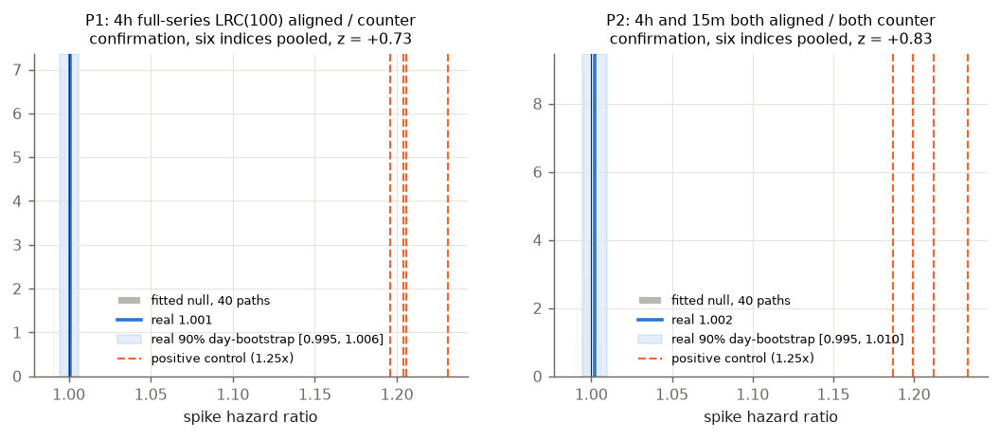
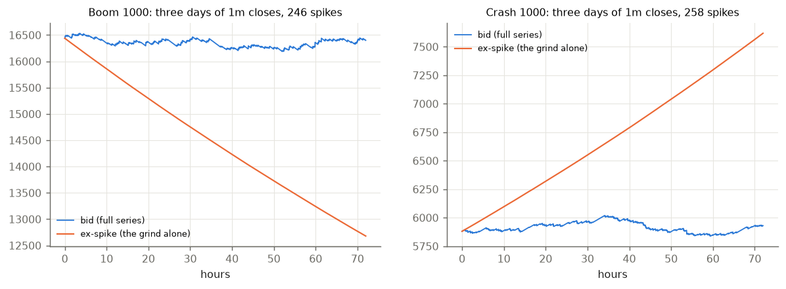
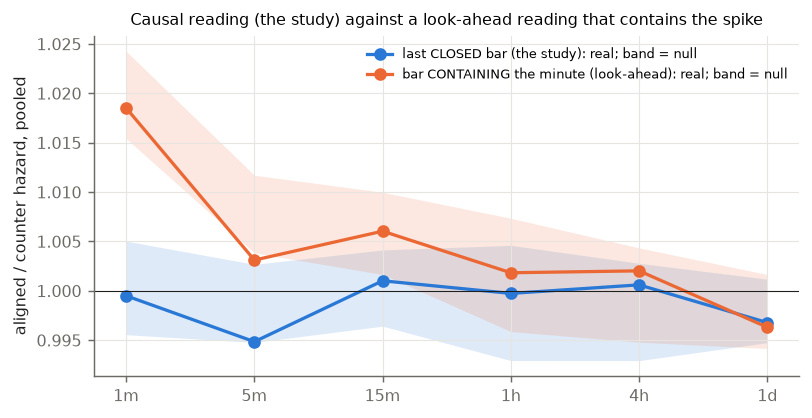
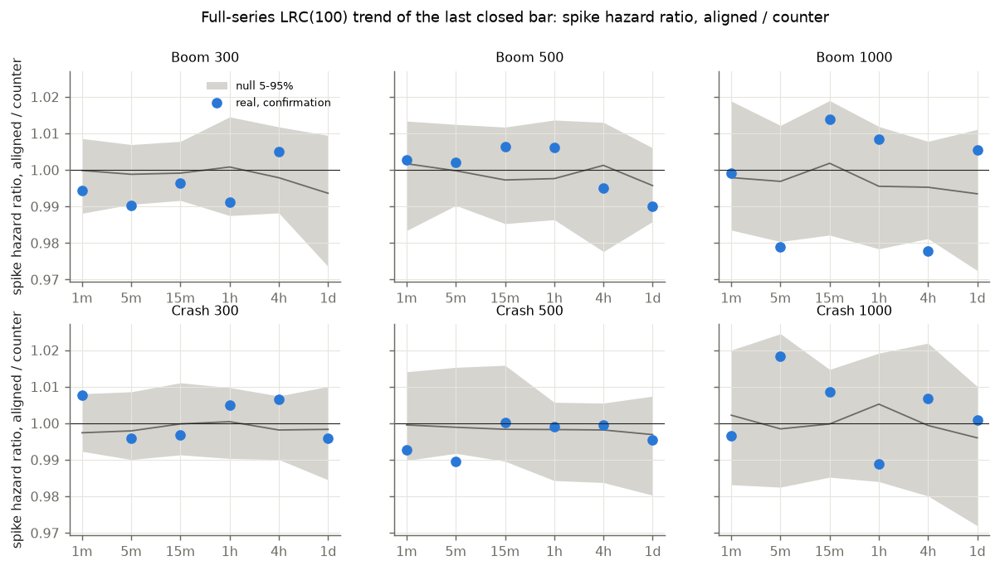
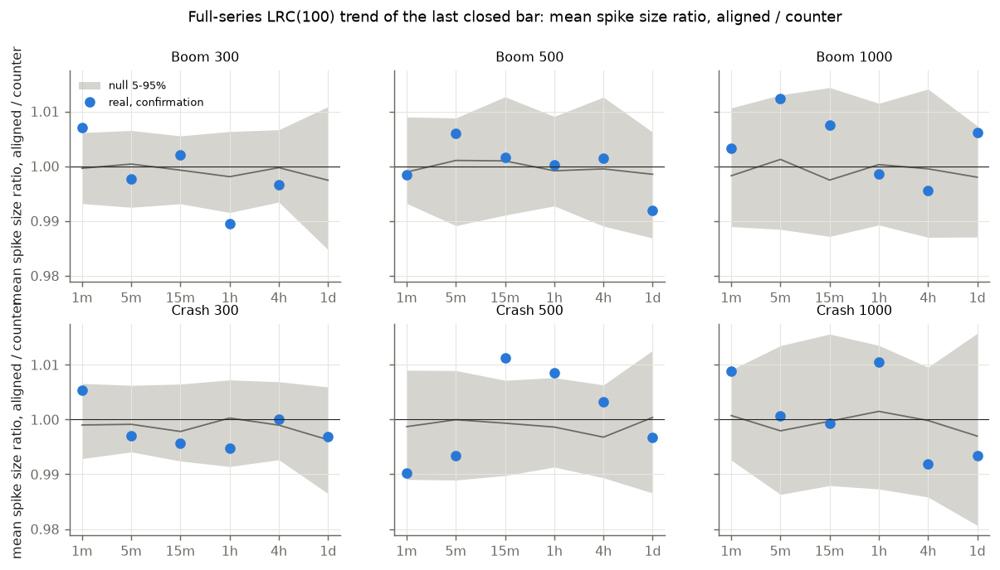
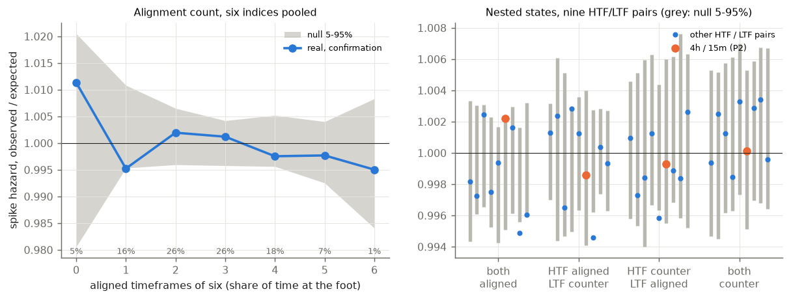
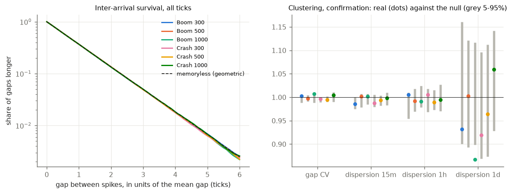
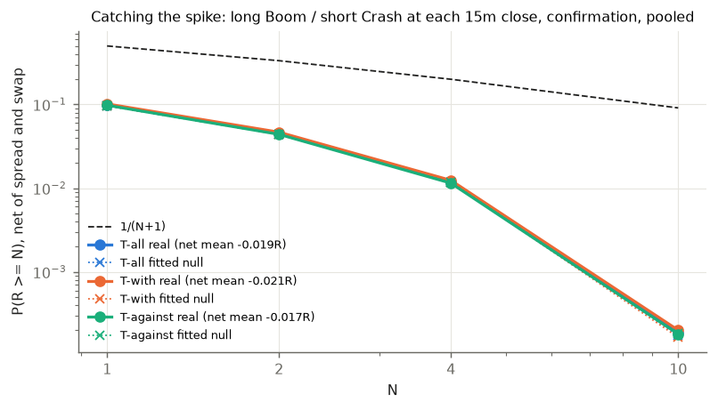

# Boom/Crash spikes do not follow the trend

**Measured 2026-10-05.** Frozen in [`bc_rule.json`](../ideas/bc_rule.json) before any tick was fetched
(commit `d212539`). Three amendments were made before any trend reading was looked at; they are
listed under *Amendments* below. Code: [`bc_fetch.py`](../ideas/bc_fetch.py) (the read-only fetch),
[`boomcrash_trend.py`](../ideas/boomcrash_trend.py) (detector, readings, fitted null, control, trade),
[`boomcrash_agg.py`](../ideas/boomcrash_agg.py) and [`boomcrash_plots.py`](../ideas/boomcrash_plots.py),
with tests in [`test_boomcrash_trend.py`](../ideas/test_boomcrash_trend.py).

The desk asked: *do Boom/Crash spikes move in the direction of the trend, with the trend (weak or
strong) read from 1h, 4h and 1d?* Boom always spikes up and Crash always spikes down, so the
direction of a spike is fixed. The question that can be tested is whether spikes come **more often**
(the hazard) or come **bigger** when the trend points the spike's way.

## The verdict

| | verdict |
|---|---|
| **P1** (primary): spike hazard, 4h trend aligned / counter, six indices pooled, confirmation | **fails.** **1.0006 [0.9947, 1.0060]** (day-bootstrap 90%). Fitted null 0.9980, z = +0.73, p = 0.47. Discovery 0.9984, z = +0.02. A spike is as likely when the 4h trend points its way as when it points against it, to within ±0.6%. |
| **P2** (co-primary): 4h and 15m **both** aligned / both counter | **fails.** **1.0021 [0.9947, 1.0097]**, null 0.9980, z = +0.83. Discovery 1.0020, z = +0.94. |
| **Power** (positive control) | The test can see an effect. Null paths with a hazard 1.25x higher while their own 4h trend is aligned read **1.196, 1.204, 1.206 and 1.231**, against 1.0006 on real data. |
| **The requested primary** (the 4h *ex-spike* trend) | **Has no aligned spikes to measure.** The grind runs one way only. With the spikes removed, Boom only falls and Crash only rises: **0.0% of spikes on all six indices and all six timeframes** come with an aligned ex-spike trend, and the ex-spike MCFL state is MIXED 100% of the time. Every spike is counter to the ex-spike trend by construction. |
| **Secondaries** | 972 cells, **772 tested** (the rest have no aligned or no counter state on the ex-spike series). **0 survive Benjamini-Hochberg at q = 0.10.** The smallest p is 0.005 (Boom 1000, 1h, strong / weak \|R\| when aligned: 1.060, but 0.999 in discovery). 11 of 772 cells have p < 0.05, fewer than the 39 that chance alone would give. This test is conservative, not lenient. |
| **Size** | Spike size does not depend on the trend either. Pooled aligned / counter size ratio is 0.9995 to 1.0026 at every timeframe (null 0.997 to 0.999, \|z\| <= 1.39). In 1h ATR, the mean spike is 0.167 / 0.167 (Boom 300 aligned / counter), 0.329 / 0.329 (Boom 1000), 0.329 / 0.327 (Crash 1000). |
| **Lower timeframes, multi-timeframe** | No effect. The log-hazard slope per extra aligned timeframe (of 1m 5m 15m 1h 4h 1d) is **-0.0010** pooled (null -0.0007, z = -0.25). The nine HTF / LTF nestings put every state within 0.6% of the index's own rate. |
| **Clustering** | None. The gap CV is 0.987 to 1.004 against 1.000 for a memoryless process. The inter-arrival survival curves lie on the geometric curve to the sixth mean gap. The 15m, 1h and 1d dispersion is about 1. The registered null check failed narrowly on three indices (below), so S8 is withdrawn for those three. |
| **Trade** (catching the spike with the trend) | Not opened, since neither primary passed. Run as a description: **T-with -0.021R [-0.028, -0.015], T-against -0.017R [-0.022, -0.011], T-all -0.019R [-0.023, -0.014]** a trade, confirmation, net of spread and swap. Gross of costs each is 0.000R to within ±0.006R. P(R >= N) matches the fitted null at every N. |



**In plain words.** A Boom index falls a little on almost every tick and jumps up about once every
300, 500 or 1,000 ticks. Over 21 months and 326 million ticks on six indices, the chance of the next
jump was the same whether the 1h, 4h or 1d chart looked bullish, bearish or flat. It was the same
whether the trend was weak or strong, and whether the 1m to 15m charts agreed with the bigger ones.
The jump was also the same size. An uptrend on a Boom chart is just a period that happened to have
more jumps than usual. It says nothing about the next jump, because the generator does not remember
the last one. A simulator that draws every jump at a constant rate reads the same on every measure
here. Matching it means **no edge before costs**: catching the spike "with the trend" earns zero
before the spread and loses the spread after it. The test can see an effect: a 25% higher hazard
in aligned trends, planted in simulated paths, came back at 1.20 to 1.23.

## Why the ex-spike trend cannot carry the question

The desk wanted to tell "trend because of spikes" apart from "spikes because of trend". Removing the
spikes was meant to leave a trend that the spikes did not cause. On these indices that trend is fixed.
The grind is one-signed: on every tick between spikes, Boom's bid falls or stays the same, and Crash's
rises or stays the same. Taken out of the series, the spikes leave a ramp:



So **every spike is counter to its ex-spike trend**, on every timeframe (measured 0.0% aligned, all
36 index-timeframe cells). What the ex-spike series still has is a grind *rate*. The tests on that
rate (S3, terciles of the ex-spike |slope|/ATR, |R| and the grind rate itself) find nothing. Pooled
STRONG / WEAK hazard ratios run from 0.993 to 1.009, all within z = ±2.01 of the null, and no cell
survives BH.

Every ex-spike test is reported. So the separation the desk asked for was done in two other ways:

1. **Causality.** Every reading uses only bars closed *before* the minute being scored, so a spike is
   never inside its own trend reading.
2. **The fitted null.** It is a tick simulator with a constant hazard, fitted on discovery. In it,
   spikes make trends exactly as they do on the real feed, but no trend can make a spike. The
   pipeline runs on 40 such paths per index. The real data match the null on every reading.

How large is the mechanical effect when causality is dropped (S10)? Read the trend from the bar that
*contains* the spike, which is look-ahead by design. The 1m aligned / counter ratio then reads
**1.0185** on real data and **1.0195** on the null [1.0154, 1.0243]. The 5m reads 1.0031 against
1.0083. Spikes make the trend, the null reproduces that, and the effect shrinks to nothing once the
reading is causal (0.9995 at 1m):



## Data

| | |
|---|---|
| Indices | Boom 300, 500, 1000 and Crash 300, 500, 1000 (the broker DB holds only the two 1000s, as 15m-1d bars, so everything was fetched) |
| Ticks | The lab's MT5 bridge, read-only, one UTC day per request, spaced. **2025-01-01 to 2026-10-04, 642 days on every index, no missing day.** The bridge serves no ticks before 2025-01-01 (404 on every index). |
| Volume | 53.5M to 54.9M ticks per index (about one a second), **326M in all**; 27 to 30 feed gaps over 60 s per index, excluded from spikes and from the ex-spike series |
| Bars | 1m from the ticks' bids; 5m-1d resampled from 1m. Bridge H1/H4/D1 from 2019 only warm the full-series 1h/4h/1d readings before the first tick. Over the overlap, tick-built 1h bars match the bridge's highs exactly on 98.9-100% of bars and its closes on 96% (p99 difference 0.008-0.029 points: the last tick's timing). |
| Split | The history is shorter than the 2024-01-01 convention allows, so the split is the midpoint, as registered: **discovery 2025-01-01 to 2025-11-17, confirmation 2025-11-18 to 2026-10-04** |
| Costs | The real tick spread (buy at the ask, sell at the bid); swap pro rata at the bridge's annual rate (Boom 300 36%, Boom 500 23%, Boom 1000 36%, Crash 300 72%, Crash 500 46%, Crash 1000 18%); no commission |

### Spikes, measured on ticks

A spike is a bid move on the spike side larger than 3 times the 99.9th percentile of the grind step
(discovery), in log-price units. Consecutive spike ticks merge into one spike.

| index | spikes | ticks per spike, discovery / confirmation | the name | deriving.md (24 h) | fitted null | spike-side moves below threshold |
|---|---|---|---|---|---|---|
| Boom 300 | 180,803 | **301.9 / 302.1** | 300 | 267.7 | 302.9 | 3,704 (2.0%) |
| Boom 500 | 109,265 | **499.0 / 497.5** | 500 | 529.4 | 500.6 | 1,307 (1.2%) |
| Boom 1000 | 54,889 | **1000.7 / 995.5** | 1000 | 908.3 | 1001.3 | 352 (0.6%) |
| Crash 300 | 180,315 | **304.0 / 304.6** | 300 | 329.0 | 305.0 | 3,675 (2.0%) |
| Crash 500 | 109,202 | **492.4 / 493.9** | 500 | 507.7 | 493.4 | 1,385 (1.3%) |
| Crash 1000 | 54,735 | **972.0 / 983.5** | 1000 | 973.8 | 973.6 | 366 (0.7%) |

Over 21 months the indices spike at the rate in their names to within 2%. Discovery and confirmation
agree to within 1.2%. deriving.md's figures come from one 24-hour window, so they are off by up to
13%. All six are inside the registered 15% kill band. The constant hazard is the measured one: P(a
spike in the next minute) is 0.177 (300s), 0.112 (500s) and 0.058 (1000s). By 4h state, the real
next-minute rate is within ±0.002 of that on every index (S5).

## Results by index and timeframe

The full-series LRC(100) direction of the last closed bar, aligned / counter hazard, confirmation:



| index | 4h ratio (P1 cell) | null mean [5-95%] | z |
|---|---|---|---|
| Boom 300 | 1.0050 | 0.9979 [0.988, 1.012] | +0.93 |
| Boom 500 | 0.9951 | 0.9986 [0.978, 1.013] | -0.33 |
| Boom 1000 | 0.9778 | 0.9953 [0.981, 1.008] | -1.44 |
| Crash 300 | 1.0065 | 0.9982 [0.990, 1.007] | +1.20 |
| Crash 500 | 0.9996 | 0.9972 [0.984, 1.006] | +0.28 |
| Crash 1000 | 1.0068 | 0.9991 [0.980, 1.022] | +0.48 |
| **pooled** | **1.0006 [0.9947, 1.0060]** | 0.9980 | **+0.73** |

Pooled across the six indices, aligned / counter by timeframe (S1) reads 0.9995 (1m), 0.9949 (5m),
1.0010 (15m), 0.9997 (1h), 1.0006 (4h) and 0.9968 (1d). The largest |z| is 1.29. MCFL structure (S2)
gives the same: aligned / counter 0.994 to 1.004, and MIXED (range) / trend 0.996 to 1.002. Neither
direction nor structure moves the hazard at any timeframe, on any index.

Spike size, aligned / counter, on the same cells:



### Multi-timeframe



| aligned timeframes of six | 0 | 1 | 2 | 3 | 4 | 5 | 6 |
|---|---|---|---|---|---|---|---|
| share of time | 5.3% | 16.1% | 25.5% | 26.0% | 18.2% | 7.3% | 1.5% |
| hazard, observed / expected | 1.011 | 0.995 | 1.002 | 1.001 | 0.998 | 0.998 | 0.995 |
| null | 1.001 | 1.003 | 1.000 | 1.000 | 1.000 | 0.999 | 0.997 |

Nested states, pooled observed / expected (BOTH aligned, HTF aligned + LTF counter = the pullback,
HTF counter + LTF aligned, BOTH counter):

| HTF / LTF | both aligned | pullback | HTF counter, LTF aligned | both counter |
|---|---|---|---|---|
| 1h / 1m | 0.998 | 1.001 | 1.001 | 0.999 |
| 1h / 15m | 1.002 | 0.997 | 0.998 | 1.001 |
| 4h / 5m | 0.999 | 1.001 | 0.996 | 1.003 |
| **4h / 15m** (P2) | **1.002** | 0.999 | 0.999 | **1.000** |
| 1d / 1m | 1.002 | 0.995 | 0.999 | 1.003 |
| 1d / 15m | 0.996 | 0.999 | 1.003 | 1.000 |

(All nine nestings are in `report.json`. The three not shown sit in the same 0.995-1.003 band.)

### Clustering



The waiting time between spikes, counted in ticks, is geometric. On a log scale all six survival
curves lie on exp(-x) out to six mean gaps. That confirms the gap CVs of 0.98 to 1.01 that
[spiking.md](spiking.md) and [deriv-variants.md](deriv-variants.md) found on 1m bars, now on 326M
ticks. Spike counts per 15m, 1h and 1d window have a variance-to-mean ratio of about 1, as for a
Poisson count. The gap CV and the 1h dispersion are the same in aligned and in counter 4h states:
the largest |z| is 2.52 (Crash 1000), and no cell survives BH.

**Registered null check (S8).** The null must reproduce the discovery gap CV and 1h dispersion within
its 90% band. It did on Boom 300, Crash 500 and Crash 1000. It missed narrowly on three indices: Boom
500's CV is 1.0036 against a band of [0.990, 1.002]; Boom 1000's CV is 0.987 [0.990, 1.007] and its
1h dispersion 0.973 [0.978, 1.023]; Crash 300's CV is 0.988 [0.991, 1.002]. Twelve checks against a
90% band would miss about one by chance, so this is a little more. The registered consequence is
that **S8 comparisons for Boom 500, Boom 1000 and Crash 300 are withdrawn**. The size of the misses
(CV within 1.3% of 1) does not change the description: the arrivals are memoryless.

## The trade (descriptive: neither primary passed)

Long Boom / short Crash at every 15m close, filled on **ticks**. Entry at the ask (Crash: the bid)
of the first tick after the close. The stop is structural: beyond the last three 15m bars' extreme,
plus 0.1 ATR, with a minimum risk of 0.25 ATR (median risk 0.83 ATR). The exit is market-decided:
the first price after the first spike, or a 24-hour time stop. The stop sits on the **grind side**,
so the price walks into it a tick at a time and never jumps it. Stopped trades lose **-1.008R on
average** (worst -1.52R, from rare large grind ticks), and 0.01% lose more than 1.1R. That is the
opposite of the Range Break lesson, where 98% of stops were jumped: here the jump is the *exit*, and
it fills on the tick after the spike, not at the spike's top.

Confirmation, six indices pooled, net of spread and swap:

| | n | mean R net [90%] | gross | P(R >= 1) | P(R >= 2) | **P(R >= 4)** | **P(R >= 10)** | stopped |
|---|---|---|---|---|---|---|---|---|
| T-all | 184,890 | -0.019 [-0.023, -0.014] | -0.001 | 0.099 | 0.045 | 0.0119 | 0.0002 | 30.4% |
| T-with (4h aligned) | 79,629 | -0.021 [-0.028, -0.015] | -0.004 | 0.102 | 0.047 | 0.0124 | 0.0002 | 31.3% |
| T-against (4h counter) | 105,261 | -0.017 [-0.022, -0.011] | +0.001 | 0.098 | 0.044 | 0.0115 | 0.0002 | 29.7% |
| T-with-ex (4h ex-spike grind STRONG) | 60,124 | -0.022 [-0.029, -0.016] | -0.006 | 0.093 | 0.039 | 0.0084 | 0.0001 | 27.8% |
| fitted null, T-all | | -0.034 | | 0.097 | 0.044 | 0.0117 | 0.0002 | |
| fitted null, T-with | | -0.035 | | 0.097 | 0.044 | 0.0118 | 0.0002 | |
| 1/(N+1) | | | | 0.500 | 0.333 | 0.200 | 0.091 | |



**1/(N+1) is not the yardstick here.** That number holds for a continuous martingale with a +N R
target. This trade has no target: it takes whatever the first spike gives. Seventy percent of trades
exit on a spike, averaging about +0.41R, and 30% are stopped at about -1R, so the gross mean is zero.
The yardstick is the fitted null, run through the same entries, stops and tick fills. The real
P(R >= N) sits on the null's at every N, with or without the trend filter. The null's net mean
(-0.034R) is lower than the real one because its price path drifts away from the real price level,
while it pays the real spread in points. The gross means are the clean comparison, and they are all
zero (per index: -0.019 to +0.019R real, -0.007 to +0.035R null).

Per index, confirmation, T-with / T-against net R: Boom 300 -0.016 / -0.015, Boom 500 -0.020 /
-0.020, Boom 1000 -0.043 / -0.005, Crash 300 -0.026 / -0.018, Crash 500 -0.013 / -0.016, Crash 1000
-0.011 / -0.028. The sign of with-minus-against flips across indices, and its pooled value is -0.004R.

The desk's iid and GARCH walks, matched to the 15m bars, were registered as a trade null. A Gaussian
walk has no spikes, so the spike exit never fires and the walk trade becomes a 24-hour hold
(P(R >= 4) 0.066-0.069, P(R >= 10) 0.025). They are in `report.json` for completeness and are not a
comparison for this trade.

## Amendments, all before any trend reading was read

1. **The positive control keeps the drift at zero** (after a synthetic-only test). The control raised
   the hazard 1.25x alone when aligned. That breaks the closure E[J] = lambda E[g]: an aligned trend
   then drifts up, feeds itself, and stays aligned forever. On a 120-day synthetic path every 4h bar
   was aligned. The control now also divides the jump size by 1.25, so only the hazard changes.
2. **The null test is predictive** (after an end-to-end run on synthetic constant-hazard data). Taking
   the sd of 10-40 null paths as known gave 14 BH survivors of 531 cells on data that *was* the null.
   It is now z = (log real - mean) / (sd x sqrt(1 + 1/n)), with sd floored at the Poisson sd of a log
   rate ratio and p from Student t with n - 1 df. The same synthetic data then gave 0 survivors.
3. **Log-price units** (after the first real prep of Boom 300, spike counts only). The indices are
   multiplicative: Boom 300 traded from 715 to 4,359 and back to 1,055 in the sample. A threshold in
   points missed 11,610 small spikes. Detector, sizes and simulator are now in log price.

One bug was found and fixed after the full run, without changing any frozen rule. The ex-spike
series was exponentiated, and its compounding one-sided grind underflowed to zero within months, so
the confirmation-half ex-spike strength terciles were empty. It is now kept in log price, and
everything was rerun. **P1 and P2 read the full series and were identical before and after**
(1.0006 and 1.0021). The first two outputs were set aside on the lab, unused.

## What this means for the desk

* **Do not filter Boom/Crash spike trades by the HTF or LTF trend, by MCFL structure, by trend
  strength or by multi-timeframe alignment.** None of them moves the chance or the size of the next
  spike by more than about half a percent, against the 20% the test can detect.
* **An uptrend on a Boom chart is a count of past spikes, not a forecast of the next one.** Any chart
  that seems to show "spikes come in the trend" is reading its own spikes back. The look-ahead
  reading shows a 2% effect at 1m, and the constant-hazard simulator shows the same 2%.
* **The spike-catching trade is zero before costs and minus the spread after it**, with or without
  the trend. This agrees with deriving.md's theorem on these generators. Here it is measured with
  tick fills over 370,000 trades.
* **Card line, if any:** "spike within the next minute: 17.7% / 11.2% / 5.8% (300 / 500 / 1000)". It
  is a constant, as [deriv-variants.md](deriv-variants.md) proposed, and now confirmed against every
  trend state.

## Reproduce

On the lab, in the study's own directory (`$HOME/till_infinity/boomcrash`):

```
set -a; . ./.bridge.env; set +a
OUT=$HOME/till_infinity/boomcrash/data python research/ideas/bc_fetch.py info bars ticks
DATA=.../data OUT=.../out META_DAYS=20089,20730 MODE=prep python research/ideas/boomcrash_trend.py
... MODE=sim  (40 null + 4 control paths per index, 8 workers, about 2 minutes per index)
... MODE=plot IMG=.../img
```

The tick store is 3,852 npz files (642 days x 6). It is not committed.
