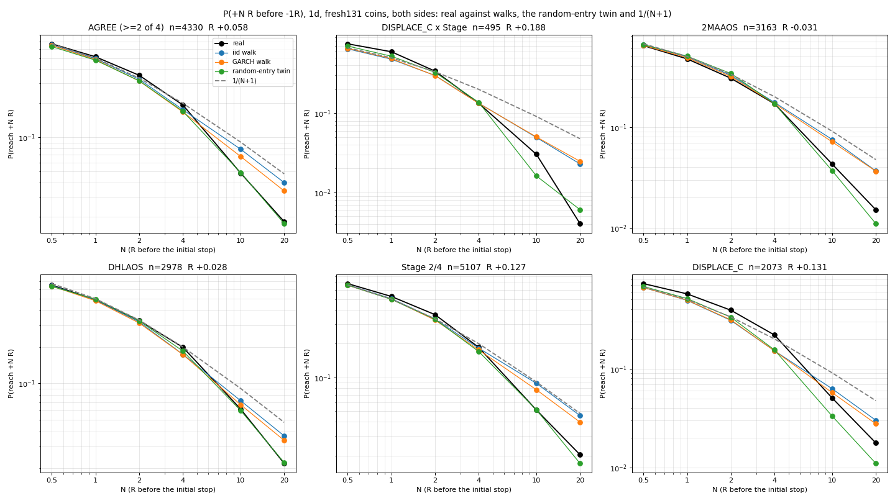
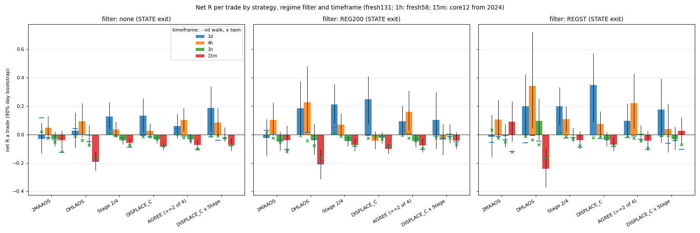
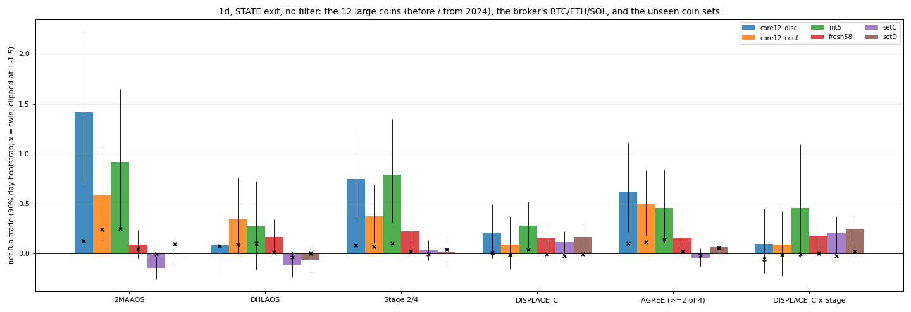
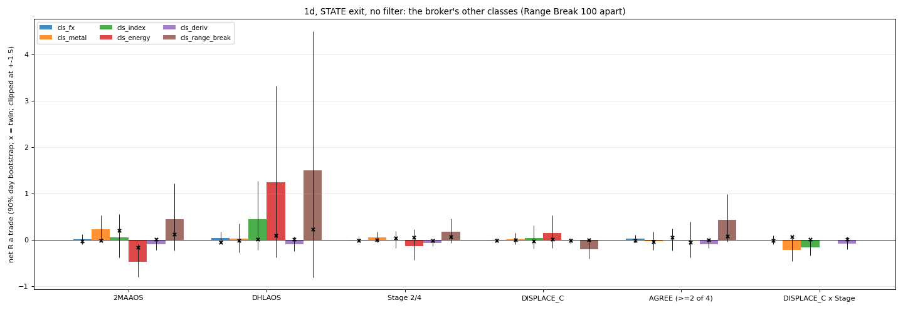
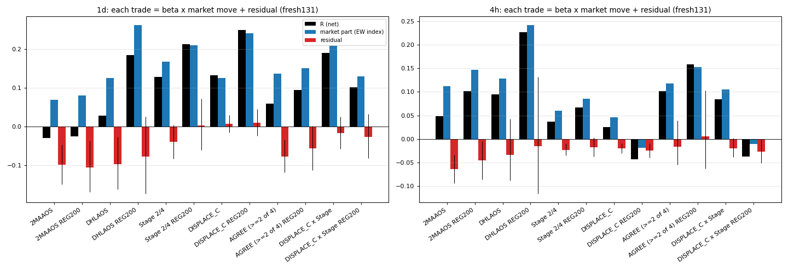
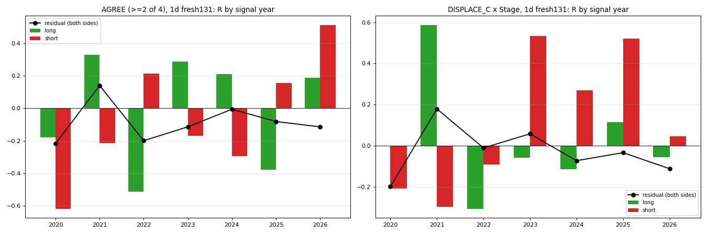
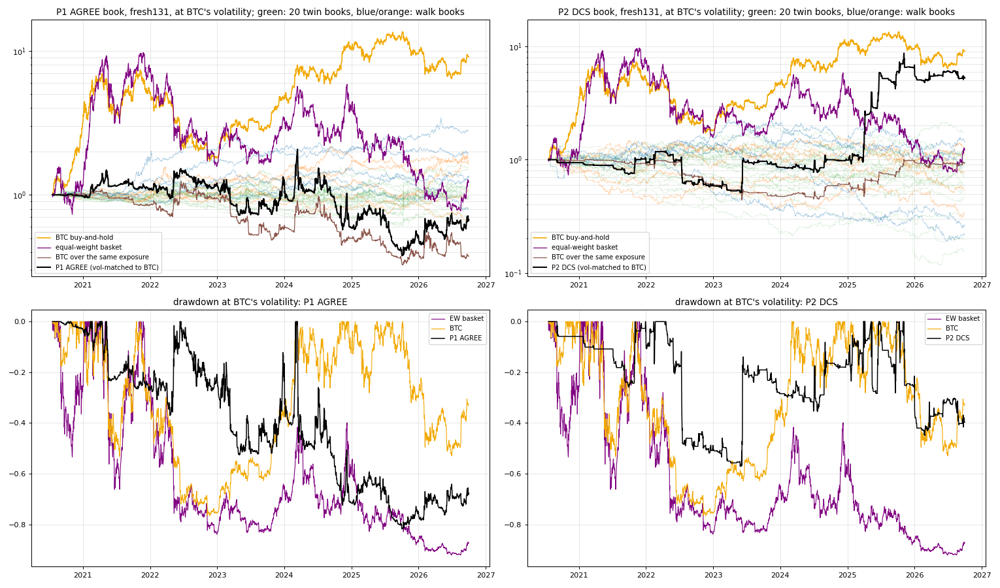
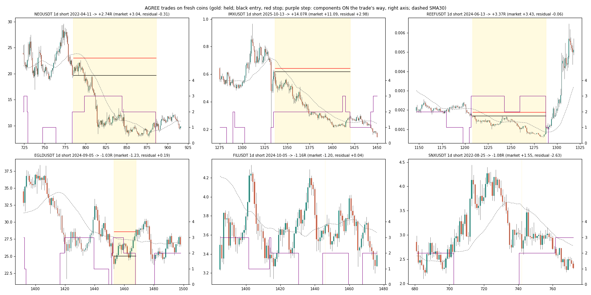

# Crypto daily trend: four signals, alone and combined, and how much of it is the market

**Measured, pre-registered, 2026-10-05.** The study comes from the one signal that keeps recurring
across the desk's studies: trend on crypto, mostly daily.
- [geraked-eas.md](geraked-eas.md): 2MAAOS and DHLAOS survive BH at crypto 4h.
- [tv-indicators.md](tv-indicators.md): Weinstein Stage 2 on 1d earns +0.20R, all of it crypto long drift.
- [turn-follow-ups.md](turn-follow-ups.md) and [pca-residuals.md](pca-residuals.md): DISPLACE_C passes on
  fresh coins, and its edge is the crypto market factor.

Here the four signals are traded alone and combined, with the desk's geometry, on unseen coins. The
rule is in [`ideas/cdt_rule.json`](../ideas/cdt_rule.json) (commit d50a9ce, before any real-data run;
amendments are listed under `amended_before_run`). Code: [`cdt.py`](../ideas/cdt.py),
[`cdt_data.py`](../ideas/cdt_data.py), [`cdt_report.py`](../ideas/cdt_report.py), and tests on synthetic
bars in [`test_cdt.py`](../ideas/test_cdt.py).

## Answer

**Both primaries fail the frozen test.** The co-primary fails narrowly, and what it does earn is the
crypto market, timed.

| primary (1d, STATE exit, 131 fresh coins) | n | R [90%] | p | before / after 2024 | fresh58 / setC | iid / GARCH walk | twin | verdict |
|---|---|---|---|---|---|---|---|---|
| **P1 AGREE** (≥ 2 of 4 ON) | 4,330 | **+0.058 [−0.025, +0.143]** | 0.125 | +0.065 / +0.053 | +0.157 / **−0.043** | +0.042 / +0.030 | +0.001 | fails |
| **P2 DCS** (DISPLACE_C in the coin's own Stage) | 495 | **+0.188 [+0.023, +0.339]** | 0.030 | +0.039 / +0.297 | +0.175 / +0.203 | −0.015 / −0.001 | −0.011 | fails (Holm needs p < 0.025) |

- **P1 fails every leg except "positive in both halves".** Its interval includes 0, it loses on setC,
  and it barely clears its walks.
- **P2 clears every leg except multiplicity.** Its p is 0.030, against the Holm bar of 0.025 for the
  smaller of two p values.
  - On the 274 SET_D coins, which no study has used, the same rule passes: **+0.246R
    [+0.092, +0.374]**, n = 437, +0.273 / +0.228 in its two halves, walks −0.023 / −0.012, twin
    +0.019.
  - It is short-side: shorts +0.264R, longs −0.014R.
  - Its book makes 79% of its total return on 5 days: crash days such as 2023-06-10 and 2025-04-02 to
    04-06.
- **Beyond beta: no.** Against the equal-weight index of the 143 coins, each trade's R splits into a
  market part (β × the index's move over the trade) and a residual:
  - P1: +0.136 market, residual **−0.077 [−0.119, −0.038]**;
  - P2: +0.208 market, residual **−0.018 [−0.058, +0.022]**;
  - every fresh-coin cell at 1d and 4h has its residual at or below 0.
  - **The edge is the crypto market factor, timed.** It is not static beta: the books' beta to BTC is
    −0.01 to 0. It is not BTC either: the same signals on BTC make −1 bps a trade for P2, against
    +230 bps on the equal-weight basket and +233 bps on the alt.
- **The book does not beat BTC buy-and-hold.** BTC's Sharpe over the same dates is 0.91 (max drawdown
  −77%).
  - P1 book: Sharpe 0.18 [−0.41, +0.84].
  - P2 book: Sharpe 0.73 [−0.01, +1.30]; the difference from BTC is −0.18 [−1.21, +0.75].
  - P2 beats its walks (mean −0.17, best of 5 +0.35) and its 20 twin books (mean −0.12, best +0.50).
- **Trend is a large-coin and a slow-bar effect.** By coin set:
  - The 12 large coins earn +0.50 to +0.62R with AGREE on 1d, before and after 2024. The broker's
    BTC/ETH/SOL earn +0.45. fresh58 earns +0.16, setC −0.04 and SET_D +0.06.
  - By timeframe: 1d > 4h > 1h > 15m. At 15m every cell loses (−0.04 to −0.21R).
  - Nothing survives Benjamini-Hochberg across the **142 secondary cells**.
- **Other classes** (FX, metals, indices, energy, Deriv; Range Break 100 apart): no component earns.
  This is a crypto effect.

## Design

**The four components.** Each one fires at a bar's close and enters at the next open. Each also has
an ON state per side, which serves as its structure exit and as its vote in the agreement.

| | entry (long; shorts mirror) | ON while |
|---|---|---|
| C1 2MAAOS | geraked port: Andean(50, 9) bull crosses its signal, bull > bear, SMA50 > SMA200, open above SMA50 − half the MA gap | bull > bear and SMA50 > SMA200 |
| C2 DHLAOS | geraked port: bull crosses its signal after price traded wholly below the previous period's low. On 1d the period is the ISO week, because a 24/7 daily bar can never sit wholly below the previous day's low | bull > bear |
| C3 Stage 2 | entering Weinstein Stage 2 (4 for shorts), tv_indicators' % slope machine | stage is 2 (4) |
| C4 DISPLACE_C | turn_trade T1: DISPLACE_C up at a 12-bar low | until a DELIVERY_SHIFT against, 10 days at most (E2) |

**Combinations.**
- **AGREE:** long when at least 2 of the 4 are ON long (and more than are ON short) and that was not
  so on the bar before. Out when the count drops below 2.
- **DCS:** DISPLACE_C taken only in the coin's own Stage 2 (Stage 4 for shorts).
- **REG200** (on every strategy): longs only while BTC's last completed daily close is above its
  200-day SMA, shorts only while it is below. **REGST** uses BTC's daily Stage instead. The regime is
  read at the signal bar's close time (tested: a 4h bar never sees the day still open). On a walk
  panel it comes from BTC's own walk.

**Geometry.**
- Entry at the next open.
- Stop 0.1 ATR beyond the 3-bar extreme, at least 0.25 ATR away. It fills at the stop, or at the open
  on a gap, less 0.05 ATR.
- Exits: **STATE** (primary), out at the next open after the ON state ends; **TRAIL**, 2 ATR behind the
  best high. Both hold at most 300 bars.
- Costs: 0.07% a round trip on Binance; the broker's spread floor on MT5.

**Nulls.**
- Log-price iid and GARCH walks matched to every series: 256 sub-steps, real timestamps, the real
  cost in ATR units, 5 seeds of each on 1d.
- A random-entry twin: 20 per trade, on the same coin and side, with the same risk in ATR and the same
  bars held, at random bars. It has the same exposure with no timing.
- 1/(N+1).

**Data.**
- Binance USDT perpetuals from data.binance.vision:
  - core12 (before 2024 = discovery, after = confirmation);
  - fresh58 and setC (together the primary fresh131, every date);
  - SET_D (274 coins, 1d).
- The broker's BTC/ETH/SOL CFDs from 2019, and its other 41 symbols at 1d and 4h, exported read-only
  from the lab database.
- **Sanity check:** DISPLACE_C as published reproduces turn_confirm's +0.142R on fresh58 1d exactly
  (n 1,116).

**Amendments, all made before the affected run:**
- MT5 bars start in 2019, because the fixed spread is many ATR on the 2011-16 BTC bars.
- 1h is narrowed to core12 + fresh58 and 15m to core12, for compute.
- DISPLACE_C and DELIVERY_SHIFT are read from MCFL's words alone. The entities are identical to the
  full parse, checked on real and walk series.

## P(N R): no tail beyond randomness on 1d

P(+N R before −1R, within 300 bars), 1d, fresh131. Each cell gives real / iid / GARCH / twin. A bar
that touches both counts as stopped.

| | n | 0.5 | 1 | 2 | 4 | 10 | 20 |
|---|---|---|---|---|---|---|---|
| 1/(N+1) | | 0.667 | 0.500 | 0.333 | 0.200 | 0.091 | 0.048 |
| AGREE | 4,330 | .668/.655/.647/.631 | .514/.495/.486/.480 | .353/.325/.314/.315 | .193/.175/.167/.170 | .048/.079/.068/.049 | .018/.040/.034/.017 |
| DCS | 495 | .749/.648/.658/.703 | .596/.480/.488/.523 | .339/.299/.298/.327 | .133/.134/.133/.137 | .030/.049/.050/.016 | .004/.023/.025/.006 |
| 2MAAOS | 3,163 | .640/.652/.643/.654 | .473/.496/.486/.503 | .304/.325/.317/.339 | .170/.175/.171/.171 | .043/.075/.071/.037 | .015/.037/.037/.011 |
| DHLAOS | 2,978 | .647/.642/.635/.631 | .490/.487/.481/.495 | .330/.322/.315/.329 | .199/.174/.173/.185 | .061/.072/.067/.060 | .022/.037/.034/.022 |
| Stage 2/4 | 5,107 | .687/.669/.664/.665 | .527/.505/.499/.496 | .363/.331/.325/.330 | .185/.182/.176/.170 | .051/.088/.077/.051 | .020/.046/.040/.017 |
| DISPLACE_C | 2,073 | .723/.661/.661/.676 | .569/.490/.492/.510 | .390/.308/.312/.331 | .219/.152/.152/.155 | .051/.063/.057/.033 | .018/.030/.028/.011 |

**On 1d the signals lift the near R (0.5-2R) but not the tail.**
- Real P(≥10R) sits on the twin's (the same coins at random times) and below the walks'.
- Over 300 daily bars, alts reach 10R less often than a driftless log walk does. The real realised
  tail is P(R ≥ 4) 0.037 and P(R ≥ 10) 0.007 for AGREE.

**At 4h there is a tail excess.**
- AGREE: P(10R) 0.074 against 0.060 on the walks and 0.061 on the twin.
- DCS: 0.072 against 0.036 / 0.040 / 0.037, and P(20R) 0.026 against 0.008.
- But the STATE exit does not hold the trades long enough to collect it. 4h DCS makes +0.085R
  [−0.012, +0.182].

## Each component, filter and timeframe

Net R a trade, STATE exit, no filter. 1d and 4h are on fresh131, 1h on fresh58 and 15m on core12 from
2024.

| | 1d | 4h | 1h | 15m |
|---|---|---|---|---|
| 2MAAOS | −0.031 | +0.048 | −0.032 | −0.042 |
| DHLAOS | +0.028 | +0.094 | −0.008 | −0.192 |
| Stage 2/4 | +0.127 [+0.03, +0.22] | +0.036 | −0.042 | −0.059 |
| DISPLACE_C | +0.131 [+0.02, +0.24] | +0.026 | −0.035 | −0.083 |
| AGREE | +0.058 | +0.101 [+0.02, +0.19] | −0.029 | −0.075 |
| DCS | +0.188 | +0.085 | −0.001 | −0.073 |

- **The BTC regime filter raises most cells** (1d Stage 2 +0.21, DISPLACE_C +0.25; 4h AGREE +0.16,
  DHLAOS +0.23). That is the market part again, below.
- **Under BH across all 142 secondary cells, none survives.** Six 1d cells pass BH when 1d is taken
  alone. Stage 2 (unfiltered, REG200, REGST) and DISPLACE_C with REG200 / REGST beat both walks and the
  twin at p 0.002-0.016, but with 142 tries the smallest p needed is 0.0007.
- **The TRAIL exit is worse than STATE everywhere except DISPLACE_C and DCS.** On 1d, AGREE makes
  −0.033 with TRAIL.

**By coin set (1d, AGREE):**

| coin set | R [90%] | twin |
|---|---|---|
| core12, before 2024 | +0.619 [+0.22, +1.11] | +0.102 |
| core12, from 2024 | +0.496 [+0.18, +0.83] | +0.114 |
| the broker's BTC/ETH/SOL | +0.453 [+0.10, +0.85] | +0.137 |
| fresh58 | +0.157 | |
| setC | −0.043 | |
| SET_D | +0.064 [−0.04, +0.16] | +0.059 |

- **2MAAOS on the large coins makes +1.42R before 2024 and +0.58R after,** and +0.91R on the broker's
  CFDs. On fresh coins it makes −0.03R.
- **The pulse is real on the dozen largest coins and fades with size.** setC and SET_D are mostly
  younger and smaller listings.
- **Those coins are where the pulse was found.** The broker's CFDs are the same three coins, so they
  are not independent of core12.

**Other classes (1d, AGREE):**

| class | R |
|---|---|
| FX | +0.024 |
| metals | −0.032 |
| indices | −0.008 |
| energy | −0.010 |
| Deriv | −0.090 |
| Range Break 100 (apart) | +0.43, n 54 |

At 4h every class is negative to flat. Range Break 100 is a generator: its range rewards anything,
as before.

## Is it BTC beta or the market factor?

Each trade's R splits into the market part (side × β × the equal-weight index's move over the trade,
in R) and a residual. β comes from the trailing 60 bars on the equal-weight index of core12 +
fresh131. Fresh131, STATE exit:

| | n | R | market part | residual [90%] | alt bps | basket same side, bps | BTC same side, bps [90%] |
|---|---|---|---|---|---|---|---|
| 1d AGREE | 4,325 | +0.059 | +0.136 | −0.077 [−0.119, −0.038] | +48 | +142 | −81 [−171, +7] |
| 1d DCS | 494 | +0.190 | +0.208 | −0.018 [−0.058, +0.022] | +233 | +230 | −1 [−114, +106] |
| 1d Stage 2/4 | 5,103 | +0.128 | +0.167 | −0.040 [−0.083, +0.004] | +125 | +219 | −9 |
| 1d DISPLACE_C | 2,072 | +0.132 | +0.125 | +0.006 [−0.016, +0.028] | +177 | +159 | +77 |
| 1d DISPLACE_C REG200 | 954 | +0.249 | +0.240 | +0.009 [−0.027, +0.043] | +359 | +330 | +253 |
| 4h AGREE | 32,641 | +0.101 | +0.118 | −0.016 [−0.056, +0.034] | +36 | +38 | +7 |
| 4h AGREE REG200 | 17,290 | +0.159 | +0.153 | +0.006 [−0.063, +0.102] | +67 | +60 | +31 |

- **Every fresh-coin cell's R is its market part or less.** Trading the equal-weight basket on the
  same signals keeps as much as the alt does, or more. BTC on the same side keeps little or nothing.
  The alts' turns are the alt market's turns, not BTC's, which agrees with pca-residuals.
- **It is timing, not holding.**
  - The books' beta to daily BTC is −0.01 to 0, and their correlation is −0.15.
  - BTC held over the same exposure windows, on the same side, gives Sharpe −0.15 (P1) and +0.11 (P2).
  - Held long only, it gives +0.51 and −0.13.
- **On the 12 large coins the residual turns positive but stays inside noise.** At 4h, from 2024,
  AGREE's residual is +0.085 [+0.009, +0.158] on the equal-weight index. On BTC it is +0.042
  [−0.035, +0.122]. A large coin's trend is BTC's trend.

## Portfolio: equal-risk, against BTC buy-and-hold

**How the book is built.**
- Each coin is an equal sleeve, 1 / the coins live that day.
- Each trade risks 2% of its sleeve and is marked to daily closes, net of 0.07% and the stop
  slippage.
- From 2020-07-19 (after the 200-bar warm-up). 90% intervals from a 20-day block bootstrap.

| book (1d) | Sharpe [90%] | CAGR / max DD as run | at BTC's vol: CAGR / max DD | net of funding | walks: iid / GARCH mean (best of 5) | twin books mean (best of 20) |
|---|---|---|---|---|---|---|
| P1 AGREE, fresh131 | 0.18 [−0.41, +0.84] | +0.7% / −10.3% | −6% / −82% | 0.12 | 0.47 (1.09) / 0.29 (0.67) | 0.07 (0.52) |
| P2 DCS, fresh131 | 0.73 [−0.01, +1.30] | +0.3% / −0.5% | +31% / −57% | 0.73 | −0.17 (0.35) / −0.06 (0.26) | −0.12 (0.50) |
| Stage 2/4, fresh131 | 0.38 [−0.22, +0.92] | | | 0.32 | 0.91 / 0.77 | |
| DISPLACE_C REG200, fresh131 | 0.73 [+0.25, +1.11] | | | 0.71 | −0.09 / 0.35 | |
| P1 AGREE, core12 | 0.84 [+0.26, +1.46] | +7.9% / −11.3% | +37% / −53% | 0.76 | 0.06 / 0.06 | |
| Stage 2/4 REG200, core12 | 1.10 [+0.49, +1.77] | | +59% / −46% | 1.00 | −0.14 / 0.51 | |
| **BTC buy-and-hold** | **0.91** | +43% / −77% | | | | |
| equal-weight basket (fresh131) | 0.49 | / −92% | | | | |

- **No book beats BTC buy-and-hold on Sharpe.**
  - The closest is Stage 2/4 REG200 on the large coins: +0.19 [−0.55, +0.97] over BTC, with a
    shallower drawdown at BTC's volatility (−46% against −77%).
  - P2 DCS: −0.18 [−1.21, +0.75].
- **The fresh-coin trend books (P1, Stage 2/4) are no better than their walk books.** Driftless log
  walks give trend rules a small long convexity.
- **DCS and DISPLACE_C REG200 beat their walks and their twins.** That timing is real, and it is the
  market factor's crash days.
- **Funding costs the trend books about 0.05-0.1 Sharpe.** It costs nothing on the short-heavy DCS
  book.

## Gallery

Three winners and three losers of AGREE on fresh coins. Each title gives the trade's market part and
residual.

## Verdict

- **P1 AGREE: fails** (+0.058R [−0.025, +0.143], setC −0.043).
- **P2 DCS: fails the frozen rule on multiplicity** (+0.188R [+0.023, +0.339], p 0.030 against Holm's
  0.025). It replicates on SET_D (+0.246R [+0.092, +0.374]). Its residual after the market is
  −0.018R [−0.058, +0.022], and its book does not beat BTC buy-and-hold.
- **Crypto daily trend is real on the largest coins and it is the market.**
  - It grows with coin size and bar length, and it is gone at 1h and 15m and in every other class.
  - What each rule adds over its coin's drift is market timing that the equal-weight basket captures
    as well as the alt does.
  - The tradeable form is a timed long/short on the crypto basket or the largest coins. Buying alts
    adds nothing.
- **Next:** a frozen test of DCS-timed equal-weight basket trades and of Stage 2/4 REG200 on the
  largest coins, forward in the paper log (the market_mirror pattern).

## Caveats

- **Bars, not ticks.** Every series pays the same cost: 0.07% on Binance, the spread floor on the
  broker. Funding is in the books only.
- **The large-coin results are the discovery set.** The broker's BTC/ETH/SOL are the same coins.
- **SET_D is mostly listings from 2024 on.** Its halves are split at its own median signal date.
- **The 1h and 15m checks were narrowed for compute.** 1h runs on core12 + fresh58, 15m on core12 only,
  with one walk of each kind.
- **The DCS book is concentrated.** Five days give 79% of its return, and at BTC's volatility it is
  levered about 160×: a picture of the shape, not a sizing.
- **The study ran on the desk's local machine.** Code could not be copied to the lab. The broker's
  bars were exported read-only from the lab database.

## Re-running

    DATA=.data/cdt/data python research/ideas/cdt_data.py                  # fetch (Binance, funding)
    DATA=... OUT=.data/cdt/out MODE=sanity python research/ideas/cdt.py    # +0.142R check
    DATA=... OUT=... MODE=run IV=1d|4h|1h|15m WORKERS=7 python research/ideas/cdt.py
    DATA=... OUT=... MODE=report python research/ideas/cdt.py              # tables, cells.csv
    DATA=... OUT=... IMG=research/docs/img/crypto-daily-trend MODE=plot python3 research/ideas/cdt.py

MT5 bars go in `DATA/mt5/` (`bars_<iv>.csv`, `all_<iv>.csv`, `specs.jsonl`, from the lab's
mt5bt.db).
