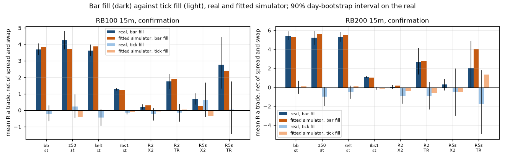
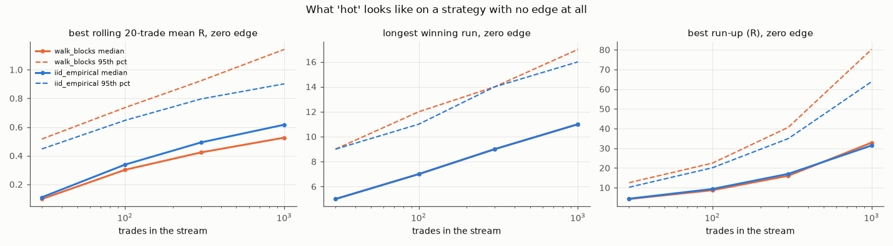

# Desk summary, 2026-10-04 to 2026-10-06: what died, what's alive, what to watch

This page is a synthesis of the studies run over these three days, and it measures nothing new. Each
line links to the doc that holds the numbers, methods and caveats. [findings.md](findings.md) is the
synthesis of the program up to 2026-09-30, and this page continues it.

**In one paragraph.** Across turns, zones, structure, sweeps, indicators, fuzzy rules, mean
reversion, public EAs, PCA residuals and the desk's own LRC setup, no direction rule beats matched
random walks after costs on any asset class. Two signals passed frozen checks on data they weren't
found on: DISPLACE_C at a 12-bar low on crypto 1d, and the BTC "market mirror". Both turned out to be
the crypto market factor, timed. Neither beats holding BTC as a book, and both are now being scored
forward. Two measurement lessons came out of these days, and both change how future studies must run:
1. On jump instruments, stops have to be filled on ticks.
2. Pausing a strategy on its recent results adds nothing; keep or kill it on its whole record.

## How to read "matches the walks"

On a martingale, a trade reaches +N R before −1R with probability 1/(N+1). A rule whose P(N R) sits on
its matched iid and GARCH walks therefore has zero edge before costs, and loses the cost. That is a
measurement of no edge, not a claim that the pattern doesn't exist. See
[walks-and-edge.md](walks-and-edge.md).

For models that read chart shape, report three parts: skill on walks (what any chart shows), real minus
walk (**behavioural skill**, the only place traders acting on those shapes can show), and the trade after
costs. See [walks-and-edge.md](walks-and-edge.md#models-that-read-chart-shape-the-chart-reader-and-the-crowd).

## Alive, and being watched

| signal | evidence | doc | status |
|---|---|---|---|
| DISPLACE_C at a 12-bar low, structure exit, crypto **1d** | +0.142R [+0.015, +0.280] on 58 fresh coins; +0.112R on 73 more; +0.169R on the original 12. It is all market factor (coin residual −0.016R). | [turn-follow-ups.md](turn-follow-ups.md) §5–6 | paper log on the lab; **Tier A** alerts in the mcfl service |
| BTC market mirror: buy BTC on the alts' daily DISPLACE_C long; exit with the alt's trade | +371 bps a trade [+32, +706] on 12 source coins; **+281 bps [+75, +530] on 274 unseen perps** (random-day twin +55) | [turn-follow-ups.md](turn-follow-ups.md) §6 | forward bar: M1 net > 0 after ≥ 100 signals; one BTC alert card a day |
| DISPLACE_C inside the coin's own Weinstein Stage 2/4 (DCS), crypto 1d | +0.188R [+0.023, +0.339] on 131 fresh coins, which narrowly fails Holm (p 0.030 vs 0.025); +0.246R [+0.092, +0.374] on 274 unseen coins. Mostly shorts and a few crash days. Basket +230 bps, BTC −1 bps. | [crypto-daily-trend.md](crypto-daily-trend.md) | candidate for a frozen forward test on the basket |
| Stage 2/4 with a BTC-uptrend filter, 12 large coins | book Sharpe 1.10 against BTC buy-and-hold's 0.91 (difference +0.19 [−0.55, +0.97]); max drawdown −46% against −77% | [crypto-daily-trend.md](crypto-daily-trend.md) | candidate for a frozen forward test |

**Crypto trend weakens from 1d to 15m, and from large coins to small.** Every 15m cell loses, and no
other asset class earns. What the alt signals earn is the alt market's swings, timed. On individual
alts after taking out the market, nothing is left.

## Dead: frozen tests that failed

| idea | result | walks / control | doc |
|---|---|---|---|
| Turn-origin zones | −0.233R; corrected side −0.256R | −0.236 / −0.202 | [turn-follow-ups.md](turn-follow-ups.md), [turn-retrade.md](turn-retrade.md) |
| Counter-candle zones (a red among greens) | −0.125R | −0.161 / −0.145 | [turn-follow-ups.md](turn-follow-ups.md) |
| Fresh, long-waiting untested levels ("the market comes back") | price returns to 95–96% of zones, as on walks; 12/12 frozen verdicts fail (−0.18 to −0.19R) | same return rate on walks | [turn-follow-ups.md](turn-follow-ups.md) |
| Turn trades T2/T_any, BREACH_REVERT side corrected | −0.113R / −0.147R | −0.099 / −0.132 | [turn-retrade.md](turn-retrade.md) |
| Predicting a BOS before it happens | the side is geometry (AUC 0.75, the same on walks); timing gains ≤ +0.004 AUC | same on walks | [bos-predict.md](bos-predict.md) |
| TradingView indicators (Levels Likely to Break, Weinstein, FVG Magnet) and clustered levels | every primary fails; real levels hold 0.58 vs 0.565 on walks | | [tv-indicators.md](tv-indicators.md) |
| Fuzzy-logic rules | −0.110R; learned rules AUC 0.508 vs logistic 0.504 | −0.150 / −0.122 | [fuzzy-logic.md](fuzzy-logic.md) |
| Tail scan of MCFL words | real 4h/1d tail excess, which holds unseen but loses after costs | | [tail-scan.md](tail-scan.md) |
| Sweeps, protected highs/lows, broken zones | −0.021R over 65,104 trades; 0 of 2,629 cells survive BH | sweep rates 0.94–1.02× walks | [sweeps.md](sweeps.md) |
| Mean reversion (12 rules, pairs, FX gap fade) | every rule loses after costs; the gap fade is −0.41R on ticks | rules earn on built-to-revert controls | [mean-reversion.md](mean-reversion.md) |
| geraked MT5 EAs | no signal edge; the grid's profit equals the walks' | | [geraked-eas.md](geraked-eas.md) |
| PCA residual stat-arb | net Sharpe −0.97 [−1.59, −0.30]; crypto is about one bet | | [pca-residuals.md](pca-residuals.md) |
| The desk's LRC break-and-retest (R1) | −0.291R over 167,501 trades; P(2R) 0.320 | −0.274 / −0.275 | [lrc-retest.md](lrc-retest.md) |
| Production fade-to-value, replayed through its own code | −0.148R over 30,779 trades; the reverse side −0.167R | −0.173 / −0.122 | [lrc-retest.md](lrc-retest.md) |
| Fade-to-value tuned to the structures service | best in sample +0.028R, below the same search on a walk (+0.132R); unseen classes −0.133R | | [ftv-tuning.md](ftv-tuning.md) |
| Range Break 100/200 rules | +3.69R on bars, **−0.199R on ticks**; RB200 +0.008R on ticks | fitted simulator reproduces both | [range-break-100.md](range-break-100.md) |
| Boom/Crash spikes following the 1m–1d trend | hazard ratio 1.0006 [0.995, 1.006]; 0 of 772 cells survive BH; a planted 1.25× effect is recovered | constant-hazard null 0.998 | [boomcrash-trend.md](boomcrash-trend.md) |
| Crypto trend combination, at least 2 of 4 signals agreeing | +0.058R [−0.025, +0.143] | +0.042 / +0.030 | [crypto-daily-trend.md](crypto-daily-trend.md) |

## Measurement lessons now standing

1. **Fill stops on ticks on jump instruments.** On Range Break, 98% of stops are jumped. The real fill
   averages −7.8R, while a bar replay fills at −1R, which is how the earlier "+3R survivors" arose.
   The same error produced every positive Deriv cell in the turn re-run. On Boom/Crash the stop is
   walked into, not jumped, so the spike is the exit.

   

2. **Price any reopen or gap on ticks.** MT5 reopen bar opens are wide-spread bid quotes. The FX gap
   fade went from +0.46R on bars to −0.41R on ticks ([mean-reversion.md](mean-reversion.md)).
3. **Check every conditioning flag's knowable time.** On Boom/Crash, a trend read from the bar that
   contains the spike shows a fake 1.8% lift, which the null reproduces. Read causally, it vanishes
   ([boomcrash-trend.md](boomcrash-trend.md)).
4. **Use a minimum risk of 0.25 ATR.** Near-zero-risk entries once produced −52,000R.
5. **Exclude the alt-coin crypto CFD 15m/30m feed since 2025-08.** It has a coarse price grid and no
   spread, so one tick reads as 5R ([tail-scan.md](tail-scan.md)).
6. **Don't use 1/(N+1) as the yardstick on jump processes,** where losses exceed −1R. Compare with a
   fitted simulator of the instrument instead.

## Running the portfolio

**Never pause or resume a strategy on its recent results.** On 16 production strategies replayed over
737,691 trades, a trade's R correlates with the mean of the previous 30 at +0.009, against +0.001 to
+0.005 on walks. Every pause rule's timing value is between −0.004 and +0.002R, the same as random
pausing ([strategy-switching.md](strategy-switching.md)).

**Keep or kill on the whole record** with the repeated SPRT (mean R 0 vs +0.10R, alpha 0.05, beta
0.20). It kills a −0.15R strategy in a median of 53 closes. A hot streak isn't evidence: per 100
trades of a zero-edge strategy, the best 10-trade stretch reaches +1.1R one time in 20.

**Live scorecard, data to 2026-09-11** ([live-rescore.md](live-rescore.md)):

| strategy | closes | P&L | win rate | profit factor | mean R | SPRT |
|---|---|---|---|---|---|---|
| thesis-only | 360 | −88 | 51% | 0.96 | +0.087* | undecided |
| sweep-aware | 161 | +133 | 52% | 1.19 | +0.081 | undecided (~650 closes to decide) |
| runner | 47 | −251 | 40% | 0.40 | −0.244 | **kill** at close 24 |
| fade-to-value | 30 | −344 | 30% | 0.24 | −0.435 | **kill** at close 27 |
| confluence-scalp | 30 | −191 | 33% | 0.39 | −0.271 | undecided (~7 closes from kill) |
| snap | 29 | −210 | 28% | 0.39 | −0.369 | undecided (~4 closes from kill) |
| whole book | 688 | **−1,241** | 47% | 0.76 | −0.019 | |

\*thesis-only's mean R rests on one mis-sized close (+65.7R). Corrected, it is −0.094R and the SPRT
kills it at close 97. Its `risk_money` should be fixed at the source.

**Fade-to-value:** the live record, the replay and the tuning study all say to switch it off. That is
the operator's decision on the production host.

## In production since these studies

The **mcfl service** sends alert-only paper cards to Discord and Telegram. It is off unless
`MCFL_ENABLED=1`, and `.data/mcfl.off` pauses it without a restart.
- **Default:** the crypto reversal signal and the BTC market mirror, with their exits, on 15m to 1d.
  The mirror sends one BTC card a day.
- **Opt-in:** BOS (major swings only on 15m), sweeps and the other descriptive patterns, labelled
  "Context". CHoCH is never sent.
- **Cards show what to watch, never the method:** a generic label, an opaque tier, entry, stop and a
  chart. A test fails any card that leaks a pattern name, parameter or statistic.

## Paper logs on the lab

- **`paper_displace.py`:** the DISPLACE_C signals on the live fresh coins (4h and 1d), plus the market
  mirror scored forward. On 2026-10-06 it held 15 4h signals, none complete, and no daily long yet.
- **`paper_gapfade.py`:** records live FX reopen spreads every Sunday.

## Next, if the desk wants them

1. Frozen forward tests, in the paper log, of DCS-timed basket trades and of Stage 2/4 with the BTC
   filter on the large coins.
2. Re-score the live strategies on a fresh closes export, dropped into `.data/closes.json`. The command
   is in [live-rescore.md](live-rescore.md).
3. Exits for the 4h tail. DCS at 4h reaches 10R twice as often as walks, but the frozen exit closes too
   early to collect it. A frozen exit study on that tail is the one open lead on high R.
