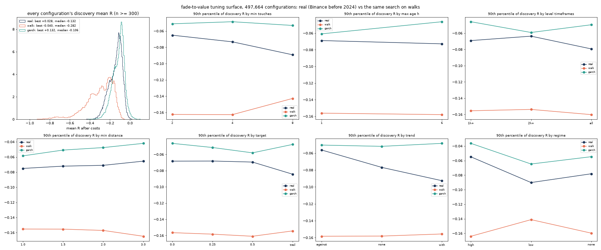
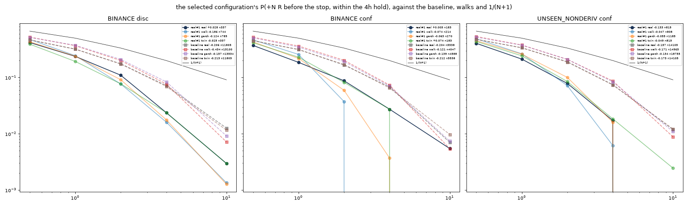
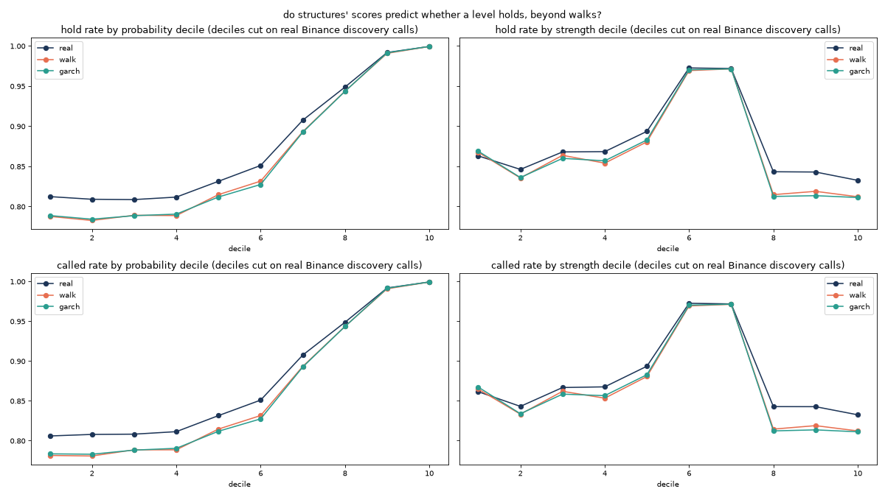

# Fade-to-value tuned to structures: the search finds nothing the walks don't

**Measured 2026-10-04.** Phase 2 of [lrc-retest.md](lrc-retest.md)'s R4b. It ran after R4b's
untuned baseline was committed and reported (`ffad2fc`). Frozen in
[`ftv_tune_rule.json`](../ideas/ftv_tune_rule.json) (`df1a483`) before any tuning run. Code:
[`ftv_tune.py`](../ideas/ftv_tune.py), reading the replay logs of [`lrc_fade.py`](../ideas/lrc_fade.py).

## The verdict

**It fails, at the first test.** The best of 497,664 configurations scores **+0.028R** in sample on
discovery data (n = 337), and the identical search on a GARCH walk scores **+0.132R** (n = 317). The
search alone manufactures more than the real data yields, so the overfitting allowance is larger
than anything the real data found. On data the tuning never saw, the selected configuration makes
+0.005R [-0.062, +0.078] on Binance 2024+ (n = 183) and **-0.133R [-0.175, -0.093]** on the unseen
non-Deriv classes (n = 815). No confirmed cell survives Benjamini-Hochberg.

**The supporting question has the same answer.** Structures' probability and strength scores do not
pick levels that hold beyond what walks produce. Real levels hold about 0.03 more often than walk
levels at every score. In the **top** probability decile that excess falls to **0.001**, and the top
strength decile is no better than the bottom.

Fade-to-value cannot be tuned into the structures service on this evidence. The mechanism the
desk's thesis needs is a quality score whose best levels hold more than chance. It is not in the
published scores, so no threshold on them can create it.

## What was searched

Every logged 15m / 30m call was re-decided offline from what production's `FadeToValue` held at that
moment: the call's features, and the valuation book within 12 vol units of spot. Value is the book
level with the most touches (ties to the nearest) among those passing the value definition. The trade
goes toward it, with production's `stop_for` and a 4-hour hold (16 15m bars).

| dimension | values |
|---|---|
| value: min touches | 2, 4 (production), 8 |
| value: min probability | 0 (production), 0.6 |
| value: min strength | none (production), the median of real discovery book levels (0.73) |
| value: max age since the book last saw it | 1h, 6h (production forgets at 6h) |
| value: the level's timeframe | any (production), 1h/2h/4h only, 2h/4h only |
| value: timeframes agreeing within 0.35 vol | 1 (production), 2 |
| max distance (vol units) | 4, 8 (production) |
| min distance (vol units) | 1, 1.5 (production), 2, 3 |
| stop clearance beyond the zone | 0.25 (production), 0.5 vol |
| stop distance | 1x (production), 2x `risk_vol` |
| target | value - 0.25 vol (production), value, value - 0.5 vol, or a 2-vol trail |
| entry timeframe | 15m, 30m, both (production) |
| LRC(100) trend on 1h | none (production), trade with it, trade against it |
| regime (structures' `vol_stretch`) | none (production), below 1, 1 or above |

That is **497,664 configurations**. Production's own settings are one of them (the "baseline").
`quality()` gates were left off (they are stateful percentile floors; R4b showed they change the
result by 0.002R). During tuning every qualifying call is a trade; confirmation also reports one open
trade per series.

**Objective (frozen).** On discovery data only, the 12 Binance perpetuals before 2024-01-01 (the
only 15m history before 2024): the highest mean R after costs with at least 300 trades, among
configurations whose P(+2R before the stop) is at or above the same configuration's on the iid walk.
The walks are tuned the same way, each against the other walk.

## Results

### Tuning, in sample (discovery)

| | configurations eligible | best mean R | n | median over all configurations |
|---|---|---|---|---|
| **real** (Binance before 2024) | 35,516 | **+0.028** | 337 | -0.132 |
| iid walk | 53,032 | -0.043 | 643 | -0.282 |
| GARCH walk | 184,072 | **+0.132** | 317 | -0.106 |

The selected real configuration: min touches 2, probability >= 0.6, any strength, seen within 1h,
**2h/4h levels only**, 1 timeframe, max 4 and min 1 vol, stop 0.5 clearance and 2x `risk_vol`,
**target the full value**, **30m entries**, any trend, **high-volatility regime**. The top five are
all variants of it: 2h/4h value levels and 30m entries in the high regime. Its in-sample interval is
[-0.040, +0.099]. The tuning surface is below. Real data sits between the
two walks along every dimension and is closer to GARCH than to iid. That says volatility clustering
is what separates real from iid, not direction.

### Confirmation (2024+, mean R after costs, 90% day-bootstrap interval)

| configuration | Binance 2024+ (same coins, unseen time) | unseen non-Deriv classes 2024+ | Volatility 1s indices | discovery |
|---|---|---|---|---|
| **selected (real #1)** | +0.005 [-0.062, +0.078], n 183 | **-0.133 [-0.175, -0.093]**, n 815 | +0.038 [-0.042, +0.116], n 239 | +0.028 |
| real #2-#5 | -0.016 to +0.017 | -0.125 to -0.134 | -0.035 to +0.041 | +0.019 to +0.027 |
| same config on its iid / GARCH walk | -0.074 / -0.063 | -0.047 / -0.056 | +0.022 / -0.070 | |
| coin twin | +0.074 | -0.049 | -0.028 | |
| untuned baseline (production's defaults) | -0.204 [-0.238, -0.168], n 5,538 | -0.157 [-0.183, -0.132], n 14,105 | -0.060 | -0.206 |
| walk-tuned (iid #1) on its own walk | -0.147 | -0.059 | -0.108 | -0.043 |
| one open trade per series: selected | +0.018 [-0.055, +0.094] | -0.135 [-0.175, -0.095] | +0.033 | +0.017 |

Against the frozen pass conditions:

- R > 0 with its interval above 0 on confirmation: **no** on both sets.
- Discovery score above the walks' best in-sample score (+0.132, the allowance): **no** (+0.028).
- Above the walks' own tuned configurations on confirmation: Binance yes (+0.005 against -0.147),
  unseen **no** (-0.133 against -0.059).
- Above the untuned baseline: yes on both sets (+0.21R and +0.02R). Mostly because it trades 30 times
  less often, at a wider stop.
- BH at q = 0.10 over the 5 configurations x 2 confirmation sets: the smallest p is 0.33. **Nothing
  survives.**

The selection does improve on production's defaults in one sense. Fewer, wider, 30m trades toward
2h/4h value cost about 0.02R less than the defaults on the unseen classes (-0.133 against -0.157)
and 0.21R less on Binance. It still loses on the unseen classes and is flat on Binance. That is cost management, not an edge. 

### Do structures' scores predict a hold? (every actionable call, non-Deriv)

HOLD = price moves 1 vol unit away from the level, on the side it arrived from, before a close 1 unit
through it, scanned on 15m bars. Deciles are cut on the real Binance discovery calls and applied
unchanged everywhere. Nearly every published call predicts a hold, so the call's own hit rate is the
same number to within 0.01.

| probability decile | 1 | 2 | 3 | 4 | 5 | 6 | 7 | 8 | 9 | 10 |
|---|---|---|---|---|---|---|---|---|---|---|
| real | 0.823 | 0.818 | 0.821 | 0.820 | 0.841 | 0.861 | 0.914 | 0.952 | 0.993 | 1.000 |
| iid walk | 0.789 | 0.782 | 0.788 | 0.788 | 0.817 | 0.833 | 0.893 | 0.944 | 0.992 | 0.999 |
| GARCH walk | 0.789 | 0.782 | 0.787 | 0.789 | 0.812 | 0.829 | 0.891 | 0.942 | 0.992 | 0.999 |
| **real - walks** | +0.034 | +0.036 | +0.033 | +0.031 | +0.026 | +0.030 | +0.022 | +0.009 | **+0.001** | **+0.001** |

| strength decile | 1 | 2 | 3 | 4 | 5 | 6 | 7 | 8 | 9 | 10 |
|---|---|---|---|---|---|---|---|---|---|---|
| real | 0.861 | 0.847 | 0.871 | 0.874 | 0.897 | 0.971 | 0.971 | 0.856 | 0.856 | 0.846 |
| walks (mean) | 0.867 | 0.835 | 0.857 | 0.854 | 0.881 | 0.970 | 0.972 | 0.813 | 0.816 | 0.810 |
| **real - walks** | -0.006 | +0.012 | +0.014 | +0.021 | +0.016 | +0.001 | -0.001 | +0.043 | +0.041 | +0.036 |

- **The rise with the probability decile is mechanical.** The walks rise identically, from 0.79 to
  0.999. A high-probability call is one the 1-unit test nearly always passes for structural reasons
  (most likely the unit and zone geometry that set the probability), random or not.
- **What is real is a flat +0.03 for real levels over walk levels.** It is the same excess the
  hold-rate study in `lrc-retest.md` found for swing and BOS levels (0.59-0.60 against 0.56). It
  *shrinks* to zero where the probability score is highest. Strength's top three deciles carry +0.04,
  but so do none of the middle ones, and the shape (0.97 at deciles 6-7 on real and walks alike) is
  geometry too.
- So the scores rank levels by how mechanically easy the hold test is, not by how much more than
  chance they hold. That is why tuning thresholds on them finds nothing that survives.

## Caveats

- **Discovery is crypto only.** The CFDs and Deriv have no 15m history before 2024, so the tuning saw
  12 Binance coins, 2019-2023. That is also why the unseen classes are a fair second test.
- **The tuning objective allows overlapping trades**; confirmation reports both. One open trade per
  series changes the selected configuration by under 0.02R.
- **Only offline decisions.** The value search re-implements production's `fair_value` and `stop_for`
  exactly on the logged books, without `quality()`, sizing or the service-level gates (see R4b in
  `lrc-retest.md` for what the replay omits).
- The hold-rate test uses each call's own vol unit, which differs by timeframe. Absolute levels are
  not comparable across deciles; the real-minus-walk column is the reading.
- The GARCH walk's in-sample best (+0.132) is the allowance used. The iid walk's (-0.043) is lower. By
  either, the real in-sample +0.028 has an interval from -0.040 to +0.099.
