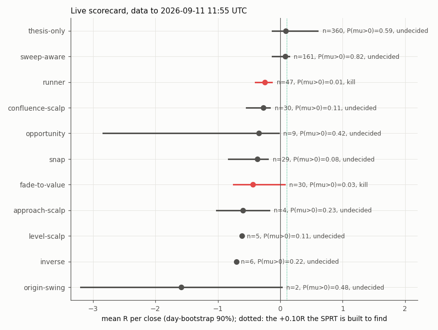
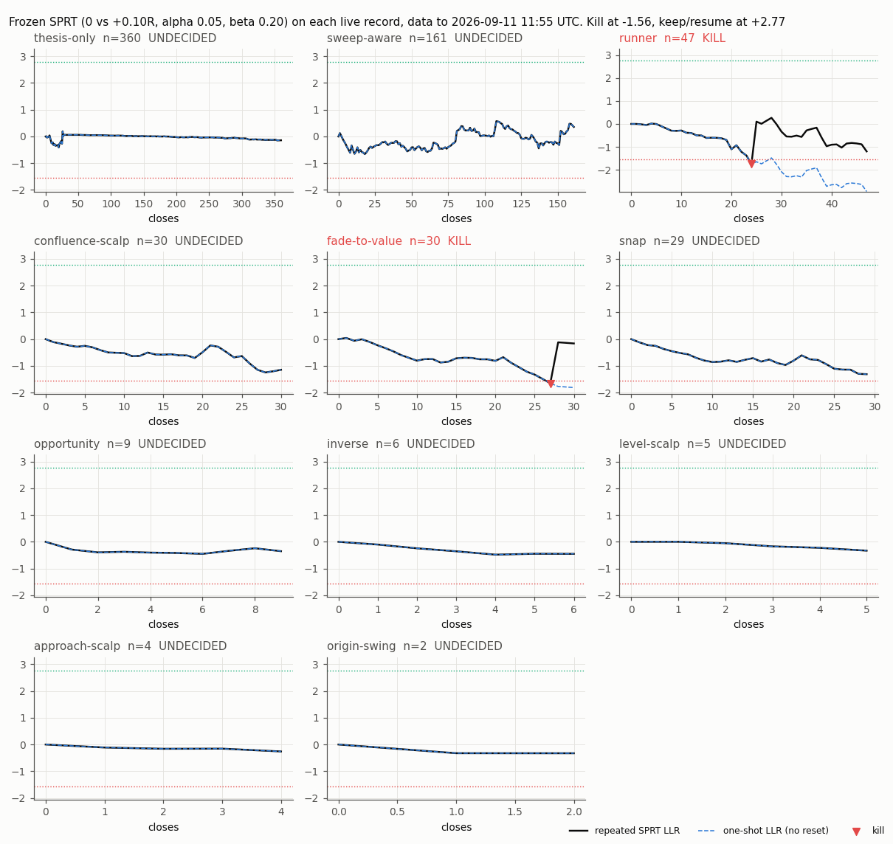
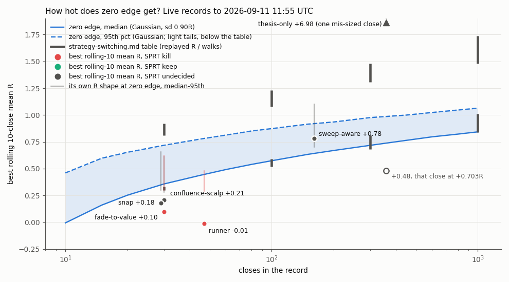

# Live scorecard: the frozen keep/kill rule on every strategy's live record

**Scored 2026-10-05. The data ends 2026-09-11 11:55 UTC.** This page applies the operating rule frozen
in [strategy-switching.md](strategy-switching.md) (section 4) to each strategy's live record. The rule is
unchanged, so nothing new was frozen: the repeated SPRT of mean R = 0 against +0.10R, alpha 0.05, beta
0.20, with the running sd of all closes, on the full record in close order. A strategy is **killed**
(paused) when the log-likelihood ratio falls to **-1.56**. It is **kept** when the LLR reaches **+2.77**,
and a killed strategy is resumed the same way. Every crossing resets the LLR.

Code: [`live_rescore.py`](../ideas/live_rescore.py). It reads closes through `switch.py`'s reader, which
now takes a journal database as well as the export. Tests: [`test_live_rescore.py`](../ideas/test_live_rescore.py).

## What the desk asked, and what this data can answer

The desk said fade-to-value was "hot" on **2026-10-04**. **That day is not in the data.** No file on this
machine holds a close after 2026-09-11. Every local source was checked:

| source | trade closes | first | last |
|---|---|---|---|
| `.data/closes.json` (the desk's export) | 688 | 2026-08-26 12:46 | **2026-09-11 11:55** |
| `.data/tmp/journal.db` (the journal the export came from) | 688, identical to the export | 2026-08-26 | 2026-09-11 11:55 |
| `.data/journal/journal.db` (file modified 09-15) | **0**: only `structures` entries (level outcomes and decisions), which end 2026-08-26 | - | - |
| `.data/journal/fresh.db` | 28, all also in the export | 2026-08-26 | 2026-08-27 13:30 |
| anything else under `.data/` | no closes newer than 09-11 | | |

The 09-15 timestamp on `journal.db` is a file write, not a newer close. No closes past 09-11 were made up.
**This scorecard covers 2026-10-04 only after a newer export is dropped into `.data/closes.json`** (or a
newer journal is added; see [Refresh](#refresh)).

## The scorecard (data to 2026-09-11)

683 attributed closes in 11 strategies. Five closes carry no strategy and are left out. R per close
follows the frozen definition: `r_multiple`, else profit / `risk_money`, else profit / the strategy's
median risk. The interval is a day bootstrap (90%). The posterior uses a N(0, 0.10²) prior.

| strategy | closes | mean R [90%] | P(mean R > 0) | SPRT LLR now | **state** | killed at | closes to the next decision at this mean |
|---|---|---|---|---|---|---|---|
| thesis-only | 360 | +0.087 [-0.129, +0.601] | 0.59 | -0.14 | **undecided** | - | ~9,950 (sd 3.5R, see below) |
| sweep-aware | 161 | +0.081 [-0.129, +0.145] | 0.82 | +0.36 | **undecided** | - | ~650 (toward keep) |
| runner | 47 | -0.244 [-0.398, -0.132] | 0.014 | -1.20 (after reset) | **kill** | close 24, **2026-09-01** 08:07 | never resumes at this mean |
| confluence-scalp | 30 | -0.271 [-0.540, -0.163] | 0.11 | -1.15 | **undecided** | - | ~7 (toward kill) |
| fade-to-value | 30 | -0.435 [-0.750, +0.068] | 0.035 | -0.16 (after reset) | **kill** | close 27, **2026-09-04** 14:48 | never resumes at this mean |
| snap | 29 | -0.369 [-0.825, -0.196] | 0.083 | -1.31 | **undecided** | - | ~4 (toward kill) |
| opportunity | 9 | -0.339 [-2.840, -0.026] | 0.42 | -0.35 | undecided (< 25 closes) | - | ~31 |
| inverse | 6 | -0.700 (one day) | 0.22 | -0.45 | undecided (< 25) | - | ~15 |
| level-scalp | 5 | -0.610 (one day) | 0.11 | -0.33 | undecided (< 25) | - | ~19 |
| approach-scalp | 4 | -0.599 [-1.018, -0.178] | 0.23 | -0.26 | undecided (< 25) | - | ~20 |
| origin-swing | 2 | -1.585 [-3.196, +0.027] | 0.48 | -0.33 | undecided (< 25) | - | ~8 |

- **Killed: fade-to-value (09-04) and runner (09-01).** These are the same closes and dates that
  strategy-switching.md reported. Both LLRs reset at the kill and have drifted down since, so neither
  is close to the +2.77 needed to resume. At their current means they never get there.
- **No strategy is kept.** None has reached +2.77. sweep-aware is the nearest, at +0.36. At its
  +0.08R mean it needs about 650 more closes, consistent with the switching study's finding that an
  edge below +0.10R takes hundreds of closes to decide.
- **Three are a few closes from a kill:** snap (about 4 closes at its mean), confluence-scalp (about 7)
  and opportunity (about 31, with only 9 closes so far). snap's last close was 2026-08-28.
- **thesis-only is undecided only because of one close.** That close is +622.63 on a `risk_money` of
  9.47, which the frozen R definition reads as **+65.7R**. [convexity.md](convexity.md) measured it at
  +0.703R. The outlier lifts the running sd to 3.5R and flattens the SPRT. As a reading beside the rule
  (the rule itself is unchanged), with that one close at +0.703R, thesis-only's mean is **-0.094R** and
  the SPRT **kills it at close 97 (2026-09-02)**. The desk should correct that close's `risk_money` at the
  source. The rule will then act on thesis-only.



## The SPRT path per strategy

Solid line: the repeated LLR the rule acts on. Dashed line: the one-shot LLR (no reset), shown for
display only. Dotted lines: the kill boundary (-1.56) and the keep/resume boundary (+2.77).



## Was any stretch "hot" beyond what zero edge produces?

The figure shows each strategy's best rolling 10-close mean R against what a strategy with **no edge**
shows over a record of the same length. Three zero-edge references are drawn:

- **Blue band:** Gaussian, sd 0.90R (the pooled replayed production sd), median to 95th percentile.
- **Grey bars:** strategy-switching.md's table (replayed R and walks, 30 to 1,000 trades). Their tails
  are heavier, so their 95th percentile is higher.
- **Thin line at each point:** the strategy's own closes, centred to zero and resampled. This is the same
  R shape with the edge removed.

| strategy | closes | best rolling-10 mean R (window) | zero edge, own shape: median / 95th | share of zero-edge records at least this hot |
|---|---|---|---|---|
| thesis-only | 360 | +6.98 (08-30 to 08-31) | +6.52 / +6.90 | 0.03 own shape. This is the one mis-sized close: with it at +0.703R, **+0.48**, below the zero-edge median (+0.73 Gaussian) |
| sweep-aware | 161 | +0.78 (09-11) | +0.70 / +1.10 | 0.35 (Gaussian 0.19) |
| runner | 47 | -0.01 (09-02) | +0.29 / +0.48 | 1.00 |
| confluence-scalp | 30 | +0.21 (09-04 to 09-08) | +0.28 / +0.61 | 0.66 |
| fade-to-value | 30 | +0.10 (08-28 to 09-02) | +0.30 / +0.63 | 0.86 |
| snap | 29 | +0.18 (08-28) | +0.30 / +0.66 | 0.74 |

**No strategy has a stretch hotter than zero edge produces, apart from the mis-sized close.**
sweep-aware's best stretch, ten closes on 2026-09-11, is near the median of what a zero-edge
record of 161 closes shows. Fade-to-value's best 10-close stretch in the export, +0.10R, sits below the
zero-edge median of +0.30R. That is a stretch zero edge exceeds 86% of the time. A zero-edge strategy
traded 30 times shows a +0.3R stretch half the time and a +0.7 to +0.9R stretch one time in twenty. A
hot day on 2026-10-04 would have to beat that envelope, at fade-to-value's record length by then, before
it said anything. Even then it would move the SPRT by only its own closes' worth of evidence: a close at
+1R adds about +0.16 to the LLR at sd 0.76R, and fade-to-value needs **+2.77 from a reset** to resume.



## Tails

Realised R at or above N, per close. These are closes, not first passage, so the shares are not
comparable to 1/(N+1) (0.50 / 0.20 / 0.09). The live exits are short scalps, and few closes run far.

| strategy | closes | R >= 1 | R >= 4 | R >= 10 |
|---|---|---|---|---|
| thesis-only | 360 | 0.050 | 0.003 | 0.003 (the mis-sized close) |
| sweep-aware | 161 | 0.087 | 0.006 | 0 |
| runner | 47 | 0 | 0 | 0 |
| confluence-scalp | 30 | 0.067 | 0 | 0 |
| fade-to-value | 30 | 0.033 | 0 | 0 |
| snap | 29 | 0.069 | 0 | 0 |
| all attributed | 683 | 0.057 | 0.003 | 0.001 |

The replayed P(N R) against 1/(N+1) and the walks is in strategy-switching.md. Every production strategy
sits on its walks there, with no tail excess.

## Reading the two formats

`switch.py`'s `read_closes` takes the export (a JSON list) or a journal database (SQLite `entries`). In
the database, a close is an entry by actor `trading` of kind `outcome` (attributed) or `observation`
(unattributed) whose context carries `profit`. `CLOSES` also takes several sources, comma-separated.
They are merged and each close counts once, keyed on time and title. The tests check that:

- the export and a journal built from the same closes give identical records and identical R streams;
- merged overlapping sources count each close once;
- on the desk's files, `.data/closes.json` equals `.data/tmp/journal.db` close for close (688), and every
  close in `.data/journal/fresh.db` matches the export's;
- the step-by-step SPRT trace is the frozen rule's `switch.states` state for every close;
- the Gaussian zero-edge median matches strategy-switching.md's table at 30, 100 and 300 closes.

The scorecard computed from the export alone is byte-identical to the one computed from all four sources.

## Refresh

Drop the newer export into `.data/closes.json`, then run from the checkout root:

```
CLOSES=.data/closes.json OUT=.data/live_rescore IMG=research/docs/img/live-rescore python3 research/ideas/live_rescore.py
```

The command prints the data's end date first. `scorecard.csv` and `events.csv` (every kill, keep and
resume, with its close number and date) go to `OUT`, and the three figures go to `IMG`. To add a newer
journal rather than an export, set `CLOSES=.data/closes.json,<path/to/journal.db>`. The run needs numpy,
pandas and matplotlib. The system `python3` has all three; the repo `.venv` lacks matplotlib, so use
`PLOTS=0` there for the tables only. Tests:
`TI_DATA=.data python3 -m pytest research/ideas/test_live_rescore.py`.

## Caveats

- **This is the taken record, not the full shadow record** the rule is specified on. The export holds
  the trades production took. The untaken (shadow) outcomes are not in any local file. Strategies
  that were paused or skipped by production's gates are scored on fewer closes than the rule would see.
- **Records are short.** Eleven strategies have 2 to 360 closes spread over 16 days. Five have fewer
  than the 25 closes the switching study's live table required. They are scored and flagged.
- **Closes from the same day are not independent.** Concurrent trades on correlated feeds win and lose
  together (strategy-switching.md, section 1). The day bootstrap allows for this. The SPRT, as frozen,
  does not.
- **One mis-sized close** (thesis-only) is read under the frozen R definition. The corrected reading is
  reported beside it, and the rule is unchanged.
