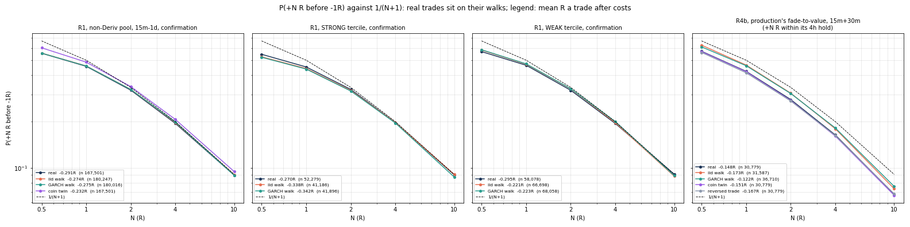
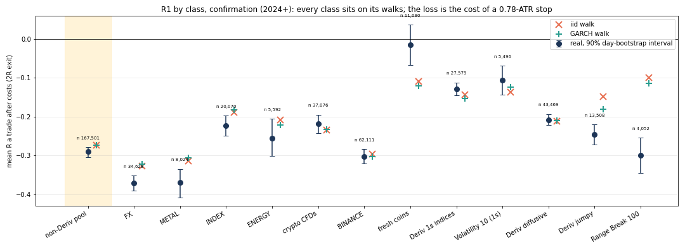
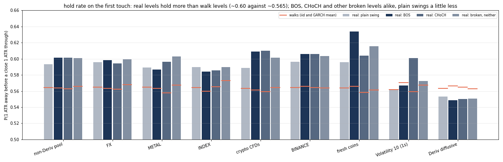
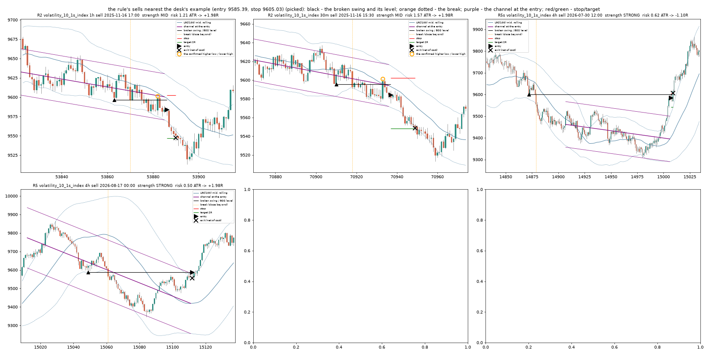
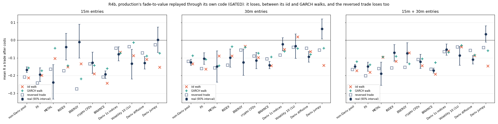

# The desk's LRC break-and-retest setup: no edge before costs, a cost drag after them

**Measured 2026-10-04.** Frozen in [`lrc_rule.json`](../ideas/lrc_rule.json) before any real-data run
(commit `293decc`). The strength terciles, R5 and the hold-rate study were added at the desk's request
the same day, also before the run. R4b (production's own `fade-to-value`) is an addendum frozen in
`18b92ed` before its own run. Code: [`lrc_retest.py`](../ideas/lrc_retest.py) (R1-R5) and
[`lrc_fade.py`](../ideas/lrc_fade.py) (R4b), with tests in
[`test_lrc_retest.py`](../ideas/test_lrc_retest.py).

## The verdict

| | verdict |
|---|---|
| **R1** (primary, P1) | **fails.** Non-Deriv pool, 15m-1d, 2R exit, confirmation: **-0.291R [-0.304, -0.279]**, n = 167,501. Discovery -0.245R. iid walk -0.274R, GARCH walk -0.275R, coin twin -0.232R. P(+N R before -1R) is 0.456 / 0.320 / 0.195 / 0.090 at N = 1, 2, 4, 10, against 0.5 / 0.333 / 0.2 / 0.091 for 1/(N+1) and the same on the walks. The setup matches the walks: **no edge before costs**. The mean R is the cost of a tight stop (median 0.78 ATR). |
| **R1 STRONG** (co-primary, P2) | **fails.** -0.270R [-0.287, -0.253], n = 52,279; discovery -0.247R. It does what the desk said *relative to the walks*: STRONG minus WEAK is +0.025R on real data against -0.117R (iid) and -0.119R (GARCH) on walks, and the same sign on discovery (-0.008R against -0.100R). But the strong tercile still loses 0.27R a trade, and its P(2R) is 0.323 against 0.318 on walks. |
| **R2** (the higher low / lower high) | -0.164R [-0.186, -0.142], below both walks (-0.122, -0.126). No edge. |
| **R3** (the published RSI + LRC strategy) | -0.483 ATR [-0.728, -0.228] a trade (no stop, as written), against -0.108 / -0.165 on walks. Buying the lower band with RSI < 30 lost most on crypto (Binance -0.74, fresh coins -0.77) and metals (-0.86). |
| **R4** (fade to value, the contrast case) | -0.191R [-0.208, -0.172], walks -0.179 / -0.186. Matches the walks. FX alone is mildly better than its walks (-0.163 against -0.224; P(2R) 0.343). |
| **R5** (an earlier BOS / CHoCH level) | -0.389R [-0.403, -0.373] at 2R, walks -0.363 / -0.366. The sweep-then-reject variant R5s: -0.256R [-0.278, -0.237], walks -0.284 / -0.284. |
| **R4b** (production's own fade-to-value, replayed through its code) | -0.148R [-0.160, -0.136] over 30,779 replayed trades (non-Deriv, 15m/30m), between the iid (-0.173) and GARCH (-0.122) walks. The reversed trade loses too (-0.167). It loses as it did live (-0.573R over 30 closes), but less, and no more than chance: no anti-edge. |
| **Hold rates** | Real levels hold more than walk levels, and BOS / CHoCH levels hold a little more than plain swings: **0.601 / 0.601 against 0.593** (walks 0.562-0.566). But *every* broken level holds 0.601, BOS, CHoCH or neither, so the break type adds nothing. The excess does not turn into a profitable trade (R5). |
| **Volatility 10 (1s)** | Exactly a walk, as it should be. R1: -0.107R confirmation (walks -0.137 / -0.124), P(2R) 0.335 against 1/3. Every rule's P(N R) sits on 1/(N+1) and on its walks. |
| **Multiplicity** | 1,142 secondary cells (rule x exit x class x timeframe, confirmation). After Benjamini-Hochberg at q = 0.10, **9 survive, all on Range Break 100** (R2 and R5s). That instrument is a range generator, not a market, and its walks are the wrong null for it (see below). No market cell survives. |

**In plain words.** The rule finds the setup the desk draws: a trend from the regression channel, a
close through a confirmed swing, a return to the broken level, a stop just beyond the pullback. On
data it was not tuned on, that setup reaches +2R before -1R 32.0% of the time, against 33.3% on a
coin toss and 32.4% on matched random walks. The trend filter, the break and the retest add nothing
to the hit rate. The tight stop that makes a 2R target look attractive also makes the spread a large
fraction of every R. After costs the setup loses about 0.29R a trade. Strong moves into and out of
the break help a little against the walks, but nowhere near enough to pay.

## The setup, in plain words

- **Trend.** A linear regression channel over the last 100 closes. Its slope says up or down.
- **Break.** In a downtrend (mirror for up), price closes below the last confirmed swing low. That is
  the break of structure (BOS) in the trend's direction.
- **Retest.** Price pulls back up to the broken level, which now acts as resistance. The desk calls
  this the "second entry". Sell there.
- **Stop and target.** The stop goes just above the pullback's high ("a little bit above the perfect
  entry spot"). The target is about 2R. The desk's example on Volatility 10 (1s) at M15/M30 was
  sell 9585.39, stop 9605.03, target 9541.50 (about 2.2R).
- **The case the desk lost on:** "saw a sell, fade to value, took a buy". A counter-trend buy at the
  channel's lower band (value) against the down move. Tested as R4, as the comparison.

## The indicator, as the references define it

| reference | what it computes |
|---|---|
| TradingView efXI515C (LonesomeTheBlue) | `get_channel(src, len)`: least squares through the last `len` (default **100**) values of `src` (close); `slope = linreg(src, len, 0) - linreg(src, len, 1)`; `dev` = root-mean-square residual about the line (divided by `len`); bands at +/- `devlen` x dev (default **2**). Trend = sign(slope): up colour when slope > 0, alerts when the sign flips. (Its residual loop indexes the line one bar off; ours uses the exact residuals.) |
| "Linear Regression Channel / Curve / Slope by DGT" (ropVPOmR) | Two channels, counts **200** and **50**, least squares on close, deviation = residual sd (divided by `len - 1`), bands at **1, 2 and 3** sd. The "curve" is `ta.linreg(close, 50, 0)`, the regression's endpoint rolled bar by bar, with optional stdev(21) or ATR(13) bands. Trend colour: red when the channel's start is above its end. Slope arrows: `correlation x stdev(close) / stdev(bar_index)` over 5 bars. |
| Orbex, "The Art of Probability: Regression Channels" (2026/03) | A line of best fit with **2-sd** bands ("95% of prices"). Pearson's R as a trend-quality filter: near 0 is chop (don't trade), beyond +/-0.8 is a clean trend. Buy the lower band or the median in an uptrend, never short the upper band of a steep up channel. An overshoot that closes back inside the band is the reversion signal. No lengths or stops given. |
| Medium, "RSI and Linear Regression Channel trading strategy" (redsword_23261, from FMZ) | Pine v5: `basis = ta.linreg(close, 100, 0)`, `dev = ta.stdev(close, 100)` (the sd of the **closes**, not of the residuals), bands basis +/- 1 dev; long when `close <= lower and RSI(14) < 30`; the long is closed when `close >= upper and RSI(14) > 70`. No stop ("does not consider risk management"). The text describes the sell mirror, the code only closes the long. |

**What this study uses.** LRC(L) at bar t is the least-squares line through closes t-L+1..t. The
midline is its value at t, which is the rolling endpoint (`ta.linreg(close, L, 0)`, the DGT curve).
The bands are midline +/- 2 x the RMS residual (efXI515C). The trend is the sign of the slope, with
L = 100 (efXI515C's default) and the variants 50 and 200 (DGT's two). Only closes up to t enter, so
the value at t is known at t's close. Tested against `np.polyfit` and a hand-computed regression
(closes 1, 3, 2, 5: slope 1.1, endpoint 4.4, RMS residual sqrt(0.675)).

## The frozen rules (long side; every rule also runs on the flipped chart)

- **Swings:** a 3/3 pivot, as MCFL's EXTREME, known 3 bars later. Labels and structure state follow
  MCFL v2 (`structure.py`): HH/LH/EH, LL/HL/EL with 0.1 ATR tolerance, state UP / DOWN / MIXED,
  established after 2 labels.
- **R1 (primary):** LRC(100) up at the break bar. The break is the first close above the most recent
  confirmed swing high. Then a buy limit at the broken level for 20 bars, filled at min(open, level),
  cancelled by the next break. **Stop:** min(level, the lowest low from the break to the bar before
  the fill) - 0.1 ATR; trades with risk under 0.25 ATR are skipped. **Exits:** X2, a fixed 2R target
  (primary); TR, a 2-ATR trail; BAND, the opposite LRC band. Cap: 100 bars.
- **R2:** the first confirmed swing low after the break, within 20 bars, labelled HL and within 1 ATR
  of the level. Bought at the open after it is known; stop 0.1 ATR below it.
- **R3:** the Medium strategy as written (above), with R in units of 1 ATR and a 500-bar cap.
- **R4:** LRC(100) down; the first touch of the lower 2-dev band; buy limit at the band; stop 1 ATR;
  exits 2R, trail, or the midline ("value").
- **R5:** every BOS-up and CHoCH-up level (a broken swing high), live from its own break, within the 10
  most recent of its type, for 500 bars. It arms 20 bars after the break (beyond R1's window) once
  price is above it, and is bought on the first touch in an LRC uptrend, stop 0.5 ATR below.
  **R5s:** the touch bar wicks below the level and closes back above; buy the next open, stop below
  that wick.
- **Strength (amended before the run):** before = the leg into the broken swing (size in ATR and
  ATR per bar); after = the displacement through the break, up to the bar before the entry (size and
  speed). Score = the sum of the four percentile ranks against the real non-Deriv R1 discovery trades
  of the same timeframe. Terciles are cut on those same trades and applied unchanged everywhere,
  walks included.
- **Costs:** the broker's spread floor (the median bar spread where the floor is 0); the 1s indices'
  tick spread; Binance 0.07%; 0.05 ATR slippage on every stop. Series whose cost exceeds 0.5 ATR are
  dropped: 24 of 580 real series, all thin alt-coin CFDs plus the 15m/30m of USDCNH, XPT and XPD.
- **Fills on the entry bar** follow the usual OHLC path convention: up bars run O-L-H-C, down bars
  O-H-L-C. A limit bought while price fell counts the post-fill low (a stop there is a loss) and,
  on an up bar, the post-fill high.
- **Nulls:** an iid and a GARCH(1,1) walk matched to each series (256 sub-steps a bar, real timestamps,
  the real cost in ATR units), and a coin twin (the same fill, entry and risk on a random side).
- **P(N R):** the share of trades reaching +N R before -1R within 1000 bars, gross of cost.

## Data

| class | series | timeframes and history |
|---|---|---|
| FX | 12 MT5 pairs | 15m/30m from 2024-07; 1h from 2020; 4h from 2018; 1d from 2002 |
| METAL | XAU XAG XPT XPD XCU | the same (XCU from 2026-01) |
| INDEX / ENERGY | 7 indices; US Oil, Brent | 15m/30m from 2024-07; 1h/4h/1d from 2024-01 |
| CRYPTO_CFD | BTC ETH SOL at every timeframe; 32 alt-coin CFDs at 1h/4h/1d | from 2018-2024 |
| BINANCE | 12 perpetuals | 15m/30m/1h/4h/1d from 2019-2020 |
| FRESH | 58 coins | 4h/1d (extra confirmation) |
| DERIV_1S | Volatility 10/25/50/75/100 (1s), fetched read-only into `data/lrc_bars.db` | 15m from 2024-01 (the bridge serves at most ~100k bars a request), 30m from 2021-10, 1h/4h/1d from 2019-09 (10, 100) and 2020-06 (25, 50, 75) |
| DERIV_DIFFUSIVE / JUMPY / RANGE_BREAK | the broker DB's synthetics | 15m from 2024-07 or 2025-02 |
| KNOWN_BAD | the 32 alt-coin CFDs at 15m/30m (from 2025-08) | reported apart, never pooled |

30m is resampled from 15m where the source has none. The split is at 2024-01-01: discovery before it,
confirmation after.

## Results

### R1 by class, 2R exit, confirmation (mean R after costs; P from the real trades)

| class | n | real | 90% interval | iid walk | GARCH walk | coin twin | P(2R) | P(4R) | P(10R) |
|---|---|---|---|---|---|---|---|---|---|
| **non-Deriv pool** | 167,501 | **-0.291** | [-0.304, -0.279] | -0.274 | -0.275 | -0.232 | 0.320 | 0.195 | 0.090 |
| FX | 34,628 | -0.372 | [-0.391, -0.352] | -0.328 | -0.323 | -0.288 | 0.315 | 0.188 | 0.085 |
| METAL | 8,024 | -0.370 | [-0.408, -0.335] | -0.314 | -0.307 | -0.299 | 0.311 | 0.191 | 0.092 |
| INDEX | 20,070 | -0.223 | [-0.249, -0.197] | -0.189 | -0.182 | -0.153 | 0.314 | 0.192 | 0.088 |
| ENERGY | 5,592 | -0.255 | [-0.301, -0.206] | -0.209 | -0.221 | -0.192 | 0.311 | 0.191 | 0.085 |
| CRYPTO_CFD | 37,076 | -0.218 | [-0.243, -0.195] | -0.235 | -0.233 | -0.172 | 0.324 | 0.198 | 0.091 |
| BINANCE | 62,111 | -0.303 | [-0.321, -0.284] | -0.296 | -0.303 | -0.256 | 0.324 | 0.198 | 0.093 |
| FRESH (4h/1d) | 11,090 | -0.016 | [-0.067, +0.037] | -0.110 | -0.121 | -0.062 | 0.356 | 0.215 | 0.095 |
| DERIV_1S | 27,579 | -0.129 | [-0.146, -0.112] | -0.144 | -0.154 | -0.101 | 0.329 | 0.200 | 0.092 |
| **Volatility 10 (1s)** | 5,496 | **-0.107** | [-0.144, -0.070] | -0.137 | -0.124 | -0.085 | 0.335 | 0.202 | 0.089 |
| DERIV_DIFFUSIVE | 43,469 | -0.208 | [-0.222, -0.194] | -0.213 | -0.210 | -0.142 | 0.325 | 0.201 | 0.093 |
| DERIV_JUMPY | 13,508 | -0.246 | [-0.272, -0.221] | -0.149 | -0.181 | -0.069 | 0.294 | 0.189 | 0.089 |
| RANGE_BREAK 100 | 4,052 | -0.300 | [-0.345, -0.255] | -0.099 | -0.114 | +0.151 | 0.258 | 0.182 | 0.100 |
| KNOWN_BAD | 39,579 | -0.295 | | -0.310 | -0.330 | -0.266 | 0.334 | 0.204 | 0.094 |
| 1/(N+1) | | | | | | | 0.333 | 0.200 | 0.091 |

### R1, non-Deriv pool, by timeframe (confirmation)

| | 15m | 30m | 1h | 4h | 1d |
|---|---|---|---|---|---|
| real | -0.358 | -0.278 | -0.229 | -0.132 | -0.072 |
| iid walk | -0.325 | -0.250 | -0.239 | -0.169 | -0.108 |
| GARCH walk | -0.323 | -0.260 | -0.236 | -0.168 | -0.114 |
| n | 75,905 | 37,550 | 41,556 | 10,578 | 1,912 |
| P(2R) real | 0.319 | 0.316 | 0.322 | 0.329 | 0.338 |

The loss shrinks as the timeframe grows only because the spread is a smaller share of a wider ATR.
At 4h and 1d the real trades sit a little above the walks (+0.04R), with intervals that include
the walks: [-0.177, -0.091] at 4h and [-0.152, +0.015] at 1d.

The other exits change nothing: the trail gives -0.281R (walks -0.260 / -0.263) and the opposite
band -0.285R (walks -0.267 / -0.271). The trend length does not matter either: LRC(50) gives -0.289R
and LRC(200) -0.289R. Every rule's P(N R) curve per class and timeframe is in
`.data/lrc/lrc_pnr_R*.png`.

### All rules, non-Deriv pool, confirmation, 2R exit (mean R after costs)

| rule | n | real | 90% interval | iid walk | GARCH walk | twin | P(1R) | P(2R) | P(4R) | P(10R) |
|---|---|---|---|---|---|---|---|---|---|---|
| R1 | 167,501 | -0.291 | [-0.304, -0.279] | -0.274 | -0.275 | -0.232 | 0.456 | 0.320 | 0.195 | 0.090 |
| R2 | 66,312 | -0.164 | [-0.186, -0.142] | -0.122 | -0.126 | -0.165 | 0.491 | 0.329 | 0.197 | 0.087 |
| R3 (ATR units) | 40,852 | -0.483 | [-0.728, -0.228] | -0.108 | -0.165 | | 0.501 | 0.335 | 0.203 | 0.093 |
| R4 | 104,018 | -0.191 | [-0.208, -0.172] | -0.179 | -0.186 | -0.148 | 0.468 | 0.323 | 0.196 | 0.090 |
| R5 | 55,093 | -0.389 | [-0.403, -0.373] | -0.363 | -0.366 | -0.299 | 0.408 | 0.314 | 0.201 | 0.094 |
| R5s | 26,077 | -0.256 | [-0.278, -0.237] | -0.284 | -0.284 | -0.243 | 0.468 | 0.323 | 0.196 | 0.089 |

R1 against R4, side by side, is `.data/lrc/lrc_r1_vs_r4.png`. Trading with the trend at the retest
and fading to value against it both land on the walks. Neither side of the desk's dilemma has an
edge before costs. R4 loses less only because its 1-ATR stop is wider than R1's 0.78 ATR, so the
spread is a smaller share of R.

### Strength of the moves around the break (R1, 2R, non-Deriv, confirmation)

| tercile | real | 90% interval | iid walk | GARCH walk | P(2R) real | P(2R) walk |
|---|---|---|---|---|---|---|
| WEAK | -0.295 | [-0.312, -0.278] | -0.221 | -0.223 | 0.319 | 0.326 |
| MID | -0.305 | [-0.321, -0.290] | -0.287 | -0.284 | 0.317 | 0.324 |
| STRONG | -0.270 | [-0.287, -0.253] | -0.338 | -0.342 | 0.323 | 0.318 |
| STRONG - WEAK | **+0.025** | | **-0.117** | **-0.119** | +0.004 | -0.008 |

On walks a strong move into and out of the break is *worse* (-0.12R). That is mechanical; a likely
reason, not checked, is that a fast displacement leaves the stop at the break candle's extreme, and
more of those trades are stopped on the fill bar. On real data that penalty vanishes: STRONG beats WEAK by 0.025R. That is +0.14R relative
to the walks, and the same on discovery (real -0.008, walks -0.10). This is the one place the real
markets differ from the walks in this study, and in the direction the desk described. It lives
almost entirely in the mean, not the hit rate (P(2R) moves by under 0.01), and the strong tercile
still loses 0.27R a trade. R2 and R5 show no consistent tercile ordering (`lrc_strength.csv`,
`.data/lrc/lrc_strength.png`).

### Hold rates: does a BOS or CHoCH level hold more than a plain swing level?

P(price moves 1 ATR away from the level before a close 1 ATR through it), on the first touch from
the trend's side. Non-Deriv pool, every timeframe:

| level | real | iid walk | GARCH walk | n (real) |
|---|---|---|---|---|
| plain swing low | 0.593 | 0.565 | 0.564 | 1,486,052 |
| BOS level | **0.601** | 0.562 | 0.566 | 121,874 |
| CHoCH level | **0.601** | 0.563 | 0.562 | 57,324 |
| any other broken swing | 0.601 | 0.566 | 0.566 | 256,341 |

- **By age at the touch** (BOS): 0-20 bars 0.593, 20-100 bars 0.624, 100+ bars 0.630 (walks 0.561-0.571).
  Older levels hold more on real data, and not on walks.
- **With a sweep** (a wick through, a close back): BOS 0.756 against 0.720 on walks; without, 0.446
  against 0.422. The sweep itself is mechanical, since a close back above is a head start on walks
  too. The real excess (~0.03) is the same with and without it.
- **By strength tercile:** BOS STRONG 0.605, MID 0.597, WEAK 0.584 (walks 0.565-0.568).
- **With or without the LRC trend:** no difference (0.604 against 0.597).

So the desk's observation is real in this sense: broken structure levels, and old ones most, hold
somewhat more than random-walk levels (about +0.035 to +0.06). But the excess is shared by plain
swing levels (+0.028) and by every broken swing, BOS or not. The break type adds 0.008 over a plain
swing and CHoCH adds nothing over BOS. A 0.60 hold at a 1-ATR scale does not pay a trade with a 0.5-ATR
stop through the level after costs (R5 above). Range Break 100 inverts (0.33 hold): it is built to
break its range. On the diffusive Deriv indices real levels hold *less* than walks (0.55 against
0.56). Volatility 10 (1s) BOS levels: 0.567 against 0.558-0.577.

### Volatility 10 (1s), the desk's instrument

| rule (2R exit, confirmation) | n | real | iid walk | GARCH walk | P(2R) |
|---|---|---|---|---|---|
| R1 | 5,496 | -0.107 [-0.144, -0.070] | -0.137 | -0.124 | 0.335 |
| R1 15m / 30m | 3,009 / 1,516 | -0.122 / -0.101 | -0.148 / -0.130 | -0.145 / -0.113 | 0.334 / 0.334 |
| R2 | 2,114 | -0.098 | -0.036 | -0.034 | 0.319 |
| R4 | 2,980 | -0.116 | -0.118 | -0.097 | 0.319 |
| R5 | 1,953 | -0.135 | -0.176 | -0.176 | 0.337 |
| R5s | 875 | -0.081 | -0.196 | -0.167 | 0.351 |

As expected for an iid Brownian generator, every number is its walk's, and P(2R) is 1/3 to the third
decimal. The cost (0.38 points of spread on a ~9,000 price, about 0.07 ATR at 15m) is the whole loss.
The 1s history the bridge would serve: 15m from 2024-01-08 (96,000 bars; requests over ~100k bars
return nothing), 30m from 2021-10-30, 1h/4h/1d from 2019-09-24.

### Does the rule find the setups the desk marks by hand?

Galleries: `.data/lrc/lrc_gallery_v10_{winners,losers}.png` (R1 on Volatility 10 (1s), M15 and M30),
`lrc_gallery_xau_*.png` (XAUUSD M15/M30), `lrc_gallery_r5_*.png` (R5, with the earlier BOS / CHoCH
level labelled) and `lrc_gallery_desk_example.png`. Each draws the rolling LRC(100) midline and bands,
the channel as fitted at the entry, the swing that broke and its level, the break bar, the entry,
the stop, the 2R target and the exit, with the trade's strength tercile.

- **Yes, mechanically:** every R1 trade is a trend-side close through a confirmed swing, a fill back
  at that level, and a stop just past the pullback's extreme. The pictures look like the desk's
  annotated charts.
- **But most fills are not the clean "break, displace, pull back" the desk draws.** 68% of R1 fills
  come on the very next bar after the break (a median wait of 1 bar, mean 2.4). That bar is the break
  candle's own retrace, not a pullback after displacement. Exploratory, and not frozen: the subsets
  the desk would pick by eye (a wait of 4-20 bars, or a displacement above 1-2 ATR) sit on their
  walks too: P(2R) 0.320-0.323 against 0.318-0.324.
- **The desk's own example** (figure below). No date was given, so it cannot be matched exactly. The rule's sells
  nearest it on Volatility 10 (1s), at entry 9585.39 and stop 9605.03, are R2 on **2025-11-16**:
  sell 9584.32, stop 9602.32 at 30m and sell 9584.13, stop 9602.71 at 1h. Both are a lower high
  after a break, and both made +1.98R. The other is R5s on **2026-07-30** 4h: sell 9584.31, stop
  9605.00, which lost.

### Range Break 100

All 9 Benjamini-Hochberg survivors are Range Break 100: R2 at 15m (+0.30R, 2R exit) and R5s at 15m
(+0.46R), with large trail and band exits. Range Break is a generator that oscillates in a range and
then breaks it, so a matched random walk is the wrong null. The hold rate there is 0.33, against
0.56 on walks, which says it is built to run through its levels. This is a property of the generator,
not of the setup or of markets. It is reported, not claimed.

## Caveats

- **The coin twin is not a clean null here.** For a limit filled while price fell, the twin is a
  short filled while price rose. The OHLC path convention reads the two fill bars differently, so the
  twin is 0.04-0.07R better than both the real trade and the walk on every class, the diffusive Deriv
  indices included, where nothing can differ. The iid and GARCH walks share the real trade's
  convention exactly and are the null to read.
- **Fill-bar convention.** On a test walk replayed along its own sub-step path, R1's true result (no
  slippage, no cost) was -0.113R, against -0.167R from the bars with 0.05-ATR slippage. Slippage
  accounts for about 0.04R of the gap, so the convention itself costs about 0.01-0.02R. The 2R target on a 0.8-ATR
  risk is rarely touched together with the stop inside one bar.
- **Swings and breaks are this study's own**, built to MCFL v2's definitions (3/3 pivots known 3 bars
  later, labels with 0.1 ATR tolerance, CHoCH as the first break against an established state). They
  are not MCFL's `BREAK` entity (origin-based). R5's "10 most recent live levels" is implemented as
  "within the 10 most recent breaks of its type".
- **The DISPLACE_C / DELIVERY_SHIFT flag** suggested for the move after the break was not used. The
  frozen score is size and speed only.
- **History is short for the 15m and 30m CFD feeds** (from 2024-07, so confirmation only); the 15m
  discovery half is mostly Binance.
- **Duplicate trades.** Two breaks can share the first higher low after them (R2), and one bar can
  sweep two levels (R5s). The first aggregation counted such a trade twice. The final tables drop
  them: 16,996 of 4.30M rows, which moves R2 and R5s by under 0.005R and nothing else.
- R3 has no stop by design, so its mean in ATR units is dominated by a few long-held trades. Its
  intervals are wide.

## R4b: production's fade-to-value, replayed

*(Frozen as an addendum, commit `18b92ed`, before its run. Results below.)*

**Verdict: it loses on replayed trades, about a quarter as much as it lost live, and no more than
the walks.** No anti-edge: the reversed trade loses as well.

| GATED (production's `consider`), 15m + 30m entries | n | mean R after costs | 90% interval | P(0.5R) | P(1R) | P(2R) | P(4R) | P(10R) |
|---|---|---|---|---|---|---|---|---|
| **real, non-Deriv pool** | 30,779 | **-0.148** | [-0.160, -0.136] | 0.571 | 0.423 | 0.278 | 0.164 | 0.068 |
| iid walk | 31,587 | -0.173 | [-0.185, -0.161] | 0.626 | 0.465 | 0.306 | 0.180 | 0.073 |
| GARCH walk | 36,710 | -0.122 | [-0.133, -0.111] | 0.610 | 0.461 | 0.304 | 0.182 | 0.076 |
| coin twin | 30,779 | -0.151 | | 0.568 | 0.421 | 0.274 | 0.161 | 0.067 |
| reversed (opposite side, same distances) | 30,779 | -0.167 | | 0.561 | 0.414 | 0.272 | 0.163 | 0.068 |
| CORE (no `quality()` gates), real | 34,533 | -0.150 | [-0.162, -0.139] | 0.570 | 0.422 | 0.277 | 0.164 | 0.068 |
| 1/(N+1) | | | | 0.667 | 0.500 | 0.333 | 0.200 | 0.091 |

(P(N R) here counts +N R before the stop *within the 4-hour hold*, so every row, walks included, sits
below 1/(N+1). Median reward:risk is 1.0 and the median stop is 1.49 ATR(15m).)

By class (GATED, real against iid / GARCH walk): FX -0.149 (-0.182 / -0.139), METAL -0.189 (-0.096 /
-0.096), INDEX -0.070 (-0.119 / -0.092), ENERGY -0.074 (-0.072 / -0.134), CRYPTO_CFD -0.121 (-0.145 /
-0.106), BINANCE -0.171 (-0.193 / -0.128), DERIV_1S -0.053 (-0.061 / -0.069), Volatility 10 (1s)
-0.087 [-0.140, -0.034] (-0.039 / -0.031), DERIV_DIFFUSIVE -0.110 (-0.088 / -0.085), DERIV_JUMPY
+0.034 [-0.011, +0.081] (-0.147 / -0.060). 15m entries lose more than 30m (-0.168 against -0.125),
which matches the walks (-0.214 / -0.157 against -0.135 / -0.089).

- **It loses, as it lost live.** The live record is -0.573R [-0.938, -0.207] over 30 closes
  (`auditing.md`, the only strategy whose loss survives correction there), and `failing.md` has the
  book's largest average stop. Replayed on 30,779 trades it loses -0.148R. That is less than live: the
  live interval's upper end, -0.207, is below the replay's whole interval. Live also traded 1m-5m
  entries, the service's confluence and candle gates, break-even and trailing protection, and real
  fills, none of which are replayed here.
- **It does not lose more than the walks.** -0.148R sits between the iid walk (-0.173) and the GARCH
  walk (-0.122). The valuation and the side carry no information about the next four hours. The loss
  is the spread and slippage on a roughly 1:1 trade.
- **No anti-edge.** The reversed trade (sell where it buys, same distances) loses -0.167R, and the
  coin twin -0.151R. Neither side pays. A reversed fade-to-value is not supported as a hypothesis by
  this replay. If it is tested at all, it needs its own frozen test.
- **The gates do almost nothing.** GATED and CORE differ by 0.002R. `quality()` refused 10,373 of the
  real calls (`edge` 7,262, `probability` 3,111); 50,373 had no value level with 4+ touches within 8
  units, and 40,483 were within 1.5 units of value.
- Range Break 100 (+0.37R on 54 trades) and the jumpy Deriv indices are generators, not markets, and
  are reported only.

**How it was replayed, and one fix.** Production's `structures` Engine was streamed over each
series' 15m bars, with 30m, 1h, 2h and 4h resampled from them, each bar delivered when it closed.
Every actionable call became `Call.to_signal(...).to_dict()`, the message `trading` reads. Every
message went to `FadeToValue.observe`, and those on 15m and 30m to `FadeToValue.consider`, with a
tick at the bar's close and the broker's spread. The strategy's 6-hour forgetting ran on a simulated
clock. The first pass used an instrument spec on which production's own sizing refused wide stops on
high-priced series as below the minimum volume: on BTC it kept 621 trades of 1,507. The reported
numbers re-run `consider` on the logged calls with a neutral spec (`lrc_fade.py MODE=redecide`). On
EURUSD, where sizing never bound, that reproduces the replay trade for trade.

**What was not replayed:** the service's confluence-zone grouping (one signal per zone) and its
context-anchoring requirement, the 4h rejection candle, the break model's `break_probability`, the
origin / level-range / race extras, momentum (absent, so its gate is skipped by design), break-even
and trailing protection, and account-level limits. One open trade per series per variant.
Production code was imported and called, never edited (the lab's copy is byte-identical to this
branch's `swing.py`, `engine.py`, `book.py` and `scalper.py`).

Plot: `.data/lrc/lrc_fade_pnr.png`. Data: 15m bars of every class over all their history (Binance
from 2019; the CFDs and Deriv from 2024), 58 series (61 less 3 dropped) x real, iid and GARCH. USDCNH, XPT and XPD are
dropped on cost (above 0.5 ATR(15m)).
