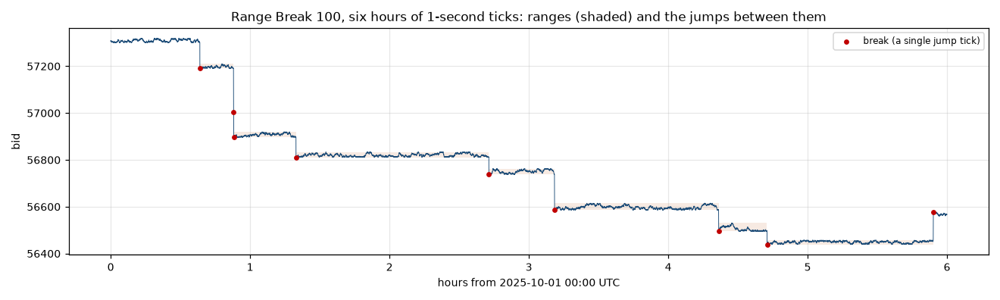
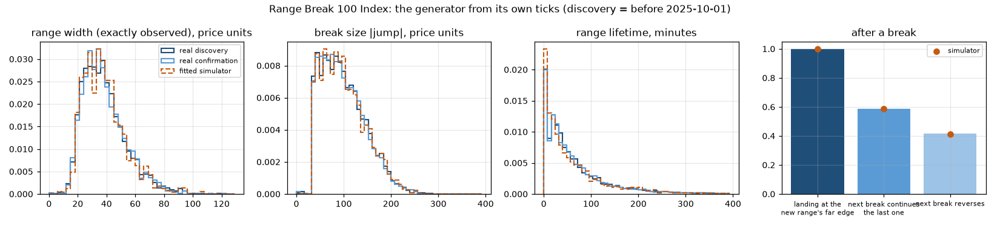
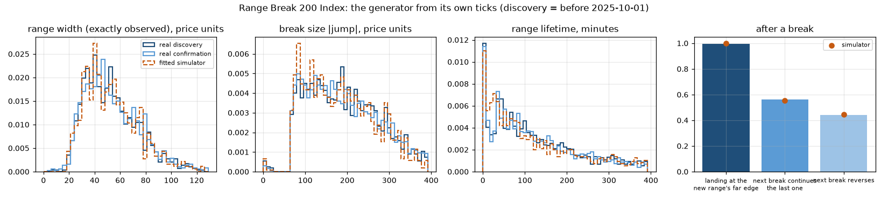
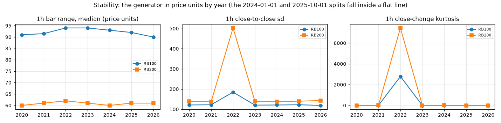
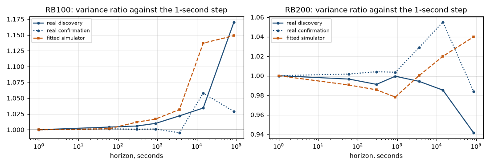
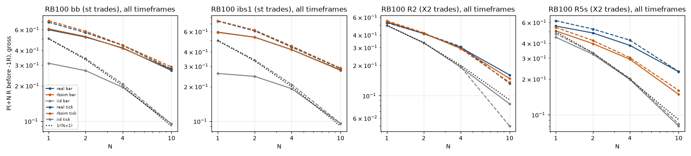
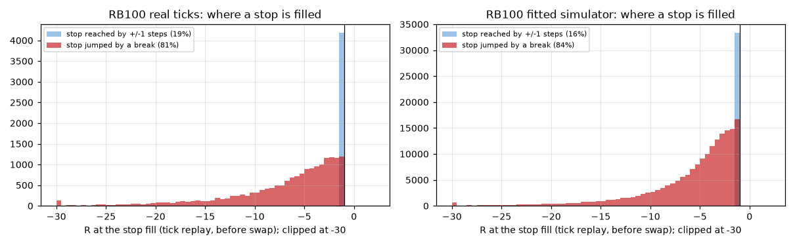
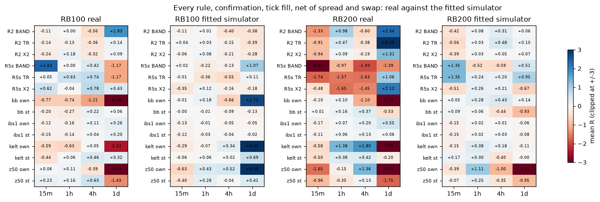
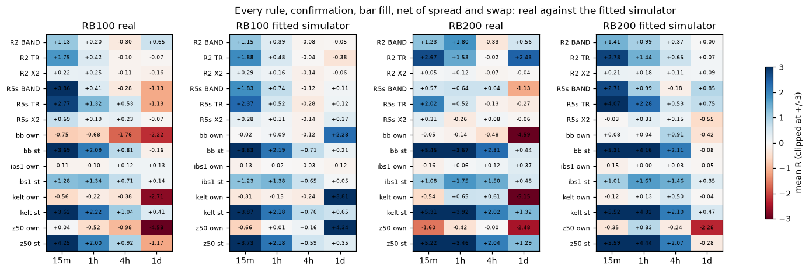

# Range Break 100: a fair game by construction, and the +3R was the bar fill

**Measured 2026-10-05.** Frozen in [`rb100_rule.json`](../ideas/rb100_rule.json) (commit `79f81b4`)
before any rule ran on real data. The simulator was fitted on discovery ticks only and committed
before each instrument's rule run ([`rb_sim_params.json`](../ideas/rb_sim_params.json): RB100 in
`09ed475`, RB200 in `883f783`). Code: [`rb100_fetch.py`](../ideas/rb100_fetch.py) (the read-only bridge fetch), [`rb100.py`](../ideas/rb100.py) (data, generator, simulator,
rules, tick replay) and [`rb100_agg.py`](../ideas/rb100_agg.py) (tables, verdicts, figures). R2 and
R5s come from [`lrc_retest.py`](../ideas/lrc_retest.py), and the Bollinger, z-score, Keltner and IBS
fades from [`mean_reversion.py`](../ideas/mean_reversion.py), both unchanged.

## The verdict

| question | answer |
|---|---|
| **Do the rules earn net of cost on unseen data?** | **No.** Primary: RB100 `bb` with the structural stop, 15m, confirmation, tick fill, net of spread and swap: **−0.199R [−0.647, +0.275]**, n = 1,989, halves −0.23 / −0.17. With bar fills the same trades show **+3.69R [+3.36, +4.03]**. Across 86 secondary tick-fill cells (RB100 and RB200, every rule, exit and timeframe), **none survives Benjamini–Hochberg**. Three have p < 0.05, against 4.3 expected by chance. |
| **Is it the generator's design?** | **Yes, all of it.** The fitted simulator reproduces both numbers. Bar fill: +3.83R (seed sd 0.39) against the real +3.69R. Tick fill: −0.005R against −0.199R. The real-minus-simulator difference is **−0.19R [−0.70, +0.33]** on ticks and −0.13R [−0.49, +0.24] on bars. 23 of 175 confirmation cells fall outside their 90% interval against the simulator, where 17.5 are expected by chance, and none of them is a profitable tick cell. |
| **Is it large enough to trade?** | **There is nothing to trade.** The generator is a martingale: at a range edge it breaks outward with probability p = 0.0101 by a mean jump of 99.3 units, so the expected next move is p·E\|J\| − (1 − p) = **+0.018 [−0.009, +0.049]** (RB100 discovery), **−0.009 [−0.032, +0.014]** (confirmation). Every trade earns zero before costs and loses the spread (0.07R a trade in the primary) and swap after them. The bar result came from a fill no broker gives: in a bar replay, a stop that a break jumps over is filled at the stop. On ticks it is filled where the jump lands. |
| **Range Break 200** | It is the same machine at p = 0.0049 (≈ 1/200), with E\|J\| = 200. Primary rule, 15m confirmation: bar +5.45R [+5.01, +5.89], tick **+0.008R [−0.65, +0.66]**. Simulator: bar +5.31R, tick +0.09R. |
| **The desk's yardstick** | **P(+N R before −1R) is not the yardstick on a jump process.** The primary reaches 4R first 48.9% of the time and 10R 31.1%, against 1/(N+1) = 20% and 9.1% and the walks' 20.8% and 9.4%. The simulator shows the same: 48.7% and 32.5%. It still earns nothing, because the losers do not lose 1R: 61% of its trades end at the stop, and 98% of those stops are filled by a break jump, at a mean of −7.8R. |


**In plain words.** Range Break 100 is a published random generator. Price ticks up or down by one
unit a second inside a range about 35 units wide. Each time it touches an edge, there is a 1-in-100
chance that it jumps out by about 100 units instead of turning back. The jump size is set so the game
is exactly fair: the small, near-certain bounce off the edge is paid for by the rare, large jump. A
bar chart hides the jump inside a candle. The earlier backtests therefore filled stops at the stop
price when the market had really jumped far past it. That cut every disaster to −1R while the lucky
jumps were paid in full, and it is the whole +3R. Filled on the broker's own ticks, every rule earns
zero minus its costs. A simulator of the published mechanism, fitted on earlier data, gives the same
numbers both ways.

## 1. The generator, from its own ticks

The bridge serves 1-second ticks from **2025-01-01** for both indices, 55.5 million per instrument
(the frozen file said "about 2024-10"; the split it fixes, 2025-10-01, is unchanged). It serves bars
from 2020-04-09 at 1h, 4h and 1d, from 2023-11-28 at 15m, and from 2026-07-28 at 1m. All of it was
fetched read-only into the lab's `rb100/data`.

| | RB100 discovery | RB100 confirmation | RB200 discovery | RB200 confirmation |
|---|---|---|---|---|
| ticks: share of ±1 steps / jumps (\|Δ\| ≥ 5) | 99.973% / 0.026% (all) | | 99.989% / 0.009% (all) | |
| interior up-step share | 0.50001 | | 0.49998 | |
| spread (ask − bid) | **1.0 on every tick** | | **1.0 on every tick** | |
| breaks a hour | 0.938 | 0.912 | 0.326 | 0.335 |
| p, breaks per tick at a known edge | **0.01015** | 0.00995 | **0.00485** | 0.00518 |
| a break goes outward from the edge touched | 99.8% | 99.8% | 99.3% | 99.6% |
| it lands on the far edge of the new range | 99.8% | 99.8% | 99.3% | 99.6% |
| next break continues the last one | 58.2% | 58.7% | 54.8% | 57.0% |
| \|jump\|: median / mean (units) | 92 / 99.3 | 92 / 98.6 | 188 / 199.9 | 185 / 199.4 |
| range width (exactly observed): quartiles | 27 / 36 / 46 | 27 / 35 / 46 | 36 / 50 / 67 | 37 / 50 / 68 |
| range lifetime, minutes: quartiles | 17 / 40 / 84 | 18 / 42 / 86 | 47 / 117 / 240 | 49 / 115 / 242 |
| corr(\|jump\|, width) | 0.00 | 0.04 | 0.03 | −0.03 |
| new range overlaps the old one | 6.6% | 6.1% | 2.2% | 2.2% |
| **drift at an edge, p·E\|J\| − (1 − p)** | **+0.017 [−0.009, +0.049]** | **−0.009 [−0.032, +0.014]** | **−0.026 [−0.076, +0.019]** | **+0.038 [−0.007, +0.080]** |



**The mechanism, exactly.** Inside a range of integer width W, price takes ±1 steps with
probability ½, once a second. At an edge it steps back inside, except with probability p, when it
jumps outward by \|J\|. The new range is drawn with the landing price at its far edge: after an up
break the landing is the new range's top, and price walks back down toward the break level. p is
1/100 for RB100 and 1/200 for RB200, which is the product description ("breaks the range once every
100 attempts on average"). E\|J\| is (1 − p)/p, so 99 and 199 units, to within the noise. Jumps are
independent of the width and of direction (49% up).

**Does a new range form at the break level?** No. It forms a jump away from it, median 92 units on
RB100 (1.6 ATR at 15m), with the landing on its far edge. The new range reaches back over the old one
in only 6% of breaks (RB100) and 2% (RB200). The broken level is retested only if a later break
reverses. 58% of the next breaks continue in the same direction. That is not momentum: the walk
starts on the landing edge, so it visits that edge first. The closed form, P(the next break reverses)
= (1 − p)/(pW + 2(1 − p)), gives the same 41%.

**In bar units** (RB100, ranges measured on ticks against ATR(14) of each timeframe):

| timeframe | ATR (units) | range width, median | break size, median | range lifetime, median | breaks a bar |
|---|---|---|---|---|---|
| 15m | 52 | 0.62 ATR | 1.56 ATR | 2.8 bars | 0.23 |
| 1h | 119 | 0.29 ATR | 0.74 ATR | 0.7 bars | 0.94 |
| 4h | 291 | 0.12 ATR | 0.31 ATR | 0.17 bars | 3.8 |
| 1d | 839 | 0.04 ATR | 0.11 ATR | 0.03 bars | 22.5 |

RB200 is the same at about half the break rate: 0.79 / 2.85 ATR at 15m, 7.7 bars a range, 0.08
breaks a bar. **The range exists only at 15m** (and barely at 1h on RB200). At 4h and 1d a bar
contains 4 to 22 breaks, and the series is a compound-Poisson jump walk.





**Stability.** In price units the bars are flat from 2020 to 2026: the median 1h range is 90-94
units on RB100 and 60-62 on RB200 every year, and the 1h close-to-close sd is 119-122 and 138-143. The one exception
is a single bar at **2022-11-24 03:00 UTC**, when both indices were reset (RB100 37,418 → 50,415;
RB200 144,721 → 99,502). That is the spike in 2022 below. It sits in the bar discovery period. Its
only effect here is that the iid and GARCH walks' sigma, taken from discovery 1h bars as frozen,
is too high (RB100 2.35 against about 2.0 a second). The walks' costs are matched in ATR units, so
their R is unaffected.



**The broker's bars are the ticks' bars.** 15m and 1h bars rebuilt from the ticks agree with the
broker's on high and low for 99.98% of bars, on the open for 98-99.5%, and on the close for
96-99%. The differences are ticks within one second of a bar edge.

**The variance ratio against the 1-second step is flat** (1.00 to 1.17 from 1 second to 1 day, real
and simulated), as [deriving.md](deriving.md) found on 1-minute bars. The confinement inside a range
is paid back by the jumps at every horizon.



## 2. The fitted null

**The simulator** (`rbsim` in [`rb100.py`](../ideas/rb100.py)) runs the mechanism above at one tick a
second on the real bars' calendar. It has three fitted ingredients, all from discovery ticks only
(2025-01-01 to 2025-09-30):

- **p**, as breaks per tick at the landing edge. That edge is the one boundary always known exactly
  (RB100 0.01015, RB200 0.00486).
- **\|J\|**, resampled from the 6,144 (RB100) and 2,134 (RB200) discovery jumps.
- **W**, the distribution of widths that are exactly observed, from ranges that broke at the far edge
  from their landing. It is reweighted by 1 / P(reversal | W) to undo that selection.

Paths are generated exactly, with no time step, by folding a free ±1 walk into [0, W] and placing
each break at the geometric-distributed K-th edge tick. Against held-out confirmation ticks it
reproduces the break rate (0.97 against 0.91 a hour), p (0.0104), the continuation share (0.587
against 0.587), the width, jump and lifetime distributions, the immediate re-break rate (1.0%), and
the flat variance ratio. Four paths per instrument cover the whole 2020-2026 calendar of the real
bars.

**The reference walks** are an iid Gaussian walk and a GARCH(0.08, 0.90) walk at one step a second,
matched in variance per second. On them every rule loses about its cost: the primary −0.05R (tick)
and −0.21R (bar). They are the wrong null for a jump-and-range process, as the brief said, and are
reported only as a reference.

## 3. The frozen test

**Rules, unchanged from their studies:**

- **The fades, mean-reversion.md**:
  - `bb`: close < SMA20 − 2 sd.
  - `z50`: close < SMA50 − 2 sd.
  - `kelt`: close < EMA20 − 2 ATR10.
  - `ibs1`: IBS < 0.2.
  - Each is entered at the next open. `st` has a structural stop 0.1 ATR under the signal bar's low,
    and `own` has no stop. The own exit, or 20 bars.
- **R2 and R5s, lrc-retest.md**, with exits X2, TR and BAND.

Both sides, at 15m, 1h, 4h and 1d.

**Costs:** the tick spread (1.0 unit), no commission, and swap of −30 points a night (3.0 units) at
every 00:00 UTC rollover held.

**Two fills:**

- **Bar**, as the source studies did. A stop is filled at min(open, stop) − 0.05 ATR.
- **Tick**, executable on the per-second bid and ask. Buy at the ask and sell at the bid. A stop or
  limit is filled at the first tick at or through it, at that tick's price. Bar-close decisions are
  executed on the next ticks.

**Periods:** confirmation is 1h/4h/1d from 2024-01-01 and 15m from 2025-10-01. Tick replays need
ticks, so they start in 2025-01.

### The primary: RB100 `bb` / `st` / 15m

| | n | mean R (net) | 90% interval | halves | fitted sim (seed sd) | iid / GARCH | coin twin | P(1R) | P(2R) | P(4R) | P(10R) |
|---|---|---|---|---|---|---|---|---|---|---|---|
| **tick fill, confirmation** | 1,989 | **−0.199** | [−0.647, +0.275] | −0.23 / −0.17 | **−0.005** (0.50) | −0.05 / −0.03 | −0.02 | 0.743 | 0.623 | 0.489 | 0.311 |
| bar fill, confirmation | 1,992 | +3.691 | [+3.360, +4.028] | +3.60 / +3.78 | +3.826 (0.39) | −0.21 / −0.18 | | 0.701 | 0.607 | 0.488 | 0.312 |
| tick fill, discovery | 1,519 | +0.205 | [−0.274, +0.704] | | −0.231 | | −0.18 | 0.750 | 0.618 | 0.479 | 0.317 |
| bar fill, discovery | 3,697 | +3.889 | [+3.639, +4.144] | | +3.776 | −0.26 / −0.25 | | 0.699 | 0.600 | 0.475 | 0.314 |
| fitted simulator, tick | | | | | | | | 0.766 | 0.634 | 0.487 | 0.325 |
| iid walk, tick | | | | | | | | | | 0.208 | 0.094 |
| 1/(N+1) | | | | | | | | 0.500 | 0.333 | 0.200 | 0.091 |

- **Earns: no.** The interval includes 0 and both halves are negative.
- **Explained by the generator: yes.** Real minus simulator is −0.19R [−0.70, +0.33] on ticks and
  −0.13R [−0.49, +0.24] on bars.
- **Tradeable: no.** The bar and tick results disagree by 3.9R, and the tick result is the one a
  broker pays.
- **The cost.** The spread costs 0.073R a trade and swap 0.012R. Added back, the gross tick result is
  −0.11R [−0.56, +0.36]: zero, as the theorem requires.



### Why the bar fill made +3R

On ticks, 61% of the primary's trades end at the stop, and **98% of those stops are filled by a
break jump**. Those fills land at **−7.8R on average** (median −6.1R). The 2% reached by ±1 steps are
filled at −1.1R. The other 39% of trades leave by the rule at +11.4R on average, the same in both
replays. A bar replay cannot see
the jump inside a 15-minute candle, so it fills every one of them at −1R less 0.05 ATR. Favourable
jumps are paid in full in both replays, since the own exit sells at the next open, which is already
past the jump. So the bar replay truncates the left tail and keeps the right one. On a fair game that
truncation is worth exactly the +3 to +5R the earlier studies saw:
[mean-reversion.md](mean-reversion.md) (+2.89R), [lrc-retest.md](lrc-retest.md)'s nine BH
"survivors", [fuzzy-logic.md](fuzzy-logic.md) and [expansion.md](expansion.md). The simulator, which
is a fair game by construction, shows the same truncation: 62% of trades stopped, 98% of those jumped, at −7.6R, and +12.0R on the rule exits. This is a
measurement artefact in the literal sense, a fill error, like the FX reopen in
[mean-reversion.md](mean-reversion.md). It is not a pattern that matches its walks.

The same mechanism makes the P(N R) curve misleading on this instrument. P(+4R before −1R) = 0.49
looks like 2.4 times the random rate. But "−1R" is where the stop was placed, not where it was
filled. On a jump process the yardstick 1/(N+1) assumes a loss that cannot happen.



### Every cell, confirmation





The 15m rules from the earlier "survivors", net mean R on confirmation:

| instrument | rule | n | bar fill | tick fill [90%] | sim bar / tick | P(4R) tick / sim | P(10R) tick / sim |
|---|---|---|---|---|---|---|---|
| RB100 | R2 X2 | 363 | +0.22 | −0.24 [−0.59, +0.12] | +0.29 / −0.06 | 0.339 / 0.332 | 0.179 / 0.173 |
| RB100 | R2 TR | 363 | +1.75 | −0.15 [−0.67, +0.38] | +1.88 / +0.04 | | |
| RB100 | R5s X2 | 56 | +0.69 | +0.62 [−0.40, +1.66] | +0.28 / −0.35 | 0.464 / 0.358 | 0.286 / 0.233 |
| RB100 | R5s BAND | 56 | +3.86 | +2.43 [+0.15, +4.90] | +1.83 / +0.02 | | |
| RB100 | bb st | 1,989 | +3.69 | −0.20 [−0.65, +0.28] | +3.83 / −0.01 | 0.489 / 0.487 | 0.311 / 0.325 |
| RB100 | z50 st | 1,203 | +4.25 | +0.23 [−0.45, +0.95] | +3.73 / −0.40 | 0.473 / 0.480 | 0.307 / 0.310 |
| RB100 | kelt st | 2,243 | +3.62 | −0.44 [−0.93, +0.04] | +3.87 / −0.06 | 0.474 / 0.495 | 0.300 / 0.328 |
| RB100 | ibs1 st | 16,145 | +1.28 | −0.15 [−0.23, −0.06] | +1.23 / −0.12 | 0.488 / 0.488 | 0.319 / 0.319 |
| RB200 | R2 X2 | 152 | +0.06 | −0.94 [−1.70, −0.15] | +0.21 / −0.39 | 0.276 / 0.338 | 0.138 / 0.199 |
| RB200 | bb st | 1,679 | +5.45 | +0.01 [−0.65, +0.66] | +5.31 / +0.09 | 0.550 / 0.570 | 0.396 / 0.399 |
| RB200 | z50 st | 985 | +5.22 | −0.96 [−1.92, +0.01] | +5.59 / −0.07 | 0.502 / 0.552 | 0.358 / 0.390 |
| RB200 | kelt st | 1,893 | +5.31 | −0.51 [−1.18, +0.15] | +5.52 / +0.17 | 0.506 / 0.543 | 0.349 / 0.379 |
| RB200 | ibs1 st | 15,776 | +1.08 | −0.11 [−0.22, −0.00] | +1.01 / −0.15 | 0.494 / 0.494 | 0.311 / 0.308 |

**Multiplicity and the frozen secondary pass rule.**

- **Tick family: 86 cells (n ≥ 30), 0 BH rejections.** Three have their 90% interval above zero:
  - RB100 R5s BAND 15m: +2.43R, n = 56.
  - RB200 ibs1 own 1d: +0.55R, n = 391.
  - RB200 kelt own 1h: +1.38R, n = 1,078.

  That is 3 cells against 4.3 expected at p < 0.05, and each fails BH.
- **Bar family: 89 cells, 39 BH rejections.** 12 meet every frozen pass condition: interval above 0,
  BH, both halves positive, above both walks, and above the simulator by more than its seed sd.
  - **Eleven of the twelve are stop exits** (st, X2, TR, BAND). Their tick replays are −0.15 to
    +0.98R, and none clears BH. They are the fill error above, and the simulator's bar fill makes
    +0.28 to +5.3R on the same cells.
  - **The twelfth is RB200 ibs1 own 1d**: buy a daily close in the bottom fifth of its range and
    sell at the next day's open, with no stop. Bar and tick agree there: +0.37R [+0.02, +0.74] and
    +0.55R [+0.08, +1.01]. But its **discovery result was −0.50R [−1.04, −0.04]**. RB100's same cell
    is +0.13R [−0.18, +0.45]. The generator is a fair game at every edge tick, and 1 of 89 cells at
    this margin is what chance gives. It is reported, not believed. Anyone who wants it should freeze
    it and run it forward.

## 4. Can it be traded after realistic costs and fills?

**No, and the reason is a theorem.** The tick data show the published process. At an edge the
expected next move is p·E\|J\| − (1 − p), which is zero within ±0.03 units a tick in every period on
both instruments. Inside a range it is a fair ±1 coin (an up share of 0.50001). So the mid price is a
martingale, and by [deriving.md](deriving.md)'s theorem every strategy built from information
available at the time earns zero before costs and −(spread + swap) after them. On the primary that is
about −0.09R a trade (0.073 spread, 0.012 swap).

The tick replay is the executable check the fx-reopen lesson asks for, at every discontinuity. Its
results sit on the simulator's to within noise.

Knowing the mechanism exactly does not help either:

- **Knowing p.** At an edge the next tick is +1 with probability 0.99 and −99 with 0.01. Selling
  the edge earns one unit 99 times and loses 99 once.
- **Knowing the range.** Its far edge is known only once touched. It is a reflecting boundary, so
  reaching it adds no drift.
- **Knowing the landing edge.** After a break, price walks back toward the old range by up to W
  units. Over the same span, the chance of another break beyond the landing (p per landing-edge
  visit) is priced at exactly the same rate.

The only free information in the process, the direction of the next ±1 step at an edge (99%
inward), is worth one unit against a one-unit spread.

## Caveats

- **The RB100 confirmation is not pristine.** The earlier studies ran these rules on RB100 bars over
  all of this history. Nothing was tuned here, every rule is copied unchanged, and the split is the
  one frozen in advance. RB200 had never been run with these rules.
- **The tick replay begins 2025-01-01**, so the 1h/4h/1d confirmation tick cells cover 2025-01 to
  2026-10 (two-thirds of their bar sample). 15m confirmation is fully covered.
- **Per-second series.** The tick series keeps the last tick in each second. Ticks arrive every
  950-1,050 ms, with 108 gaps over 10 s in 21 months. A jump is one tick and is always kept.
- **The coin twin** (random side, same entry tick and stop distance, out at the original's exit) is
  −0.02R on the primary. That is zero, as it must be on a martingale.
- **Swap** is charged at 00:00 UTC, the broker's server time, at 3.0 units a night for longs and
  shorts. Results without swap differ by ≤ 0.04R at 15m and are in `cells.csv` (`Rns_*`).
- **One broker snapshot** (`symbol_info`) showed bid and ask 2.6 units apart. Every one of 111
  million ticks shows 1.0, and ticks are what fills.
- **The iid/GARCH sigma** includes the 2022-11-24 reset (above). The walks are references only, with
  costs matched in ATR units.
- **1d `own` cells** (no stop, R in units of a 0.1-0.3 ATR structural distance) swing by ±5R on 30
  to 70 trades. They account for most of the 23 cells outside the simulator's interval, in both
  directions.

## Reproduce

On the lab, in `rb100/` (bridge env sourced for the fetch only):

```
python code/rb100_fetch.py bars ticks                               # read-only, spaced requests
OUT=out DATA=data INSTS=RB100 MODE=fit|validate|char python code/rb100.py
OUT=out DATA=data ONLY=RB100 WORKERS=7 MODE=run python code/rb100.py   # then RB200 the same way
OUT=out DATA=data MODE=agg|plot python code/rb100.py
```

Outputs: `out/char.json`, `sim_validate.json`, `cells.csv` (every cell, both fills, all sources, both
periods), `real_minus_sim.csv`, `verdict.json`, `stop_fills.csv`, `trades_all.pkl.gz` (3.2 million
trade rows).
