# When to pause or resume a strategy: on this desk's streams, timing adds nothing

**Measured 2026-10-05.** The desk asked: *"We have a portfolio of strategies. Like yesterday when
fade-to-value was hot, how do we know when to resume or pause a strategy?"* The rules were frozen in
[`switch_rule.json`](../ideas/switch_rule.json) and committed (`232662e`) before any real-data run.
Code: [`switch_replay.py`](../ideas/switch_replay.py) (production's strategies replayed through
production's code), [`switch_lrc.py`](../ideas/switch_lrc.py) (the LRC research rules as streams),
[`switch.py`](../ideas/switch.py) (every measurement) and [`switch_plot.py`](../ideas/switch_plot.py).
Lab runs: `switch/out`.

## The answer

| question | verdict |
|---|---|
| **1. Is a strategy's next R predictable from its own record?** (the necessary condition) | **Barely, and not enough to act on.** Across 737,691 replayed production trades, the correlation between a trade's R and the mean of the 30 trades closed before it is **+0.009 [+0.004, +0.013]** on real data, against +0.001 (iid walk) and +0.005 (GARCH walk). LRC research rules: +0.005 against +0.006 / +0.007. **0 of 262 cells** beat both walks after Benjamini-Hochberg. One class stands out: Binance perpetuals, +0.045 [+0.031, +0.059] against -0.011 / +0.007. |
| **2. Do pause/resume rules add value?** | **No rule passes.** Timing value (switched minus a random-pause twin that pauses just as often) on the production book in confirmation is **-0.004 to +0.002R per opportunity** for every rule. No interval clears zero, and every rule does as well or better on the walks. Pausing *does* save money (+0.05 to +0.10R per opportunity), but only because every stream loses after costs. The same saving appears on walks (+0.05 to +0.10R), and a random pause of the same length saves the same. |
| **3. Kill/sample-size math** | SPRT (0 vs +0.10R, alpha 0.05, beta 0.20) calls a -0.50R strategy dead in a median **25 closes** (p90 41), a -0.15R strategy in **53** (p90 120), and a +0.20R strategy alive in **142** (p90 247). A +0.05R strategy takes **248** closes and is wrongly called dead 69% of the time, because it is below the +0.10R the test was asked to find. Zero-edge streams look hot all the time: over 100 trades the best 10-trade window averages **+0.52 to +0.59R** at the median and **+1.1 to +1.2R** at the 95th percentile. |
| **4. Recommendation** | **Do not pause and resume on recent performance.** Keep or kill a strategy on accumulated evidence with the frozen SPRT, run on its full shadow record, and re-admit it only when that record crosses the SPRT's "alive" boundary. Size flat. Exponential weights over strategies with a cash arm does the same job as kill/keep, and does no better than on walks. |

**Fade-to-value, live.** Its 30 closes in the export average **-0.435R** (R from `r_multiple` where
present, else profit / risk; the desk's -0.573R is the mean of the 9 closes that carry `r_multiple`).
The posterior gives P(mean > 0) = **0.035** at the end. The SPRT would have paused it at close 27
(2026-09-04), the posterior rule at close 20 (09-01), CUSUM at close 7 (08-27) and the drawdown stop at
close 10 (08-27). On the record it has, no rule would have resumed it. A few winning closes "yesterday" is
what a zero-edge strategy does routinely (see the hot-streak table). Replayed through production's code on
46,771 trades, fade-to-value makes **-0.116R**, between its iid walk (-0.146R) and its GARCH walk
(-0.104R): no edge before costs.

## What production already does

Read from `till_infinity/trading/` (not modified):

- **Nothing pauses a whole strategy.** The roster is the fixed `TRADING_STRATEGIES` list, changed by hand.
- `strategies/policy.py` `Policy` is full-information exponential weights over **exit shapes**, not
  strategies. It departs from the measured default only when a challenger's lead clears `MARGIN_Z = 3.5`
  standard errors (decay 0.01, `MIN_SEEN = 30`, rewards clipped to [-3, +5]). That came from
  [zeroskill.md](zeroskill.md).
- `Entries` keeps the same ledger per family and strategy, and **nothing reads it** (recording only).
- `risk.py` `Guard` has three gates: the account-level daily loss halt (`daily_loss_fraction`, lifted at
  the next day), a per-feed `loss_cooldown` after a loss, and the drift pause (`context.py`,
  `drift_pause` 900 s per feed). The ZMA gate vetoes per feed. All of these act on a feed or the account,
  never on a strategy.

So the gap the desk feels is real: nothing in production turns a strategy off. This page says what
should fill it.

## The streams

**PROD: production's strategies, replayed through production's code.** This is the method of R4b in
`lrc-retest.md`, widened from fade-to-value to every registered `LevelStrategy` that enters on 15m/30m
calls. Each series' 15m bars (with 30m, 1h, 2h and 4h resampled from them) stream through
`structures.engine.Engine`. Every actionable call becomes `Call.to_signal(...).to_dict()`, with
`confluence` set the way `structures/service.py` sets it (`drawing.confluence.combine`). Every payload goes
to every strategy's `observe`. Payloads on 15m/30m go to its `consider`.

Each Intent is traded on 15m bars: stop, target, or out when the hold runs out. R is net of the spread,
with 0.05 ATR of stop slippage, one position per strategy per series, and risk of at least 0.25 ATR.
Series: FX, metals, indices, energy, crypto CFD majors, Deriv diffusive / jumpy / Range Break, the 12
Binance perpetuals (15m from 2021) and the Deriv 1s indices, each with R4b's matched iid and GARCH walks.

Sixteen strategies traded. Mean R after costs on real data, with the iid and GARCH walks:

| strategy | real n | real R | iid walk | GARCH walk | P(>=4R) real / walks | P(>=10R) real / walks |
|---|---|---|---|---|---|---|
| thesis-only | 62,001 | -0.042 | -0.051 | -0.044 | 0.165 / 0.178, 0.176 | 0.057 / 0.061, 0.060 |
| confluence-scalp | 53,894 | -0.076 | -0.087 | -0.072 | 0.167 / 0.180, 0.176 | 0.068 / 0.075, 0.074 |
| sweep-aware | 59,096 | -0.089 | -0.099 | -0.082 | 0.167 / 0.181, 0.177 | 0.072 / 0.079, 0.078 |
| snap | 63,642 | -0.105 | -0.113 | -0.102 | 0.167 / 0.182, 0.177 | 0.072 / 0.079, 0.077 |
| approach-scalp | 23,567 | -0.107 | -0.111 | -0.100 | 0.168 / 0.181, 0.179 | 0.072 / 0.079, 0.077 |
| level-scalp | 62,312 | -0.108 | -0.118 | -0.107 | 0.167 / 0.181, 0.177 | 0.072 / 0.079, 0.077 |
| opportunity | 47,823 | -0.108 | -0.112 | -0.101 | 0.167 / 0.182, 0.176 | 0.073 / 0.079, 0.077 |
| swing-level | 49,639 | -0.108 | -0.108 | -0.102 | 0.168 / 0.182, 0.176 | 0.073 / 0.079, 0.077 |
| runner | 49,911 | -0.109 | -0.112 | -0.099 | 0.167 / 0.182, 0.176 | 0.072 / 0.079, 0.077 |
| momentum-scalp | 25,847 | -0.109 | -0.113 | -0.107 | 0.164 / 0.180, 0.175 | 0.070 / 0.080, 0.077 |
| **fade-to-value** | 46,771 | **-0.116** | -0.146 | -0.104 | 0.172 / 0.182, 0.181 | 0.071 / 0.076, 0.076 |
| ride | 42,705 | -0.117 | -0.106 | -0.098 | 0.167 / 0.182, 0.175 | 0.073 / 0.079, 0.076 |
| inverse | 103,581 | -0.129 | -0.147 | -0.123 | 0.172 / 0.183, 0.180 | 0.075 / 0.082, 0.081 |
| cycle-scalp | 44,476 | -0.154 | -0.154 | -0.141 | 0.197 / 0.207, 0.206 | 0.088 / 0.095, 0.096 |
| origin-swing | 2,354 | -0.265 | -0.244 | -0.191 | 0.161 / 0.180, 0.171 | 0.074 / 0.087, 0.077 |
| cycle-turn-scalp | 72 | -0.134 | - | - | 0.153 | 0.042 |

(P(N R) counts +N R before the stop within the strategy's own hold, so every row sits below 1/(N+1) =
0.200 at 4R and 0.091 at 10R, walks included.)

- **Every strategy matches its walks: no edge before costs.** Real R sits between or near the two walks.
- **There is no tail excess anywhere.** P(>=4R) and P(>=10R) are slightly *below* the walks for every
  strategy (about 0.01 at 4R).

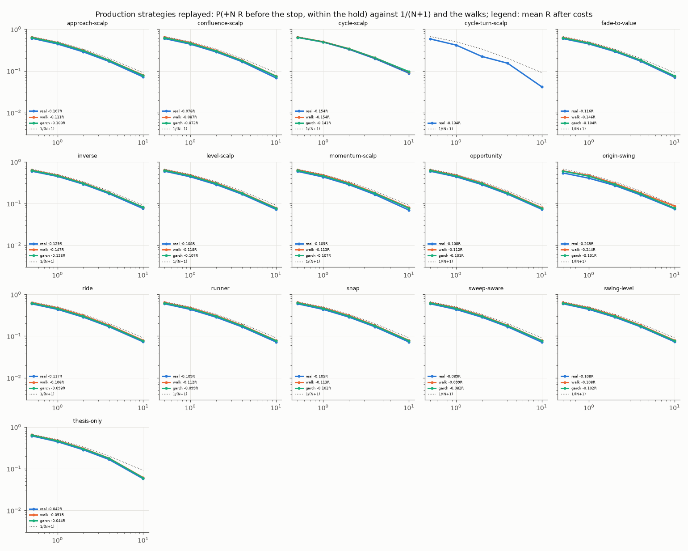

**LRC: the desk-drawn research rules** of [lrc-retest.md](lrc-retest.md): R1 (LRC trend + BOS retest),
R4 (LRC band fade) and R5s (sweep-then-reject), with a 2R exit, at 15m, 1h, 4h and 1d. That gives
688,085 real trades. Each trade's exit time and regime inputs were rebuilt from the same bars (100% of
entry timestamps reproduced).

**Order and knowledge.** Every rule's state is a function of the shadow record only. Production's
untaken record observes every outcome, so pausing loses no information. The state is updated after each
close in exit order. A trade reads the state left by the closes known at its entry.

## 1. The necessary condition

The quantity: `pred_30`, the correlation between a trade's R and the mean R of the 30 trades that had
closed before it. If it is zero, no rule built on the record can time anything. It is pooled within each
cell (standardised), day-bootstrapped, and compared with the same strategy on its walks.

| confirmation (2024+) | real | iid walk | GARCH walk | real - iid | real - GARCH |
|---|---|---|---|---|---|
| PROD book, all strategies | **+0.009** [+0.004, +0.013] | +0.001 | +0.005 | +0.007 [+0.001, +0.014] | +0.004 [-0.001, +0.011] |
| PROD, every class cell | +0.012 [+0.007, +0.016] | +0.000 | +0.006 | +0.012 [+0.005, +0.018] | +0.006 [-0.000, +0.012] |
| LRC, every non-Range-Break cell | +0.005 [+0.001, +0.010] | +0.006 | +0.007 | -0.001 [-0.006, +0.005] | -0.002 [-0.007, +0.004] |
| PROD Binance | **+0.045** [+0.031, +0.059] | -0.011 | +0.007 | **+0.057** [+0.040, +0.073] | **+0.039** [+0.022, +0.055] |
| PROD Deriv diffusive | +0.017 [+0.008, +0.026] | +0.002 | +0.005 | +0.015 [+0.003, +0.028] | +0.012 [-0.002, +0.024] |
| PROD FX | +0.015 [+0.004, +0.026] | +0.005 | +0.009 | +0.010 [-0.005, +0.024] | +0.006 [-0.011, +0.020] |
| PROD Range Break (apart) | -0.146 | -0.006 | -0.012 | -0.140 | -0.134 |

Per cell (strategy x class x timeframe, confirmation, >= 100 trades): **0 of 262** beat both walks after
BH at q = 0.10. Median lag-1 autocorrelation is higher on real LRC streams (0.097 against 0.012 / 0.011),
and runs are streakier (z -3.2 against -0.8 / -0.6). That is concurrency, not memory. Real symbols in a
class move together, so trades open at the same moment win and lose together. The matched walks are
independent per series. `pred_30` reads only closes known before entry, and it does not see this.

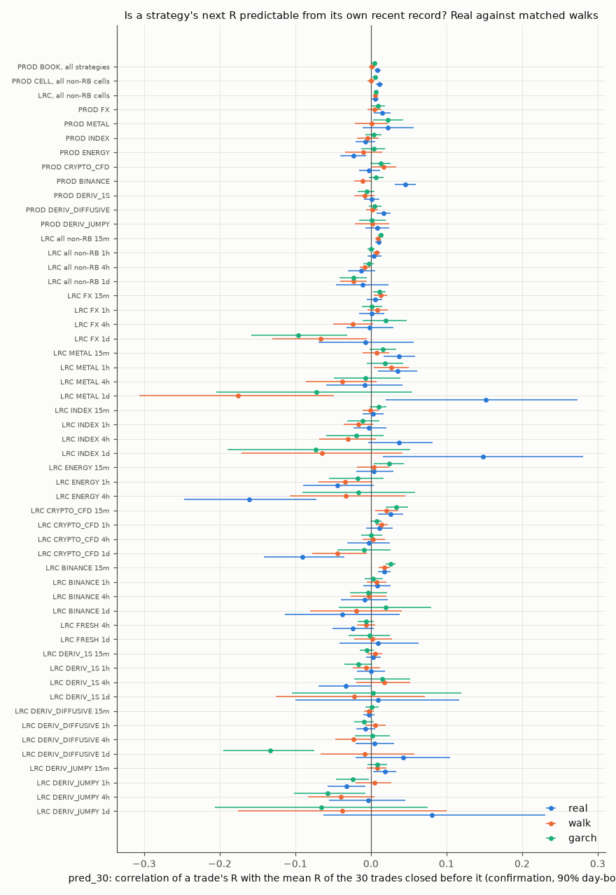

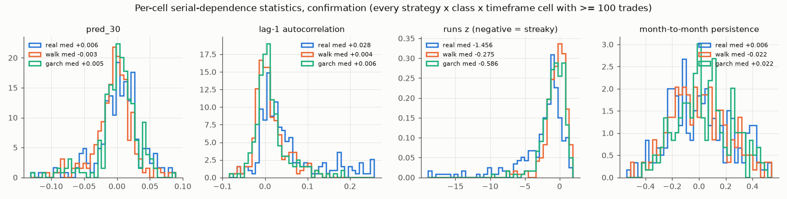

**What a pred_30 of 0.01 is worth.** A positive control (`power.csv`) built streams whose mean flips
between +a and -a every 50, 200 or 500 trades. Regimes that rules can exploit, +0.05 to +0.15R a trade,
produce pred_30 of **0.06 to 0.23**. A pred_30 of 0.01 corresponds to regimes of about +-0.1R flipping
every 50 trades, worth about +0.007 to +0.010R to the equity-curve and CUSUM rules. That is the size of
what the real streams show, and it is below the cost of a single tick.

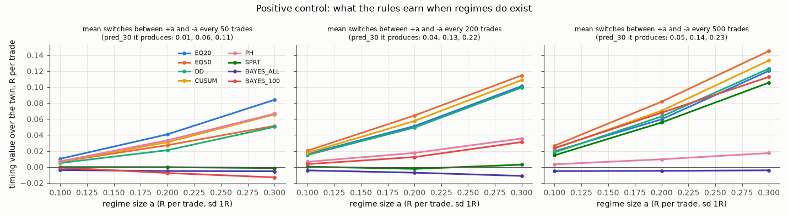

## 2. The rules

Ten frozen rules (see the JSON): equity-curve filters on 20 and 50 trades; a drawdown stop (8R) with
resume on +4R of shadow recovery; CUSUM and Page-Hinkley between 0 and +0.10R; a repeated Wald SPRT;
a Bayesian posterior with a N(0, 0.10^2) prior, on all trades or with a 100-trade memory; and volatility
and trend gates fitted on discovery. Hedge is in its own section below.

Three quantities, all per opportunity (every trade the always-on strategy would take):

- **value over always-on:** switched minus always-on;
- **timing value (primary):** switched minus a random-pause twin, which is the same pause mask circularly
  shifted within the same half, 200 shifts;
- the same on the **iid and GARCH walks**.

**Production book, confirmation (2024+, 581,708 trades, BOOK scope).**

| rule | paused | value over always-on | timing value [90%] | iid walk | GARCH walk | daily Sharpe: on / switched / twin |
|---|---|---|---|---|---|---|
| EQ20 | 70% | +0.069 | +0.0006 [-0.0009, +0.0021] | +0.0001 | +0.0009 | -16.4 / -13.6 / -15.7 |
| EQ50 | 78% | +0.078 | +0.0015 [-0.0001, +0.0029] | -0.0002 | +0.0011 | -16.4 / -11.1 / -14.9 |
| DD | 58% | +0.058 | +0.0016 [-0.0001, +0.0033] | -0.0002 | +0.0010 | -16.4 / -13.1 / -14.7 |
| CUSUM | 85% | +0.084 | +0.0011 [-0.0002, +0.0024] | -0.0002 | +0.0002 | -16.4 / -8.8 / -12.8 |
| PH | 52% | +0.050 | +0.0007 [-0.0007, +0.0021] | -0.0006 | -0.0005 | -16.4 / -15.5 / -16.3 |
| SPRT | 100% | +0.098 | +0.0000 | -0.0001 | -0.0000 | -16.4 / -1.2 / -9.7 |
| BAYES_ALL | 100% | +0.099 | 0 (all paused) | 0 | 0 | - |
| BAYES_100 | 80% | +0.079 | +0.0003 [-0.0014, +0.0021] | -0.0005 | +0.0006 | -16.4 / -8.5 / -12.2 |
| REGIME_VOL | 81% | +0.076 | **-0.0037** [-0.0062, -0.0011] | -0.0000 | -0.0002 | |
| REGIME_TREND | 65% | +0.063 | -0.0010 [-0.0022, +0.0001] | -0.0009 | -0.0004 | |

On walks, value over always-on is +0.052 to +0.102 (iid) and +0.046 to +0.094 (GARCH): the same as real.
The LRC rules (CELL scope, 458,968 confirmation trades) read the same way. Timing values run from -0.0017
to +0.0031, every one inside what the same rule earns on walks. The one exception is **REGIME_VOL, at
+0.0075 [+0.0053, +0.0098]**. It beats both walks, but it also earns on the iid walk (+0.0019 [+0.0007,
+0.0030]), so it fails the frozen walk check. It trades the high-volatility tercile, where the spread is
the smallest share of R. That is cost management, worth 0.008R, not a regime.

Against the frozen pass conditions (`rules_verdicts.csv`): **no rule passes.** Nine of ten fail (i), the
confirmation interval above zero. The tenth (REGIME_VOL on LRC) fails the walk check.

**Benjamini-Hochberg over 2,430 rule x cell tests:** 13 survive, 11 of them Binance (R1 15m with the
equity filters and the volatility gate; snap, cycle-scalp, sweep-aware and confluence-scalp with EQ50,
CUSUM or BAYES_100), at +0.004 to +0.05R per opportunity. That matches the only class where pred_30
beats the walks. Over 150 BOOK tests (rule x strategy across the whole book), **none** survive.
Range Break is reported apart. Every rule *loses* timing there (-0.02 to -0.05R): it is a range
generator, and a losing streak there is followed by its mean-reverting payoff.

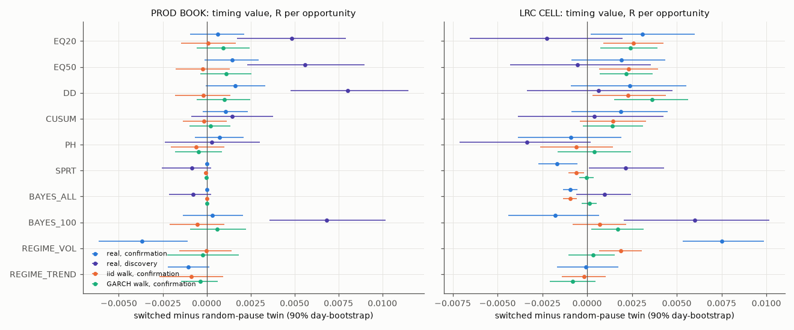

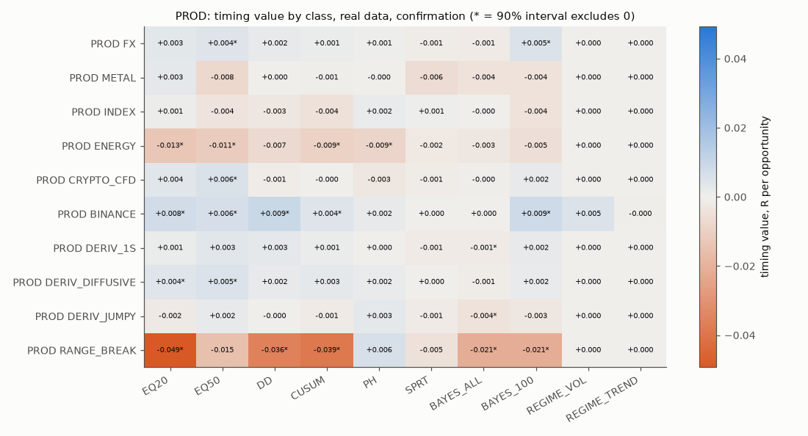

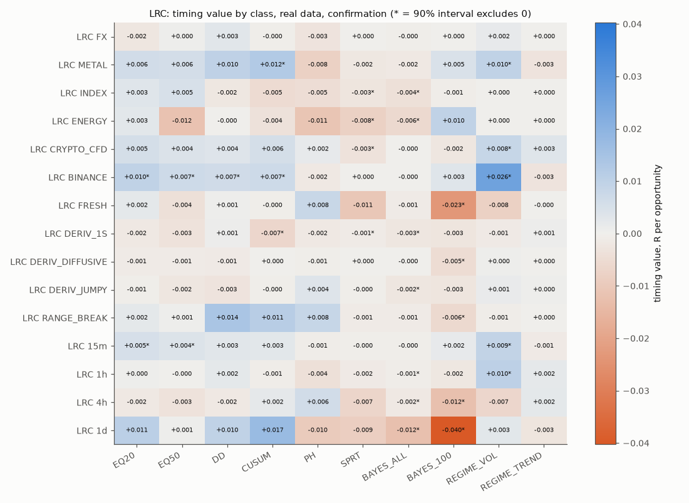

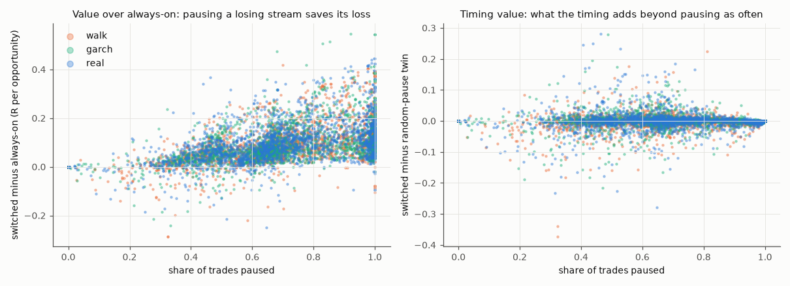

### Hedge (exponential weights with a cash arm)

Each day, weights over the strategies plus cash come from discounted past daily R (0.99 a day, eta 0.02
or 0.10). The portfolio is compared with always-on and with the same weights shifted in time.

| confirmation, per day | always-on R/day | Hedge R/day | timing vs shifted weights | iid walk | GARCH walk | Sharpe on / Hedge |
|---|---|---|---|---|---|---|
| PROD, eta 0.02 | -56.9 | -4.2 | +1.67 [+1.16, +2.18] | +4.32 | +3.52 | -16.5 / -7.4 |
| PROD, eta 0.10 | -56.9 | -0.2 | +0.27 [+0.17, +0.35] | +1.87 | +0.15 | -16.5 / -2.3 |
| LRC 15m non-Deriv, eta 0.10 | -55.0 | -2.0 | +7.24 | +7.08 | +7.32 | -30.0 / -4.9 |
| LRC 1h / 4h / 1d non-Deriv, eta 0.10 | -19.8 / -4.6 / -0.6 | -4.8 / -4.7 / -1.1 | +0.42 / -0.55 / -0.54 | -0.22 / +0.04 / -0.15 | -0.04 / +0.03 / -0.05 | |

Hedge's gain is the cash arm: it moves 37-49% of the book to cash and stops paying costs. The timing it
adds is as large or larger on walks. Its Sharpe stays negative because nothing it can allocate to has an
edge.

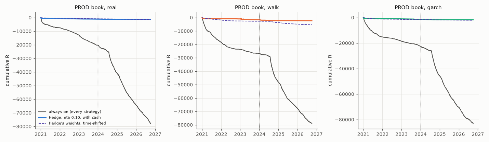

## 3. How many closes to call a strategy dead or alive

Simulated with the pooled real PROD R distribution (736,071 trades, sd 0.90R), centred and shifted to
each true edge; 2,000 paths of up to 3,000 closes. Gaussian sd-1 paths need up to a third more closes.

| true edge | SPRT first decision, p10 / p50 / p90 | called dead / alive | posterior P(mu > 0) < 0.20 (BAYES_ALL pause) | P(mu > 0) < 0.05 | CUSUM pause | DD pause | EQ20: paused share |
|---|---|---|---|---|---|---|---|
| **-0.50R** | 20 / **25** / 41 | 100% / 0% | 11 / 18 / 29 | 20 / 25 / 53 | 5 / 9 / 15 | 9 / 15 / 25 | 97% |
| **-0.15R** | 29 / **53** / 120 | 100% / 0% | 20 / 35 / 127 | 27 / 92 / 284 | 9 / 17 / 36 | 18 / 36 / 75 | 75% |
| **+0.05R** | 60 / **248** / 832 | 69% / 31% | 30% ever pause | 7% ever | 13 / 38 / 100 | 38 / 127 / 356 | 43% |
| **+0.20R** | 78 / **142** / 247 | 2% / **98%** | 3% ever pause | 0% | 24 / 98 / 307 | 160 / 849 / 2209 | 19% |

- **The cheap rules are trigger-happy.** CUSUM pauses a +0.20R strategy within a median 98 closes, and
  EQ20 keeps it off 19% of the time. On a real edge both cost money. On the desk's streams they only
  cost less because every stream loses.
- **A +0.05R edge cannot be told from zero in a usable time.** The SPRT is built to find +0.10R. At
  +0.05 it calls the strategy dead 69% of the time after a median 248 closes. Proving +0.05R needs
  thousands of closes ([calibrating.md](calibrating.md): about 2,500 for +5% of risk).
- **Fade-to-value's 30 live closes** are about the size a -0.5R strategy needs. At -0.15R, closer to its
  replayed -0.116R, the SPRT median is 53 closes.

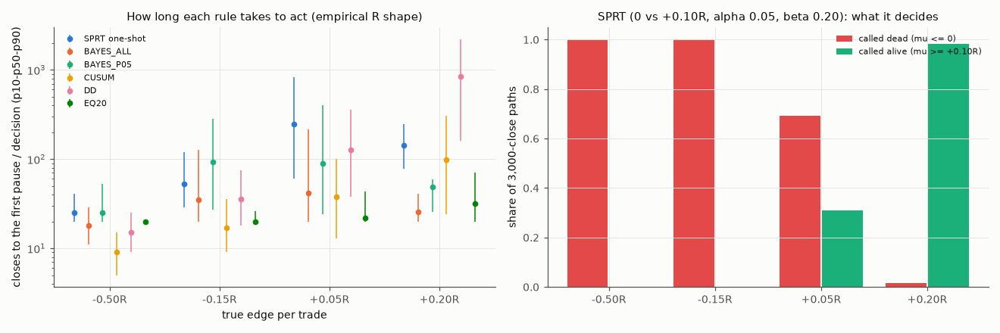

### What each rule said on the live record

Closes export, 688 closes to 2026-09-11, strategies with >= 25 closes. The close number at which each
rule first paused (date), and its state at the end:

| strategy | n | mean R | P(mu > 0) at end | EQ20 | DD | CUSUM | SPRT | BAYES_ALL | pred_10 (perm p) |
|---|---|---|---|---|---|---|---|---|---|
| **fade-to-value** | 30 | **-0.435** | **0.035** | 20 (09-01), paused | 10 (08-27), paused | 7 (08-27), paused | 27 (09-04), paused | 20 (09-01), paused | -0.21 (0.67) |
| confluence-scalp | 30 | -0.271 | 0.108 | 20 (09-08), paused | 27, paused | 9, paused | never | 20, paused | +0.02 (0.19) |
| snap | 29 | -0.369 | 0.083 | 20, paused | 10, paused | 6, paused | never | 20, paused | +0.15 (0.06) |
| runner | 47 | -0.244 | 0.014 | 20, paused | 23, paused | 13, paused | 24 (09-01), paused | 20, paused | -0.02 (0.32) |
| sweep-aware | 161 | +0.081 | 0.82 | 20, on | never | 6, on | never | never | -0.00 (0.36) |
| thesis-only | 360 | +0.087 (-0.096 without one close) | 0.59 | 20, paused | 58, paused | 55, paused | never | never | +0.02 (0.02) |

thesis-only's mean is carried by one close: +622.63 on a `risk_money` of 9.47, which reads +65.7R under
the frozen R definition. [convexity.md](convexity.md) puts it at +0.703R. Without it the strategy is at
-0.096R.

On these records, switching would have saved fade-to-value 4-9R of its 13R loss, the same as a random
pause of the same length: its live record shows no sign of memory (pred_10 -0.21, permutation p 0.67).
The export ends on 2026-09-11, so "yesterday's" hot run is not in it. The same code reads a fresh export:
`CLOSES=... MODE=live python research/ideas/switch.py`.

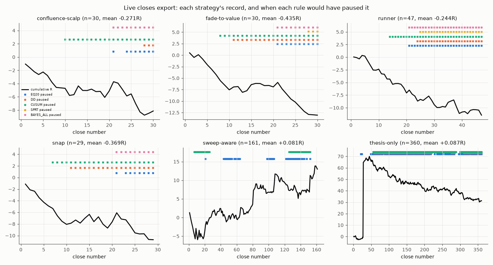

### What "hot" looks like on a strategy with no edge

Zero-edge streams: real PROD R centred to zero and resampled, and centred blocks of the walk streams.
Median / 95th percentile:

| trades in the stream | 30 | 100 | 300 | 1,000 |
|---|---|---|---|---|
| best rolling 10-trade mean R | +0.30-0.33 / +0.81-0.92 | +0.52-0.59 / +1.08-1.23 | +0.68-0.81 / +1.31-1.48 | +0.84-1.01 / +1.48-1.74 |
| best rolling 20-trade mean R | +0.10-0.11 / +0.45-0.52 | +0.30-0.34 / +0.65-0.74 | +0.42-0.49 / +0.80-0.92 | +0.53-0.62 / +0.90-1.14 |
| longest winning run | 5 / 9 | 7 / 11-12 | 9 / 14 | 11 / 16-17 |
| best run-up, R | 4.2-4.4 / 10-13 | 8.7-9.3 / 20-22 | 16-17 / 35-41 | 31-33 / 64-80 |

A strategy with no edge, traded 100 times, shows a 10-trade stretch averaging +0.5R half the time, and
a +20R run-up one time in twenty. **A hot day or a hot week is not evidence of a regime.** Only the
accumulated record is, and only through a test that knows how long the record is.


## 4. The frozen operating rule

1. **Do not pause or resume a strategy on recent performance.** No equity-curve, drawdown, CUSUM or
   Page-Hinkley rule adds more than +0.002R per opportunity on this desk's streams, and each does as
   much on random walks. A strategy being hot or cold says nothing about its next trade.
2. **Keep or kill on accumulated evidence: the repeated SPRT** (H0 mean R = 0 against H1 = +0.10R,
   alpha 0.05, beta 0.20, sd = the running sd of all closes, all closes in R net of costs). It runs on
   the strategy's **full shadow record**, which the desk's untaken record already keeps, traded or not.
   - **Pause** when its log-likelihood ratio falls to ln(0.2/0.95) = **-1.56**.
   - **Resume** only when the shadow record drives it up to ln(0.8/0.05) = **+2.77**. A strategy that is
     resumed must have earned it on trades it did not take.
   - Measured on the production book in confirmation: **+0.098R per opportunity [+0.094, +0.104]** over
     always-on. It pauses 99.9% of trades, because every replayed strategy loses after costs. Timing
     value 0.0000. The same rule on walks saves +0.102 (iid) and +0.093 (GARCH). That is the honest
     reading: **the value is the costs not paid on strategies with no edge.**
3. **Sizing: flat.** No exponential-weight allocation beats its time-shifted twin by more than it does on
   walks. Production's `Policy` margin rule ([zeroskill.md](zeroskill.md)) is the right shape for any
   future weighting: depart from equal weights only past a significance margin.
4. **What to expect.** A -0.5R strategy is stopped in about 25 closes, a -0.15R one in about 50 (p90
   120). A +0.20R strategy is confirmed in about 140. A strategy at +0.05R cannot be confirmed by any
   rule in under a few thousand closes. The desk should not expect to see one.
5. **Where to look for the exception: Binance.** It is the one class whose record carries memory
   (pred_30 +0.045 against both walks), and 11 of the 13 BH-surviving cells are there (+0.004 to
   +0.05R per opportunity). If a timing rule is ever worth a frozen test, it is the equity filter on
   crypto perpetuals, on coins it was not read on.

## What was not replayed, and other caveats

- **Production's service, not just its strategies.** One-zone-one-message deduplication, the regime
  label, the break model, macro and release features, the momentum ensemble (absent, so its gates are
  silent), candle witnesses that need the bar store, break-even and trailing protection, sizing and
  account limits. Entries are 15m/30m only (live trades 1m-5m as well). Replayed fade-to-value loses
  less than live (-0.116 against -0.435R), as R4b found.
- **Discovery is thin.** Before 2024 the production replay has only the Binance perpetuals, and the LRC
  streams have Binance plus MT5 1h/4h/1d. The self-adaptive rules have no fitted parameters, so both
  halves are out of sample for them. The regime gates and Hedge rest on Binance discovery for PROD.
- **Implementation notes (rules unchanged since the freeze):**
  - Page-Hinkley uses the running mean at each step, the standard online form. The batch form written in
    the JSON is identically t x delta.
  - The random-pause twin is drawn within each half. Drawn across both halves, a rule that pauses more as
    evidence accumulates would be credited for pausing late in the stream.
  - LRC streams were restricted to the frozen timeframes (the source also has 30m).
  - A synthetic iid check before the real run read every rule's timing at 0 +- 0.002R.
- **The live R definition** follows the freeze: `r_multiple`, else profit / `risk_money`, else profit /
  the strategy's median risk. One thesis-only close is mis-sized under it (above).
- **Range Break 100 is a generator**, reported apart and never pooled.

## Reproduce

```
# lab: the production replay (R4b's series and walk seeds), the LRC streams, then everything else
LRC_DIR=lrc OUT=switch/replay MT5BT_DB=data/mt5bt.db python switch/switch_replay.py   (MODE=agg after)
LRC_DIR=lrc OUT=switch/lrc TRADES=lrc/out/lrc_trades.pkl.gz python switch/switch_lrc.py
OUT=switch/out PROD=switch/replay/prod_trades.pkl.gz LRC=switch/lrc/lrc_streams.pkl.gz MODE=nec|rules|hedge|kill python switch/switch.py
# local: the live closes export
CLOSES=.data/closes.json MODE=live python research/ideas/switch.py
IN=switch/out LIVE=... IMG=research/docs/img/switching python research/ideas/switch_plot.py
```
