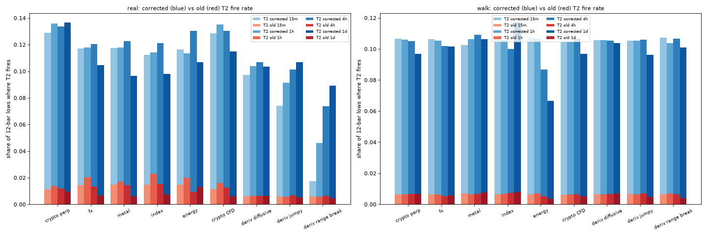
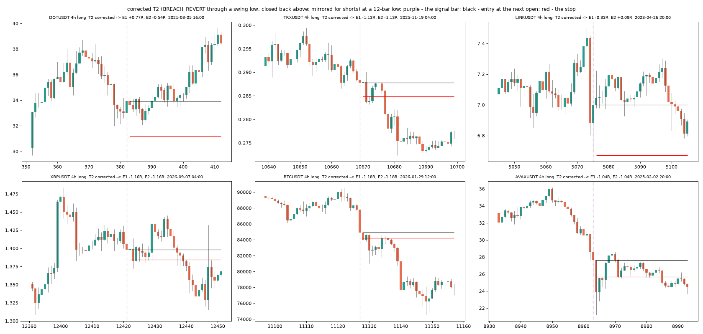
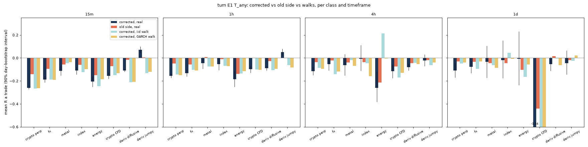
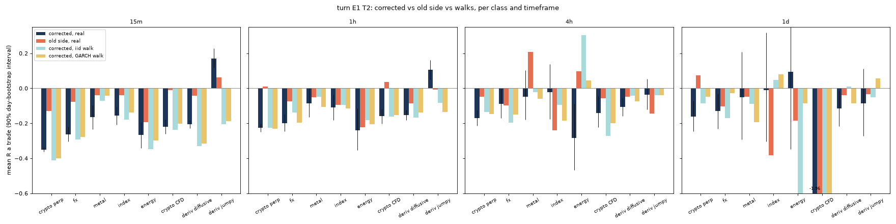
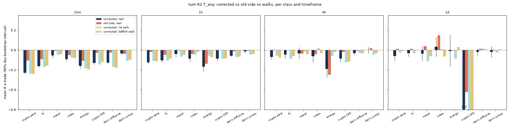
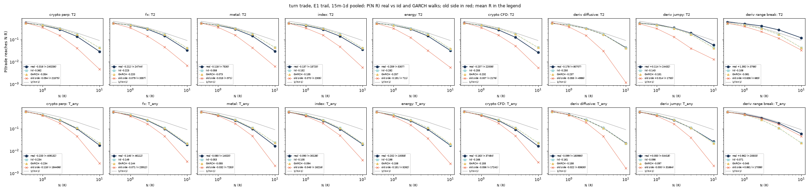
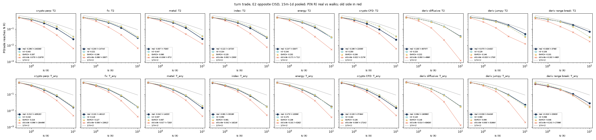
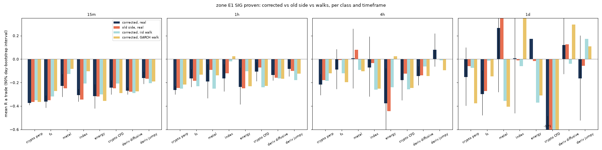
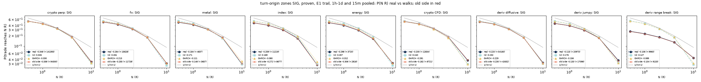
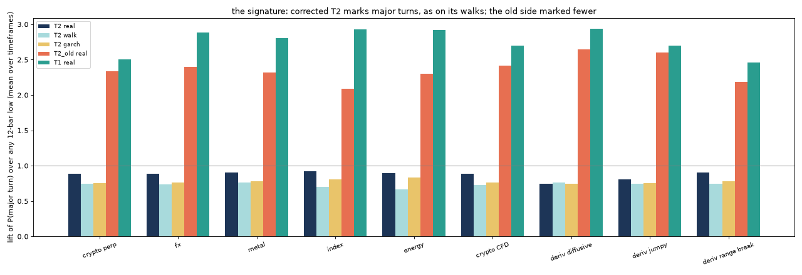

# The turn trades re-run with the corrected BREACH_REVERT side

**Measured, 2026-10-05. Every verdict stands: T2, T_any and the SIG zones fail with the right side,
and by a wider margin than before.** The corrected T2 is no longer a rare event. It fires at 10-14% of
12-bar lows, against about 1% for the old wrong side. It trades like a random walk, or slightly worse,
on every asset class and timeframe. Adding it to T_any pulls T_any towards "buy every low". Nothing
passes on the original data. The cells carried forward to fresh coins fail there too. DISPLACE_C (T1)
is untouched: its trade counts and numbers reproduce exactly.

Follows [turning-points.md](turning-points.md) and [turn-follow-ups.md](turn-follow-ups.md). For how to
read the walk control, see [walks-and-edge.md](walks-and-edge.md). Matching the walks means zero edge
before costs: the trade reaches N R no more often than 1/(N+1).

## The bug and the only amendment

MCFL labels BREACH_REVERT by the swept swing. DOWN is a swing low traded through and closed back above:
the bullish event. `turn_trade.ups` read the UP label until 2026-10-04. So T2 at a 12-bar low was "a
swing *high* swept at a fresh low". That is rare, and it is not the setup the rule describes. The
error fed into T_any, into the violent-origin flag `SIG` of the turn-origin zones, and into the Deriv
turns study.

`turn_retrade_rule.json` was frozen and committed before the run (commit 105cb22). It records the
side of T2 as the **only** amendment to `turn_rule.json`, `turn_rule2.json`, `turn_zone_rule.json` and
`deriv_turns.py`. Signal, entry, stop, slippage, exits, caps, costs, primaries and pass rules are
unchanged.

`turn_retrade.py` runs the frozen functions themselves:
- `turn_trade.trades` (fixed 1/2/3R) and `turn_trade.trades_exits` (E1 2-ATR trail; E2 opposite CISD);
- `turn_zones.zones`;
- `deriv_turns.lows`.

Each frame is parsed once. Both sides of T2 are carried on the same bars and the same walks
(`T2_old`, `T_any_old`, `SIG_old`), so the old and corrected numbers compare like for like.

**Reproduction check.** On Binance 1h+4h the old side reproduces the original CSV exactly: T1 7,802
trades, T2_old 5,668, T_any_old 42,885, E1 −0.045R, E2 −0.015R, 2R −0.015R. The MCFL version on the
lab is the one the original runs used.

**Coverage.** The brief extended the original runs. Reported, not judged:
- data: Binance 12 coins; the 10 MT5 markets, split per class (fx, metal, index, energy, crypto CFD);
  the 15 Deriv synthetics, split diffusive / Boom-Crash-Jump / Range Break;
- timeframes: 15m, 1h, 4h and 1d. 15m is new for every test, and 1d is new for the turn trades;
- nulls: iid and GARCH walks, 256 sub-steps a bar, real timestamps, real cost in ATR units;
- statistics: day-bootstrap 90% intervals, and Benjamini–Hochberg at q = 0.10 over 1,458 p-values.

One fix to the frozen code's walk baseline: the fixed-R walks now pay the real cost in ATR units. The
original walk charged 0.07% of the walk's own price, the cost-scaling bug turning-points.md notes.

The gallery is a sanity check that the side is now right. Each signal bar trades through a prior swing
low and closes back above it.

## 1. The frozen primaries: old against corrected

| primary (Binance 12 coins) | side | n | R [90%] | before / after 2024 | every low | iid / GARCH walk | verdict |
|---|---|---|---|---|---|---|---|
| P1 `turn_rule.json`: T_any, 2R, 1h+4h | original doc | 42,885 | −0.015 [−0.036, +0.005] | −0.019 / −0.011 | −0.167 | (broken) | fails |
| | old side, this run | 42,885 | −0.015 [−0.036, +0.007] | −0.019 / −0.011 | −0.167 | −0.039 / −0.041 | fails |
| | **corrected** | 96,504 | **−0.113 [−0.125, −0.101]** | −0.100 / −0.127 | −0.167 | −0.099 / −0.104 | **fails** |
| P2 `turn_rule2.json`: T_any, E1 trail, 1h+4h | original doc | 42,885 | −0.045 [−0.066, −0.026] | −0.039 / −0.052 | −0.199 | −0.046 | fails |
| | old side, this run | 42,885 | −0.045 [−0.065, −0.026] | −0.039 / −0.052 | −0.199 | −0.051 / −0.061 | fails |
| | **corrected** | 96,504 | **−0.147 [−0.166, −0.130]** | −0.127 / −0.168 | −0.199 | −0.132 / −0.139 | **fails** |
| P3 `turn_zone_rule.json`: SIG, proven, E1, 1h/4h/1d | original doc | 20,337 | −0.233 [−0.277, −0.189] | −0.255 / −0.212 | −0.241 | −0.236 / −0.202 | fails |
| | old side, this run | 20,337 | −0.233 [−0.276, −0.189] | −0.255 / −0.212 | −0.241 | −0.236 / −0.202 | fails |
| | **corrected** | 30,742 | **−0.256 [−0.292, −0.221]** | −0.274 / −0.236 | −0.241 | −0.238 / −0.203 | **fails** |

The tails tell the same story. For P2 corrected, P(≥4R) is 0.097 against 0.110 on walks, and
P(≥10R) is 0.016 against 0.022 (1/(N+1): 0.20 and 0.091). For P3 corrected, P(≥4R) is 0.175 against
0.178, and P(≥10R) is 0.032 against 0.027.

- **No verdict changes.** All three primaries fail with the corrected side. P1 and P2 now sit at or
  slightly below their walks. The old side had looked closer to zero.
- **Why the old side looked better.** It was a different, rare event: a bar that swept a swing high
  while printing a 12-bar low, about 1% of lows. Its P(≥4R) was low (0.049) and its mean was near
  zero, so it was a small, short-reaching trade. The corrected T2 fires on 13% of lows, and its R sits
  with the walks.

## 2. Every class and timeframe

### T_any, E1 trail

R is per trade, net of costs. n is shown with the old side's n in brackets.

| class | tf | n (old) | R corrected [90%] | R old side | iid / GARCH walk | every low | P(≥4R) real / iid | P(≥10R) real / iid |
|---|---|---|---|---|---|---|---|---|
| crypto perp | 15m | 309,579 (140,347) | −0.261 [−0.271, −0.251] | −0.141 | −0.267 / −0.265 | −0.356 | 0.102 / 0.110 | 0.019 / 0.023 |
| crypto perp | 1h | 77,310 (34,313) | −0.155 [−0.173, −0.137] | −0.048 | −0.143 / −0.150 | −0.207 | 0.097 / 0.110 | 0.017 / 0.022 |
| crypto perp | 4h | 19,194 (8,572) | −0.115 [−0.150, −0.080] | −0.036 | −0.085 / −0.095 | −0.167 | 0.097 / 0.109 | 0.015 / 0.022 |
| crypto perp | 1d | 3,049 (1,264) | −0.110 [−0.170, −0.044] | −0.031 | −0.049 / −0.039 | −0.090 | 0.063 / 0.082 | 0.007 / 0.011 |
| fx | 15m | 22,343 (11,403) | −0.187 [−0.214, −0.159] | −0.096 | −0.189 / −0.190 | −0.298 | 0.106 / 0.111 | 0.022 / 0.023 |
| fx | 1h | 15,631 (8,386) | −0.131 [−0.162, −0.101] | −0.058 | −0.104 / −0.108 | −0.175 | 0.096 / 0.113 | 0.017 / 0.024 |
| fx | 4h | 5,284 (2,689) | −0.054 [−0.111, +0.005] | −0.023 | −0.142 / −0.118 | −0.122 | 0.099 / 0.101 | 0.018 / 0.019 |
| fx | 1d | 2,854 (1,434) | −0.078 [−0.133, −0.024] | −0.033 | −0.096 / −0.032 | −0.110 | 0.067 / 0.074 | 0.011 / 0.009 |
| metal | 15m | 7,071 (3,646) | −0.111 [−0.153, −0.064] | −0.056 | −0.046 / −0.036 | −0.148 | 0.101 / 0.114 | 0.017 / 0.023 |
| metal | 1h | 4,755 (2,512) | −0.044 [−0.095, +0.006] | +0.006 | −0.074 / −0.073 | −0.130 | 0.099 / 0.103 | 0.018 / 0.024 |
| metal | 4h | 1,637 (807) | −0.062 [−0.152, +0.033] | −0.038 | −0.018 / −0.070 | −0.123 | 0.101 / 0.116 | 0.018 / 0.028 |
| metal | 1d | 557 (288) | −0.035 [−0.172, +0.105] | −0.045 | −0.062 / −0.085 | −0.122 | 0.063 / 0.073 | 0.014 / 0.015 |
| index | 15m | 21,094 (11,192) | −0.110 [−0.143, −0.076] | −0.059 | −0.123 / −0.097 | −0.208 | 0.100 / 0.110 | 0.021 / 0.021 |
| index | 1h | 6,903 (3,922) | −0.054 [−0.106, +0.002] | −0.009 | −0.068 / −0.070 | −0.175 | 0.089 / 0.113 | 0.017 / 0.023 |
| index | 4h | 1,820 (930) | −0.007 [−0.112, +0.112] | −0.036 | −0.045 / −0.160 | −0.091 | 0.094 / 0.114 | 0.024 / 0.019 |
| index | 1d | 321 (172) | −0.019 [−0.176, +0.154] | −0.046 | +0.045 / −0.007 | −0.133 | 0.062 / 0.086 | 0.016 / 0.018 |
| energy | 15m | 7,006 (3,585) | −0.206 [−0.251, −0.160] | −0.151 | −0.247 / −0.185 | −0.305 | 0.100 / 0.111 | 0.019 / 0.019 |
| energy | 1h | 2,322 (1,315) | −0.186 [−0.251, −0.116] | −0.139 | −0.134 / −0.115 | −0.236 | 0.081 / 0.115 | 0.014 / 0.019 |
| energy | 4h | 609 (294) | −0.260 [−0.383, −0.118] | −0.213 | +0.214 / −0.003 | −0.218 | 0.075 / 0.117 | 0.015 / 0.036 |
| energy | 1d | 121 (68) | −0.006 [−0.237, +0.232] | −0.104 | −0.165 / −0.058 | +0.003 | 0.083 / 0.021 | 0.017 / 0.000 |
| crypto CFD | 15m | 19,068 (8,711) | −0.155 [−0.182, −0.127] | −0.070 | −0.151 / −0.133 | −0.154 | 0.096 / 0.112 | 0.017 / 0.024 |
| crypto CFD | 1h | 13,042 (6,040) | −0.098 [−0.128, −0.068] | −0.001 | −0.100 / −0.104 | −0.157 | 0.090 / 0.111 | 0.016 / 0.024 |
| crypto CFD | 4h | 4,361 (2,052) | −0.116 [−0.175, −0.057] | −0.073 | −0.172 / −0.129 | −0.184 | 0.091 / 0.110 | 0.015 / 0.021 |
| crypto CFD | 1d | 1,013 (438) | −1.345 [−1.946, −0.858] | −0.442 | −1.188 / −1.144 | −2.112 | 0.067 / 0.081 | 0.015 / 0.012 |
| Deriv diffusive | 15m | 94,312 (49,699) | −0.108 [−0.121, −0.095] | −0.016 | −0.212 / −0.209 | −0.390 | 0.110 / 0.109 | 0.023 / 0.022 |
| Deriv diffusive | 1h | 47,420 (24,194) | −0.090 [−0.109, −0.073] | −0.028 | −0.107 / −0.095 | −0.174 | 0.111 / 0.109 | 0.023 / 0.022 |
| Deriv diffusive | 4h | 16,251 (8,210) | −0.079 [−0.110, −0.049] | −0.046 | −0.042 / −0.054 | −0.149 | 0.108 / 0.115 | 0.022 / 0.023 |
| Deriv diffusive | 1d | 2,997 (1,527) | −0.054 [−0.114, +0.006] | +0.017 | −0.005 / −0.062 | −0.076 | 0.069 / 0.084 | 0.010 / 0.012 |
| Deriv Boom/Crash/Jump | 15m | 27,409 (16,980) | +0.070 [+0.043, +0.099] | +0.004 | −0.132 / −0.121 | −0.077 | 0.105 / 0.109 | 0.027 / 0.023 |
| Deriv Boom/Crash/Jump | 1h | 19,897 (10,988) | +0.050 [+0.021, +0.080] | −0.001 | −0.061 / −0.084 | −0.067 | 0.114 / 0.112 | 0.026 / 0.025 |
| Deriv Boom/Crash/Jump | 4h | 6,086 (3,180) | −0.022 [−0.071, +0.030] | −0.018 | −0.062 / −0.040 | −0.078 | 0.111 / 0.107 | 0.023 / 0.026 |
| Deriv Boom/Crash/Jump | 1d | 1,026 (516) | −0.044 [−0.144, +0.065] | −0.018 | −0.025 / +0.022 | −0.097 | 0.077 / 0.081 | 0.011 / 0.013 |
| Deriv Range Break (apart) | 15m / 1h / 4h / 1d | 12,061 / 6,406 / 1,736 / 300 | +1.339 / +0.508 / +0.162 / +0.110 | +1.222 / +0.263 / +0.038 / −0.089 | ≈ −0.1 to 0 | +3.692 / +1.456 / +0.478 / −0.097 | | |

The crypto CFD 1d row is driven by cost. The broker's spread is large against tight daily stops, so
the walks and every low lose as much or more.

### T2 alone, E1 trail: crypto perps (the primary venue)

| tf | n (old) | R corrected [90%] | R old side | iid / GARCH walk | every low | P(≥4R) real / iid | P(≥10R) real / iid |
|---|---|---|---|---|---|---|---|
| 15m | 180,574 (15,775) | −0.350 [−0.363, −0.337] | −0.130 | −0.412 / −0.400 | −0.356 | 0.142 / 0.173 | 0.031 / 0.043 |
| 1h | 46,433 (4,656) | −0.225 [−0.248, −0.202] | +0.010 | −0.226 / −0.233 | −0.207 | 0.130 / 0.173 | 0.026 / 0.042 |
| 4h | 11,379 (1,012) | −0.171 [−0.214, −0.123] | −0.049 | −0.135 / −0.147 | −0.167 | 0.132 / 0.172 | 0.025 / 0.042 |
| 1d | 1,870 (132) | −0.162 [−0.247, −0.070] | +0.073 | −0.086 / −0.048 | −0.090 | 0.090 / 0.152 | 0.011 / 0.022 |

On FX, metals, indices, energy and the crypto CFDs, T2 is negative in every cell with n above 300.
In every cell with n above 300 its tail sits **below** the walks: P(≥4R) is 0.08-0.16 against 0.14-0.19.

**The P(N R) curves.** For corrected T2 and T_any the real curve lies on, or just under, the iid and
GARCH walk curves, and all of them sit below 1/(N+1). The old-side curve (red) drops away at 4-10R. It
was a short-reaching trade, not a better one.

### The turn-origin zones (SIG, proven, E1)

The corrected SIG adds about 50% more origins. The zone's numbers barely move, because the zone trade
never depended on which bar marked the origin:

| class | 15m | 1h | 4h | 1d | iid walk (1h / 4h) | old side (1h / 4h) |
|---|---|---|---|---|---|---|
| crypto perp | −0.374 | −0.265 | −0.218 | −0.154 | −0.252 / −0.186 | −0.246 / −0.180 |
| fx | −0.362 | −0.165 | −0.090 | −0.297 | −0.231 / −0.120 | −0.184 / −0.008 |
| index | −0.307 | −0.164 | −0.072 | +0.008 (74) | −0.018 / −0.259 | −0.120 / −0.033 |
| crypto CFD | −0.243 | −0.106 | −0.178 | −1.710 | −0.241 / −0.257 | −0.072 / −0.124 |
| Deriv diffusive | −0.271 | −0.135 | −0.144 | +0.120 (413) | −0.163 / −0.063 | −0.158 / −0.139 |

### The signature's lift: corrected T2 does not mark turns

Lift is P(major turn | feature) / P(major turn | any 12-bar low), averaged over the four timeframes:

| | crypto perp | fx | index | Deriv diffusive |
|---|---|---|---|---|
| T2 corrected: real / iid / GARCH | 0.88 / 0.74 / 0.76 | 0.89 / 0.74 / 0.76 | 0.92 / 0.70 / 0.80 | 0.75 / 0.76 / 0.75 |
| T2 old side: real / iid | 2.34 / 2.57 | 2.40 / 2.59 | 2.09 / 2.52 | 2.65 / 2.59 |
| T1 DISPLACE_C: real / iid | 2.50 / 2.92 | 2.88 / 2.90 | 2.93 / 2.81 | 2.94 / 2.84 |

- **The corrected bullish breach-revert at a fresh low is *less* likely than average to become a major
  turn.** The same is true on walks. The likely mechanism is that the wick that swept the low becomes
  the low the 3-ATR rally must hold above.
- **The "BREACH_REVERT lift 2.58" in turning-points.md section 1 was the bearish event.** It is
  geometry, as the walks show the same lift.
- On real markets the corrected T2 is a little above its walks (0.88-0.92 against 0.70-0.80). This
  is a small excess with no trade attached.

## 3. Multiple testing and what survives

BH at q = 0.10 ran over 634 corrected cells (T2, T_any, SIG and SIG_RZ, per class × timeframe ×
test). Each cell gives p for mean R above the better walk, plus P(≥4R) and P(≥10R) above the pooled
walks: 1,458 p-values in all.

- **Mean-R survivors: 69.** 35 of them are negative cells that merely lose less than their walks.
  The 34 with R > 0 are all Deriv Boom/Crash/Jump (12) or Range Break (22).
- **Tail survivors (P(≥4R) or P(≥10R)): 23 and 64.** These are Deriv jumpy (17), Range Break (22),
  crypto perp (12), crypto CFD (10), Deriv diffusive (3), fx (2) and index (2). No surviving tail
  cell reaches 1/(N+1). Every crypto one is a SIG zone, with P(≥10R) of 0.03-0.04 against 0.03 on
  walks.

**The Deriv positives are a measurement artefact: bar fills miss the jumps** ([deriving.md](deriving.md)).

T2 E1 by symbol and side shows where the gain sits. It is only on the side whose stop a spike jumps
through:

| | 15m | 1h |
|---|---|---|
| Boom 1000 shorts | +0.86 | +0.30 |
| Crash 1000 longs | +0.72 | +0.46 |
| the other side of each (walk ≈ −0.2) | −0.15 to −0.17 | −0.13 to −0.14 |
| Jump 50 (symmetric jumps): shorts / longs | −0.09 / −0.01 | +0.18 / −0.03 |

- The bar fill stops such a trade at the stop. The real tick path is filled beyond it.
- Every low on the jump-exposed side shows the same gain: +0.75 / +0.73 at 15m.
- Range Break shows it on every low too (+3.69R at 15m).
- Deriv's generators are published martingales, so these cells are a fill artefact and are not
  carried forward. On the diffusive Deriv indices, corrected T2 and T_any sit with their walks.

## 4. Confirmation on unseen coins

The frozen trigger carried forward the BH tail survivors on crypto perps: the SIG zones. The 4h and 1d
cells ran on the 58 fresh coins and on SET_C (73 coins), with walks:

| set | cell | n | R [90%] | every low | iid / GARCH walk | P(≥4R) real / iid | P(≥10R) real / iid (p) | verdict |
|---|---|---|---|---|---|---|---|---|
| fresh 58 | 4h SIG left E1 | 49,274 | −0.144 [−0.183, −0.102] | −0.138 | −0.135 / −0.116 | 0.176 / 0.177 | 0.032 / 0.032 (0.17) | fails |
| fresh 58 | 1d SIG proven E1 | 1,768 | −0.326 [−0.437, −0.202] | −0.295 | −0.057 / −0.071 | 0.110 / 0.166 | 0.009 / 0.002 (0.08) | fails |
| fresh 58 | 1d SIG left E1 | 5,552 | −0.255 [−0.323, −0.182] | −0.192 | −0.078 / −0.133 | 0.111 / 0.158 | 0.007 / 0.003 (0.016) | fails |
| SET_C 73 | 4h SIG left E1 | 51,589 | −0.152 [−0.192, −0.107] | −0.137 | −0.131 / −0.128 | 0.175 / 0.178 | 0.032 / 0.030 (0.09) | fails |
| SET_C 73 | 1d SIG proven E1 | 1,962 | −0.287 [−0.387, −0.179] | −0.180 | −0.058 / −0.108 | 0.112 / 0.161 | 0.014 / 0.006 (0.003) | fails |
| SET_C 73 | 1d SIG left E1 | 5,789 | −0.214 [−0.283, −0.142] | −0.155 | −0.088 / −0.098 | 0.113 / 0.159 | 0.012 / 0.003 (<0.001) | fails |

The X2 (fixed 2R) exits fail in the same way: −0.18 to −0.28R.

- **The daily P(≥10R) excess over iid walks replicates, but it is not SIG's.** Every 1d low has it:
  ALL proven reaches 10R 0.8% / 1.5% of the time against 0.4% on iid walks. GARCH walks give
  0.7-1.1%. It is roughly the fat tail of daily crypto.
- It sits at about a tenth of 1/(N+1) = 0.091, and P(≥4R) is well below the walks.
- No cell meets `turn_confirm_rule.json`'s bar.

**Not run, against the frozen confirmation clause.** The 15m and 1h crypto-perp tail cells were not
fetched and run on the fresh coins. That clause would have taken about 400 more 15m/1h jobs. Every one
of those cells is already far below the tail pass rule's 1/(N+1) bar in-sample: P(≥10R) is 0.03
against 0.091, and P(≥4R) is 0.18-0.19 against 0.20. Their mean R is −0.26 to −0.37. A pass on fresh
coins was therefore impossible under the frozen rule. This is recorded as a departure.

## What changes in the earlier documents

| claim | before | after |
|---|---|---|
| turning-points §2: T_any at 2R, Binance | −0.015R, fails | −0.113R [−0.125, −0.101], fails |
| turning-points §3: T_any trail, Binance | −0.045R, fails; matches walk | −0.147R [−0.166, −0.130], fails; at or below walks (−0.132 / −0.139) |
| turning-points §3: MT5 T_any trail | −0.036R | 1h/4h −0.13 / −0.05 (fx), −0.04 / −0.06 (metal), −0.05 / −0.01 (index); all negative, none above zero with its interval |
| turning-points §1: "BREACH_REVERT lift 2.58" | a turn marker | that was the bearish event; the bullish one has lift 0.75-0.92, as on walks |
| turn-follow-ups §1: SIG zones | −0.233R, fails | −0.256R [−0.292, −0.221], fails |
| turn-follow-ups §4: Deriv turns | match walks | still match walks on the diffusive indices; jumpy and Range Break gains are bar-fill |
| T1 DISPLACE_C, `turn_confirm*`, market mirror | | **unchanged** (T1 never used BREACH_REVERT) |

## Re-running

On the lab, from `$HOME/till_infinity/turn-retrade`, with `PYTHONPATH` set to the lab repo's
`research/ideas`, `research` and the repo root:
- `OUT=out MT5BT_DB=... python ideas/turn_retrade.py` with `MODE=run` (444 jobs, about 2.5 h on 8
  workers; each job is resumable from `out/parts`), then `MODE=summary` and `MODE=plot`;
- `MODE=confirm CACHE=$HOME/till_infinity/data/binance_fresh CELLS='[{"iv": "4h", "test": "zone E1",
  "family": "SIG", "act": "left"}, ...]'`.
